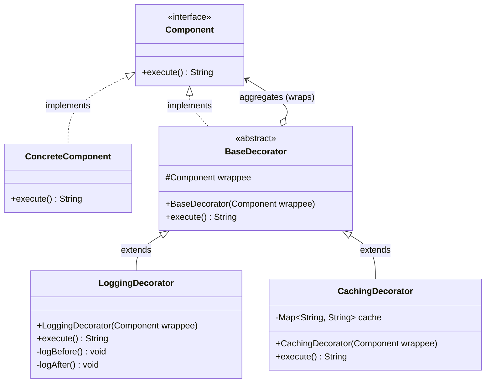

# Decorator Design Pattern

The **Decorator Pattern** is a GoF (Gang of Four) structural design pattern that allows behavior to be added to individual objects, either statically or dynamically, without affecting the behavior of other objects from the same class.

Instead of relying on class inheritance to extend capabilities—which binds behaviors statically at compile time—the Decorator pattern relies on **object composition and recursive wrapping**.

---

## 1. What Problem Does It Solve?

### The Subclass Explosion Problem
When building complex systems, objects often require optional layers of behavior (e.g., formatting, caching, compression, encryption, authentication, condiments, metrics). If inheritance is used to model every conceivable combination of these options, the number of subclasses grows exponentially.

For $N$ independent features, static inheritance requires up to:
$$\sum_{k=1}^N \binom{N}{k} = 2^N - 1 \text{ subclasses}$$

For example, with 4 optional data stream enhancements (Encryption, Compression, Checksum, Base64), subclassing would require $2^4 - 1 = 15$ subclasses:
- `EncryptedDataSource`
- `CompressedDataSource`
- `EncryptedAndCompressedDataSource`
- `CompressedAndEncryptedDataSource` (if order matters!)
- `EncryptedCompressedAndBase64DataSource`
- ...and so forth.

```
                    [ DataSource ]
                   /      |       \
        [Encrypted]  [Compressed]  [Base64]
           /               \
[EncryptedAndCompressed]  [CompressedAndBase64]  ... (Exponential Explosion!)
```

### Limitations of Static Inheritance
1. **Compile-time Binding:** Once an object is instantiated from a subclass, its behaviors cannot be altered or reordered at runtime.
2. **Single Inheritance Constraint:** In languages like Java, a class can inherit from only one superclass. Combining behaviors from distinct branches of an inheritance hierarchy is impossible without code duplication.
3. **Violation of the Open/Closed Principle (OCP):** Introducing a new behavior requires either modifying the superclass (bloating it for all clients) or creating dozens of new combinatorial subclasses.
4. **Violation of Single Responsibility Principle (SRP):** Classes like `EncryptedAndCompressedDataSource` juggle multiple unrelated concerns (disk I/O, AES encryption, and GZIP compression).

### The Solution: Wrapping & Delegation
Decorator solves this by treating behaviors as **pluggable wrappers**. You start with a base component and wrap it in one or more decorator objects. Because each decorator conforms to the same interface as the wrapped object, clients treat the resulting composite structure as a single instance of the abstraction.

---

## 2. Structure and Participants

```
+-------------------------------------------------------------------------------+
|                               <<interface>>                                   |
|                                 Component                                     |
|                               + operation()                                   |
+-------------------------------------------------------------------------------+
           ^                                                ^
           | implements                                     | implements
+-----------------------+                    +----------------------------------+
|   ConcreteComponent   |                    |       Decorator (abstract)       |
| + operation()         |                    | - wrappee: Component             |
+-----------------------+                    | + operation() {                  |
                                             |     wrappee.operation();         |
                                             |   }                              |
                                             +----------------------------------+
                                                            ^
                                           +----------------+----------------+
                                           | extends                         | extends
                          +----------------------------------+  +----------------------------------+
                          |        ConcreteDecoratorA        |  |        ConcreteDecoratorB        |
                          | + operation() {                  |  | + operation() {                  |
                          |     super.operation();           |  |     addedBehavior();             |
                          |     addedBehavior();             |  |     super.operation();           |
                          |   }                              |  |   }                              |
                          +----------------------------------+  +----------------------------------+
```

### Participants

| Participant | Role & Responsibility |
| :--- | :--- |
| **`Component`** | Defines the common interface for objects that can have responsibilities added to them dynamically. |
| **`ConcreteComponent`** | The core object providing baseline functionality. It has no dependencies on decorators and knows nothing about them. |
| **`Decorator`** (Abstract) | Implements or extends `Component` and maintains an aggregation reference (`wrappee`) to another `Component`. It defines a default delegation mechanism forwarding requests to `wrappee`. |
| **`ConcreteDecorator`** | Adds specific responsibilities before and/or after delegating to the wrapped component. Decorators can be arbitrarily nested. |
| **`Client`** | Programs against the `Component` abstraction. The client is oblivious to whether it interacts with a raw `ConcreteComponent` or a multi-layered chain of `ConcreteDecorator`s. |

---

## 3. Mermaid Class Diagram



---

## 4. How Wrapping and Delegation Work

The Decorator pattern operates like a Russian Matryoshka doll or an onion. Each layer wraps the layer beneath it.

### The Mechanism: Dual Relationship
A decorator maintains a dual relationship with the `Component`:
1. **Inheritance / Interface Implementation (Subtyping):** The decorator is a subtype of `Component`. This guarantees **type conformance**; anywhere a `Component` is expected, the decorator can be passed.
2. **Composition (Aggregation):** The decorator holds a reference to a `Component`. This provides **runtime flexibility**; the wrapped object can be another decorator or the core component.

### Call Stack Unwinding

```
Client Invocation: decoratorA.execute()
    │
    ▼
┌──────────────────────────────────────────────┐
│ ConcreteDecoratorA                           │
│   1. Pre-processing logic (e.g., auth check) │
│   2. wrappee.execute() ────────────────────┐ │
└────────────────────────────────────────────┼─┘
                                             │
    ┌────────────────────────────────────────┘
    ▼
┌──────────────────────────────────────────────┐
│ ConcreteDecoratorB                           │
│   1. Pre-processing logic (e.g., start timer)│
│   2. wrappee.execute() ────────────────────┐ │
└────────────────────────────────────────────┼─┘
                                             │
    ┌────────────────────────────────────────┘
    ▼
┌──────────────────────────────────────────────┐
│ ConcreteComponent (Core)                     │
│   Executes baseline domain business logic    │
│   Returns raw result ──────────────────────┐ │
└────────────────────────────────────────────┼─┘
                                             │
    ┌────────────────────────────────────────┘
    ▼
┌──────────────────────────────────────────────┐
│ ConcreteDecoratorB (continued)               │
│   3. Post-processing logic (e.g., log time)  │
│   4. Returns modified or audited result ───┐ │
└────────────────────────────────────────────┼─┘
                                             │
    ┌────────────────────────────────────────┘
    ▼
┌──────────────────────────────────────────────┐
│ ConcreteDecoratorA (continued)               │
│   3. Post-processing logic (e.g., encrypt)   │
│   4. Returns final payload to Client         │
└──────────────────────────────────────────────┘
```

---

## 5. When to Use and When NOT to Use

### When to Use
- **Dynamic Responsibilities:** You need to assign responsibilities to individual objects dynamically and transparently at runtime without affecting other instances.
- **Alternative to Subclassing:** When extension by subclassing is impractical, prohibited (e.g., `final` classes), or causes combinatorial class explosion.
- **Composability of Independent Features:** When behaviors are modular, orthogonal, and can be applied in various permutations (e.g., Compression + Encryption + Caching).
- **Pay-as-you-go Complexity:** You want to keep root classes lightweight instead of loading them with every possible feature.

### When NOT to Use
- **Heavy or Wide Component Interfaces:** If the `Component` interface contains 20+ methods, every decorator must forward 20 methods, creating boilerplate and fragile delegation.
- **Deep Object Identity Sensitivity:** If client code relies on object identity (`obj1 == obj2`) or uses reflection/`instanceof` to discover concrete types, decorators break this transparency because the wrapper is a distinct object.
- **Intrusive State Manipulation:** Decorators modify the "skin" of an object from the outside. If a feature requires deep access to private internal fields of the component, use **Strategy** or **State** instead.
- **When Order Independence Cannot Be Guaranteed:** If decorators fail or corrupt data when nested in certain permutations (e.g., decrypting before decompressing) and managing configuration complexity outweighs the benefit of dynamic composition.

---

## 6. Advantages, Disadvantages, and Architectural Trade-offs

### Advantages
1. **High Flexibility over Inheritance:** Behaviors can be attached, detached, or recombined at runtime.
2. **Open/Closed Principle:** New decorators can be created without modifying existing components or decorators.
3. **Single Responsibility Principle:** Small, cohesive classes focused on one concern (e.g., `GzipCompressionDecorator`, `AesEncryptionDecorator`).
4. **Avoids Feature-Laden Classes High in Hierarchy:** You do not need to push optional behaviors up into the base class.

### Disadvantages
1. **Proliferation of Small Classes:** Can lead to a design with many tiny classes that differ only in how they interconnect.
2. **Configuration and Instantiation Boilerplate:** Instantiating deeply nested decorators can look verbose:
   ```java
   InputStream is = new BufferedInputStream(new GZIPInputStream(new FileInputStream("data.bin")));
   ```
   *(Mitigated by using Factory or Builder patterns).*
3. **Debugging and Stack Trace Complexity:** Stack traces become deep and hard to inspect as calls traverse multiple wrappers.
4. **The "Self-Call" (Object Identity) Trap:** If the `ConcreteComponent` invokes one of its own public methods internally, the call does **not** route through the outer decorator, bypassing wrapper logic.

---

## 7. Relationship to SOLID Principles

```
┌───────────────────────────────────┬─────────────────────────────────────────────────────────────────┐
│ SOLID Principle                   │ How Decorator Manifests It                                      │
├───────────────────────────────────┼─────────────────────────────────────────────────────────────────┤
│ **Single Responsibility (SRP)**   │ Each decorator handles exactly one cross-cutting concern.       │
│                                   │ Logging does not leak into business logic or caching.           │
├───────────────────────────────────┼─────────────────────────────────────────────────────────────────┤
│ **Open/Closed Principle (OCP)**   │ New behaviors are added by writing new decorator classes,       │
│                                   │ without altering existing components or clients.                │
├───────────────────────────────────┼─────────────────────────────────────────────────────────────────┤
│ **Liskov Substitution (LSP)**     │ Any `Decorator` is substitutable for `Component`.               │
│                                   │ The client never requires downcasting to concrete types.       │
├───────────────────────────────────┼─────────────────────────────────────────────────────────────────┤
│ **Interface Segregation (ISP)**   │ Forces `Component` interfaces to be lean and focused,           │
│                                   │ preventing decorators from having to implement unneeded methods.│
├───────────────────────────────────┼─────────────────────────────────────────────────────────────────┤
│ **Dependency Inversion (DIP)**    │ Decorators depend on the `Component` abstraction, not concrete  │
│                                   │ classes or siblings.                                            │
└───────────────────────────────────┴─────────────────────────────────────────────────────────────────┘
```

---

## 8. Pattern Comparisons

| Dimension | Decorator | Strategy | Proxy | Adapter | Composite |
| :--- | :--- | :--- | :--- | :--- | :--- |
| **Intent** | Adds responsibilities dynamically without changing interface. | Changes the internal implementation of an algorithm. | Controls access, lifecycle, or location of an object. | Converts one interface to match another interface. | Treats individual objects and compositions uniformly (tree). |
| **Interface** | Identical to component. | Different from context; interface defines strategy contract. | Identical to target. | Different; converts target to desired client interface. | Uniform interface for leaves and composites. |
| **Wrapping** | Wraps 1 component (recursive chaining). | Context holds 1 strategy (replaces internals). | Wraps 1 subject (usually manages its lifecycle). | Wraps 1 adaptee. | Composite wraps $N$ children (1:N tree). |
| **Metaphor** | Changing the **skin** of an object. | Changing the **guts** of an object. | A **gatekeeper** / surrogate standing in for the object. | A **translator** between incompatible plugs. | A **container** representing part-whole hierarchies. |
| **Compile vs Runtime** | Runtime composition. | Runtime strategy swap. | Often compile-time or factory-wired. | Compile-time wiring. | Runtime tree construction. |

### Decorator vs. Subclassing (Inheritance)
- **Subclassing:** Creates a new type statically at compile time. Affects all instances of that class.
- **Decorator:** Enhances a specific instance at runtime. Distinct instances of the same base class can wear different decorator stacks simultaneously.

---

## 9. How to Recognize Correct Decorator Usage

Legitimate Decorator implementations always exhibit these five structural hallmarks:
1. **Shared Abstraction:** The Decorator class implements the exact same interface (or abstract class) as the Concrete Component.
2. **Encapsulated Wrappee:** The Decorator class contains a private/protected field typed to the *Component interface* (not the concrete class).
3. **Delegation:** The Decorator forwards calls to the wrappee, adding behavior before, after, or around the delegated call.
4. **Transparent Substitutability:** The client accepts the wrapped object anywhere the base component interface is accepted.
5. **Composability / Nestability:** A decorator can wrap another decorator of the same family without syntax errors or runtime exceptions.

---

## 10. Warning Signs of Incorrect Usage (Code Smells)

Look out for these common anti-patterns during design reviews and interviews:

### 1. The Missing Wrappee (Inheritance in Disguise)
```java
// BAD: Claims to be a decorator, but does not wrap an existing instance.
public class LoggingPaymentService extends PaymentService {
    @Override
    public void pay(BigDecimal amount) {
        log.info("Paying...");
        super.pay(amount); // This is just subclassing, NOT Decorator!
    }
}
```

### 2. Leaking New Methods (Breaking the Interface Contract)
```java
// BAD: Adding public methods that do not exist on Component.
public class CompressionDecorator implements DataSource {
    private final DataSource wrappee;
    // ...
    public void setCompressionLevel(int level) { ... } // Breaks chaining!
}
// Client code:
DataSource ds = new CompressionDecorator(new FileDataSource());
// ds.setCompressionLevel(9); // COMPILE ERROR! Client must downcast, defeating the pattern.
```

### 3. Swallowing Delegation (Hijacking Instead of Decorating)
If a class implements `Component` and holds a `Component` reference, but never calls `wrappee.operation()` (or unconditionally bypasses it), it is acting as a **Mock**, **Stub**, or **Proxy**, not a Decorator.

### 4. Combinatorial Decorator Explosion
Creating classes like `MilkAndSugarDecorator` or `EncryptedAndCompressedDecorator`. Decorators should remain atomic: compose `new MilkDecorator(new SugarDecorator(beverage))`.

### 5. Modifying Internal Component State Directly
A decorator should treat the wrappee as a black box. If the decorator accesses internal fields of the wrappee via reflection or package-private leaks, encapsulation is broken.

---

## 11. Decorator Verification Checklist

Use this checklist to evaluate whether a design genuinely adheres to the Decorator pattern:

- [ ] Does a common `Component` interface or abstract class exist?
- [ ] Does the base `ConcreteComponent` provide a functional, standalone baseline?
- [ ] Does the `Decorator` implement the `Component` interface?
- [ ] Does the `Decorator` hold a reference to `Component` via its constructor?
- [ ] Is the wrappee reference typed to the **abstraction** rather than a concrete class?
- [ ] Does the decorator delegate to `wrappee.method()` in its implementation?
- [ ] Does the decorator add behavior *without* altering the method signature?
- [ ] Can decorators be nested in arbitrary combinations: `new DecA(new DecB(new DecC(core)))`?
- [ ] Can client code consume the decorated instance strictly through the `Component` interface?
- [ ] Are decorators cohesive and focused on a single responsibility?

---

## 12. Common Interview Questions and Answers

### Q1: How is the Decorator pattern implemented in the standard Java SDK?
**Answer:**
The most classic example is the `java.io` package:
```java
InputStream input = new BufferedInputStream(
                        new GZIPInputStream(
                            new FileInputStream("data.txt.gz")));
```
- `InputStream` is the `Component`.
- `FileInputStream` is the `ConcreteComponent`.
- `FilterInputStream` is the abstract `Decorator`.
- `BufferedInputStream` and `GZIPInputStream` are `ConcreteDecorators`.

Other examples include:
- `java.util.Collections.unmodifiableList(List)` and `Collections.synchronizedList(List)`: wrap an existing list to decorate it with immutability checks or synchronization locks.
- `javax.servlet.http.HttpServletRequestWrapper`: allows decorating HTTP requests (e.g., sanitizing headers or wrapping the request body stream).

---

### Q2: How does the Decorator Pattern handle the "Self-Problem" (Internal Method Invocations)?
**Answer:**
The "Self-Problem" occurs when a method inside `ConcreteComponent` invokes another method on `this`:
```java
public class CoreService implements Service {
    public void opA() { opB(); }
    public void opB() { /* do work */ }
}
```
If a decorator overrides `opB()`:
```java
public class LoggingDecorator extends BaseDecorator {
    public void opB() {
        log("opB called");
        super.opB();
    }
}
```
When a client calls `decorator.opA()`, the execution enters `decorator.opA()` $\rightarrow$ delegates to `core.opA()` $\rightarrow$ calls `this.opB()`. Because `this` points to `CoreService`, **`decorator.opB()` is never executed!**
This is an inherent limitation of composition-based delegation compared to true delegation or AOP (Aspect-Oriented Programming). To mitigate this:
1. Keep component interfaces flat and avoid internal self-invocations between public interface methods.
2. If internal interception is required, consider AOP (bytecode manipulation/dynamic proxies) or the Template Method pattern.

---

### Q3: When does Decorator order matter, and how do you manage it?
**Answer:**
Decorator order matters whenever operations are non-commutative:
- **Data Pipelines:** `Compress` then `Encrypt` produces smaller, secure output. `Encrypt` then `Compress` produces high-entropy ciphertext that GZIP cannot compress effectively!
- **Security & Logging:** You may want `AuthenticationDecorator` to run before `AuditingDecorator` so unauthenticated requests are rejected before consuming audit database writes.

To manage order safely:
1. **Builder / Fluent API:** Encapsulate construction logic in a dedicated builder (`DataSourceBuilder.withEncryption().withCompression().buildFile(path)`).
2. **Factory Method:** Expose standardized factory methods for supported configurations so clients do not manually assemble complex decorator chains.

---

### Q4: What is the difference between Decorator and Proxy?
**Answer:**
Both patterns share identical class diagrams (both implement the subject interface and wrap an instance). The distinction is **semantic and architectural intent**:
- **Decorator:** Focuses on **adding responsibilities and features**. The client typically constructs the decorated object graph and knows it is adding enhancements. Decorators are stacked recursively.
- **Proxy:** Focuses on **access control, lifecycle management, or location transparency** (e.g., Lazy Loading Virtual Proxy, Protection Proxy, Remote gRPC Proxy). The proxy usually creates or manages the lifecycle of the underlying subject itself, and proxies are rarely nested dynamically by clients.

---

### Q5: How does Decorator differ from Chain of Responsibility?
**Answer:**
- In **Decorator**, every decorator participates in the request (executes added behavior and passes execution along to the wrappee). The call traverses down to the leaf component and unwinds back up.
- In **Chain of Responsibility**, handlers in the chain can **terminate** the request at any point without forwarding it. Usually, exactly one handler handles the request, or handlers filter/short-circuit execution before it reaches an endpoint.
