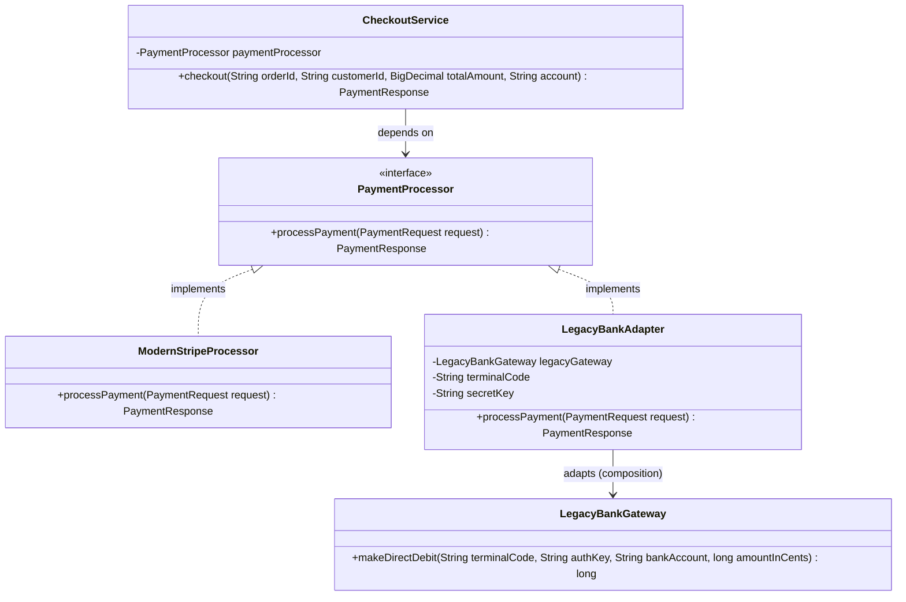

# Example 01: Legacy Payment Gateway Integration

## 1. Problem Statement
An e-commerce application uses a standardized `PaymentProcessor` contract expecting:
- Modern domain objects (`PaymentRequest`, `PaymentResponse`)
- Clean high-precision currency (`BigDecimal` in dollars)
- Unified transaction statuses

The company needs to integrate with a legacy corporate banking provider (`LegacyBankGateway`):
- Closed-source / proprietary vendor class.
- Accepts amounts strictly in primitive `long` cents.
- Requires proprietary terminal codes and secret keys for every single invocation.
- Returns primitive status codes (e.g. `200` = success, `-100` = insufficient funds, `-401` = unauthorized).

Without an adapter, the client checkout service becomes contaminated with vendor constants, manual unit math, and nested conditionals.

## 2. Bad Design vs Good Design

### Bad Design (Inlined Integration)
```java
public class BadCheckoutService {
    private final LegacyBankGateway legacyGateway = new LegacyBankGateway();

    public boolean processCheckout(PaymentOrder order, String provider) {
        if ("LEGACY_BANK".equalsIgnoreCase(provider)) {
            long cents = order.amountInDollars().multiply(BigDecimal.valueOf(100)).longValue();
            long status = legacyGateway.makeDirectDebit("TERM-991", "SECRET-KEY-XYZ", order.sourceAccountNumber(), cents);
            return status == 200L;
        }
        throw new UnsupportedOperationException();
    }
}
```
**Weaknesses:**
1. **OCP Violation:** Adding Stripe or PayPal forces edits to `BadCheckoutService`.
2. **SRP Violation:** Checkout service manages currency math and bank-specific credentials.
3. **Hard to Test:** Cannot unit test checkout without running the legacy gateway.

### Good Design (Adapter Pattern)
```java
public class LegacyBankAdapter implements PaymentProcessor {
    private final LegacyBankGateway legacyGateway;
    private final String terminalCode;
    private final String secretKey;

    public PaymentResponse processPayment(PaymentRequest request) {
        long amountInCents = request.amount().multiply(BigDecimal.valueOf(100)).longValue();
        long status = legacyGateway.makeDirectDebit(terminalCode, secretKey, request.accountOrCardIdentifier(), amountInCents);
        return status == 200L 
            ? PaymentResponse.ok(request.transactionReference(), "Approved", "LEGACY_TX_OK")
            : PaymentResponse.fail(request.transactionReference(), "Rejected", "LEGACY_CODE_" + status);
    }
}
```
**Benefits:**
1. **Purity of Domain:** `CheckoutService` depends strictly on `PaymentProcessor`.
2. **Quarantined Legacy Quirks:** Terminal codes, cents conversions, and error codes exist only inside `LegacyBankAdapter`.
3. **Interchangeability:** Swapping between Stripe and Legacy Bank is a one-line constructor dependency injection change.

## 3. Class Diagram


## 4. Execution Flow
```text
[CheckoutService]
       │
       ▼ calls processPayment(PaymentRequest)
[LegacyBankAdapter]
       │ 1. Multiplies dollars by 100 -> amountInCents
       │ 2. Injects "TERM-991", "SECRET-KEY-XYZ"
       ▼ calls makeDirectDebit(...)
[LegacyBankGateway]
       │ Returns 200L
       ▼
[LegacyBankAdapter]
       │ Maps 200L -> PaymentResponse.ok(...)
       ▼
[CheckoutService] receives clean domain PaymentResponse
```

## 5. SOLID Principles Genuine Demonstration
- **Single Responsibility Principle (SRP):** `LegacyBankAdapter` translates interfaces and data formats; `CheckoutService` manages customer checkout flow; `LegacyBankGateway` executes bank debit logic.
- **Open/Closed Principle (OCP):** New processors (PayPal, Square, Adyen) can be plugged in without changing `CheckoutService`.
- **Dependency Inversion Principle (DIP):** `CheckoutService` depends upon the high-level `PaymentProcessor` abstraction, not low-level legacy banking classes.
