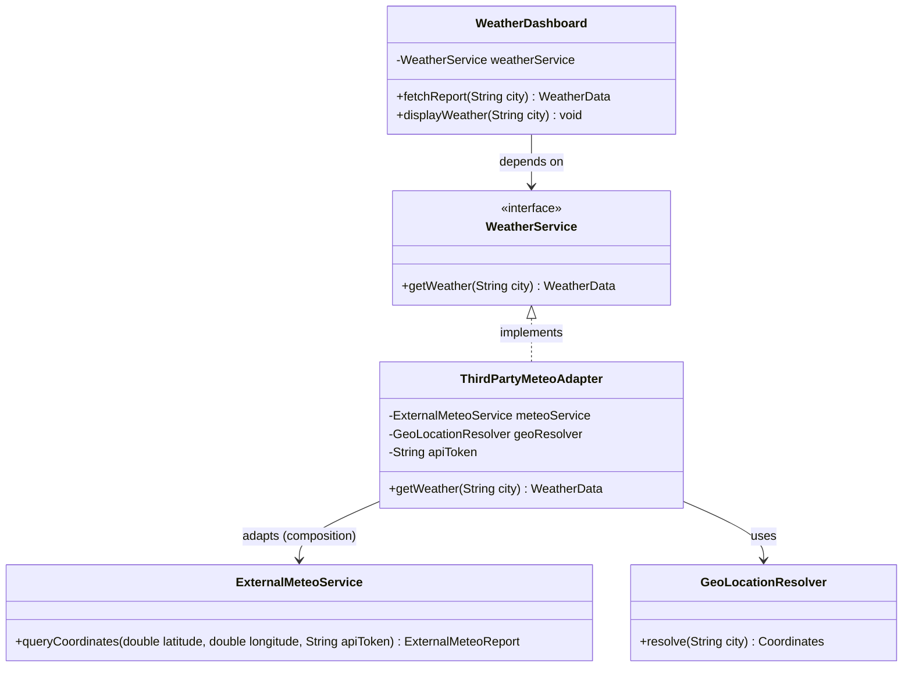

# Example 02: Third-Party Weather API Integration

## 1. Problem Statement
An application's UI dashboard needs to display real-time weather metrics by city name:
- Standard metric units: temperature in Celsius (°C), humidity percentage (0% to 100%).
- Human-readable condition strings ("Sunny & Clear", "Rainy").

The company subscribes to `ExternalMeteoService`, a third-party commercial SDK:
- It only accepts GPS latitude and longitude coordinates.
- It requires an external API secret token.
- It returns temperatures strictly in degrees Fahrenheit.
- It returns humidity as a decimal fraction (`0.45` rather than `45%`).
- It represents weather conditions as proprietary numeric status codes (`101`, `204`, `305`).

Directly consuming `ExternalMeteoService` in the dashboard couples UI controllers to external vendor data structures, coordinate math, and conversion formulas.

## 2. Bad Design vs Good Design

### Bad Design (Inlined SDK Consumption)
```java
public class BadWeatherDashboard {
    private final ExternalMeteoService meteoService = new ExternalMeteoService();

    public void displayCityWeather(String city) {
        // Manual inlined coordinate mapping
        double lat = "Paris".equals(city) ? 48.8566 : ...;
        ExternalMeteoReport report = meteoService.queryCoordinates(lat, lon, "VALID_METEO_TOKEN");
        // Inlined temperature and humidity conversion
        double c = (report.tempFahrenheit() - 32.0) * 5.0 / 9.0;
        double h = report.relHumidityRatio() * 100.0;
    }
}
```
**Weaknesses:**
1. **DIP Violation:** Dashboard directly depends on concrete vendor SDK `ExternalMeteoService`.
2. **Formula Duplication:** Unit conversion logic is trapped inside the dashboard and cannot be reused by alerts, cron jobs, or mobile backends.
3. **Rigid:** Switching to another provider like AccuWeather or NOAA requires altering the presentation code.

### Good Design (Adapter Pattern)
```java
public class ThirdPartyMeteoAdapter implements WeatherService {
    private final ExternalMeteoService meteoService;
    private final GeoLocationResolver geoResolver;
    private final String apiToken;

    public WeatherData getWeather(String city) {
        Coordinates coords = geoResolver.resolve(city);
        ExternalMeteoReport report = meteoService.queryCoordinates(coords.latitude(), coords.longitude(), apiToken);
        double celsius = (report.tempFahrenheit() - 32.0) * 5.0 / 9.0;
        double humidity = report.relHumidityRatio() * 100.0;
        String condition = mapSkyStatus(report.skyStatusCode());
        return new WeatherData(city, celsius, humidity, condition);
    }
}
```
**Benefits:**
1. **Clean Domain Interface:** `WeatherDashboard` only depends on `WeatherService`.
2. **Encapsulated Translation:** Coordinate resolution, credential injection, Fahrenheit-to-Celsius formulas, and code-to-string mappings are encapsulated in `ThirdPartyMeteoAdapter`.
3. **High Testability:** Dashboard can be tested using mock `WeatherService` instances without external network calls.

## 3. Class Diagram


## 4. Execution Flow
```text
[WeatherDashboard] 
       │ calls getWeather("Paris")
       ▼
[ThirdPartyMeteoAdapter]
       │ 1. Resolves "Paris" -> Coordinates(48.8566, 2.3522)
       │ 2. Injects apiToken
       ▼ calls queryCoordinates(48.8566, 2.3522, token)
[ExternalMeteoService]
       │ returns ExternalMeteoReport(68.0 F, 0.45 ratio, code 101)
       ▼
[ThirdPartyMeteoAdapter]
       │ 3. Converts 68F -> 20.0°C
       │ 4. Converts 0.45 -> 45%
       │ 5. Maps 101 -> "Sunny & Clear"
       ▼ returns WeatherData("Paris", 20.0, 45.0, "Sunny & Clear")
[WeatherDashboard] displays formatted metric weather
```

## 5. SOLID Principles Genuine Demonstration
- **Single Responsibility Principle (SRP):** `ThirdPartyMeteoAdapter` is responsible only for adapting external meteorological data and units; `WeatherDashboard` is responsible only for presenting results to users.
- **Open/Closed Principle (OCP):** A new weather provider (e.g. `NationalWeatherAdapter`) can be plugged in without changing `WeatherDashboard`.
- **Dependency Inversion Principle (DIP):** High-level client modules depend on the `WeatherService` abstraction, not low-level vendor SDKs.
