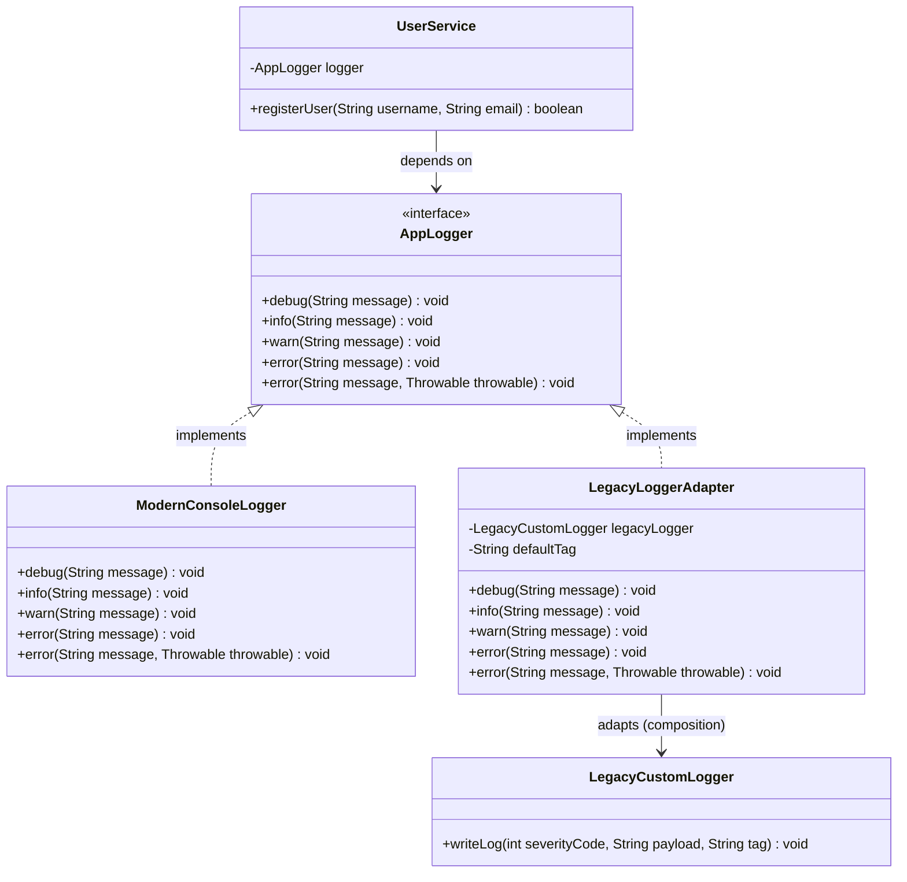

# Example 03: Legacy Logger Integration

## 1. Problem Statement
A modern software system defines a clean, expressive logging contract `AppLogger`:
- Methods: `debug(msg)`, `info(msg)`, `warn(msg)`, `error(msg, throwable)`.
- Standardized logging levels and automatic exception diagnostics.

The project must interface with an older corporate monolithic component that uses `LegacyCustomLogger`:
- Incompatible interface: `writeLog(int severityCode, String payload, String tag)`.
- Uses primitive integers: `1 = DEBUG`, `2 = INFO`, `3 = WARN`, `4 = ERROR`.
- Requires an explicit component subsystem tag with every log.
- Does not take `Throwable` objects directly; requires manual serialization into a string stack trace.

Directly using `LegacyCustomLogger` in business services leads to repetitive code converting exceptions to strings, magic numbers scattered across classes, and an inability to swap in modern frameworks like SLF4J, Log4j2, or Logback.

## 2. Bad Design vs Good Design

### Bad Design (Direct Coupling & Magic Numbers)
```java
public class BadUserService {
    private final LegacyCustomLogger legacyLogger = new LegacyCustomLogger();

    public void registerUser(String username, String email) {
        legacyLogger.writeLog(2, "Registering: " + username, "USER_SVC");
        try {
            // ...
        } catch (Exception e) {
            StringWriter sw = new StringWriter();
            e.printStackTrace(new PrintWriter(sw));
            legacyLogger.writeLog(4, "Failed: " + e.getMessage() + "\n" + sw, "USER_SVC");
        }
    }
}
```
**Weaknesses:**
1. **Magic Numbers:** Severity is passed as raw integer literals (`2`, `4`).
2. **Boilerplate Exception Formatting:** Every error catch block must duplicate `StringWriter` logic.
3. **High Coupling:** Swapping loggers requires rewriting every line of logging code across all business services.

### Good Design (Adapter Pattern)
```java
public class LegacyLoggerAdapter implements AppLogger {
    private final LegacyCustomLogger legacyLogger;
    private final String defaultTag;

    public void info(String message) {
        legacyLogger.writeLog(2, message, defaultTag);
    }

    public void error(String message, Throwable throwable) {
        String payload = formatPayloadWithStackTrace(message, throwable);
        legacyLogger.writeLog(4, payload, defaultTag);
    }
}
```
**Benefits:**
1. **Clean Domain Services:** `UserService` calls standard `logger.info(...)` and `logger.error(...)`.
2. **Centralized Serialization:** Exception stack trace extraction is contained inside `LegacyLoggerAdapter`.
3. **Pluggable:** Replace `LegacyLoggerAdapter` with `ModernConsoleLogger` or `CloudWatchLogger` with zero changes to `UserService`.

## 3. Class Diagram


## 4. Execution Flow
```text
[UserService]
       │
       ▼ calls logger.error("Failed to register user", exception)
[LegacyLoggerAdapter]
       │ 1. Maps method to severity code 4 (ERROR)
       │ 2. Converts Exception stack trace into String
       │ 3. Appends tag "USER_SVC"
       ▼ calls writeLog(4, formattedPayload, "USER_SVC")
[LegacyCustomLogger]
       │ appends formatted log record
       ▼
Logs recorded without exposing legacy integer codes or manual StringWriter boilerplate to UserService.
```

## 5. SOLID Principles Genuine Demonstration
- **Single Responsibility Principle (SRP):** `LegacyLoggerAdapter` handles logging level mapping and stack trace translation; `UserService` focuses exclusively on user lifecycle logic.
- **Open/Closed Principle (OCP):** New log destinations (Logstash, Splunk, Datadog) can be added as new `AppLogger` implementations without modifying `UserService`.
- **Dependency Inversion Principle (DIP):** Client services depend on `AppLogger`, never on `LegacyCustomLogger`.
