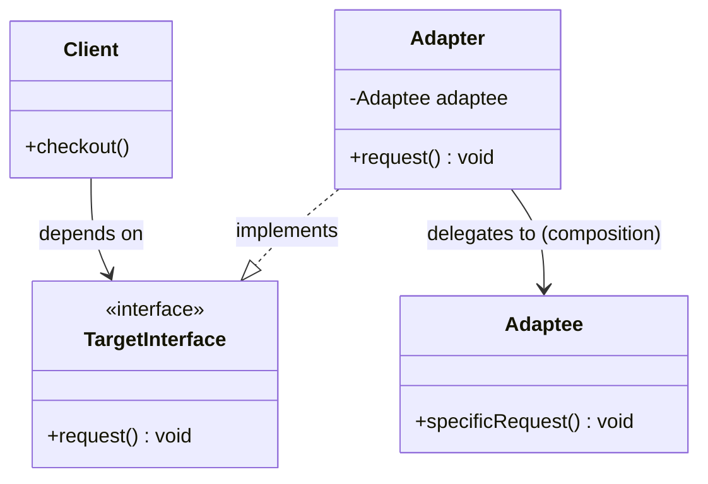
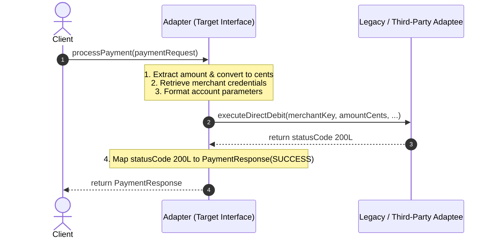

# Adapter Design Pattern: Comprehensive Guide & Engineering Handbook

## 1. What the Pattern Is and Why It Exists

The **Adapter Pattern** (also known as a **Wrapper**) is a structural design pattern that allows objects with incompatible interfaces to collaborate.

In enterprise software engineering, you rarely build an entire system in a vacuum. You frequently integrate:
- Third-party SDKs and vendor APIs.
- Legacy subsystems written years ago with obsolete interfaces.
- Modern internal microservices and domain models.

When an existing class has the exact behavior you need, but its method signatures, parameter types, or data structures do not match the interface expected by your client code, you have three choices:
1. *Modify the existing/third-party class*: Often impossible (it's in a closed-source JAR or managed by another vendor) or dangerous (breaks existing legacy callers).
2. *Contaminate your domain code*: Litter your core business logic with vendor-specific conditionals, conversions, and imports.
3. *Use an Adapter*: Introduce an intermediary object that translates calls from the client's expected target interface into invocations the adaptee understands.

The Adapter pattern provides choice #3: **it bridges the gap between incompatible interfaces without modifying either party**.

---

## 2. Real-World Analogy

Imagine traveling internationally from the United States to the United Kingdom with your laptop:
- Your laptop charger has a **US two-pin flat plug** (Client expects a US socket).
- The wall socket in your hotel room in London is a **UK three-pin rectangular socket** (Adaptee provides UK power).

You cannot:
- Change London's electrical infrastructure (cannot modify third-party vendor code).
- Cut off your laptop's cord and solder new pins on the spot (cannot break client contracts).

Instead, you plug your US charger into a **travel adapter**, which plugs into the UK wall socket. The travel adapter does not generate electricity; it simply converts the physical interface and routes the current from the UK socket to your US plug.

```
[ Laptop Charger (Client) ] 
       │ (US 2-pin interface)
       ▼
[ Travel Adapter ]
       │ (UK 3-pin interface)
       ▼
[ London Wall Socket (Adaptee) ]
```

---

## 3. The Problem Without the Pattern

Suppose you are building an e-commerce platform with a standardized `PaymentProcessor` interface:

```java
public interface PaymentProcessor {
    PaymentResponse processPayment(PaymentRequest request);
}
```

Your system integrates with a legacy banking gateway called `OldBankGateway` (or a third-party SDK):

```java
public class OldBankGateway {
    // Completely different method name, parameter order, and primitive currency representation (cents)
    public long executeDirectDebit(String merchantKey, long amountInCents, String senderAccount, String receiverAccount) {
        // proprietary debit logic...
        return 200L;
    }
}
```

### The Naive / Bad Solution
Without an adapter, the client code (e.g., `CheckoutService`) is directly contaminated:

```java
public class CheckoutService {
    public void checkout(Order order, String gatewayType) {
        if ("OLD_BANK".equals(gatewayType)) {
            OldBankGateway bank = new OldBankGateway();
            long cents = (long) (order.getTotalAmount() * 100);
            long code = bank.executeDirectDebit("KEY_XYZ", cents, order.getCustomerAccount(), "STORE_1");
            if (code != 200L) throw new PaymentFailedException();
        } else {
            // standard processing...
        }
    }
}
```

### Why This Is Dangerous:
1. **Violates Open/Closed Principle (OCP):** Every time you add another payment vendor (Stripe, PayPal, Adyen), `CheckoutService` must be edited with more branch logic.
2. **Violates Single Responsibility Principle (SRP):** `CheckoutService` should focus on orders, not formatting bank account strings or currency unit conversions.
3. **Vendor Lock-in and Bleeding Boundaries:** Vendor-specific types and quirks leak into your high-level business domain.

---

## 4. How the Pattern Works Step by Step

1. **Target Interface**: Defines the domain-specific contract that the client code understands and consumes (`PaymentProcessor`).
2. **Client**: Interacts exclusively with the Target interface (`CheckoutService`).
3. **Adaptee**: The existing, incompatible class with useful functionality that cannot be modified (`OldBankGateway`).
4. **Adapter**: A class that implements the Target interface and wraps an instance of the Adaptee.
5. **Execution Flow**:
   - The Client calls a method on the Target interface: `adapter.processPayment(request)`.
   - The Adapter translates domain objects (`PaymentRequest`, dollars) into parameters expected by the Adaptee (cents, merchant keys).
   - The Adapter delegates to the Adaptee: `adaptee.executeDirectDebit(...)`.
   - The Adapter translates the Adaptee's return value into the Target's expected return type: `new PaymentResponse(...)`.
   - The Client receives the result seamlessly.

---

## 5. Class Diagram and Sequence Diagram

### Class Diagram (Object Adapter)



**Explanation of Class Diagram:**
The `Client` depends strictly upon the high-level `TargetInterface`. `Adapter` implements `TargetInterface`, maintaining a private reference to `Adaptee`. When `request()` is called, `Adapter` delegates to `adaptee.specificRequest()`.

### Sequence Diagram



**Explanation of Sequence Diagram:**
The client sends standard business domain objects. The adapter converts those parameters into low-level legacy calls, awaits the response, maps status codes back to business domain responses, and hands the clean response back to the client.

---

## 6. Each Participant's Responsibility

| Participant | Role & Responsibility |
|---|---|
| **Target Interface** | Declares the standard business interface used by the domain client. |
| **Client** | Calls methods on the Target interface; unaware of any concrete Adaptee. |
| **Adaptee** | Existing or third-party class that contains necessary capabilities but has an incompatible interface. |
| **Adapter** | Implements the Target interface, holds a reference to the Adaptee, converts inputs/outputs, and delegates execution. |

---

## 7. Two Styles of Adapters: Object Adapter vs Class Adapter

There are two primary ways to construct an adapter:

### 1. Object Adapter (Recommended in Java)
Uses **Composition**. The adapter holds an instance of the adaptee:
- **Pros**: Adheres to "Favor composition over inheritance". A single adapter can work with the adaptee and all of its subclasses.
- **Cons**: Requires one extra object forwarding indirection.

### 2. Class Adapter (Multiple Inheritance)
Uses **Inheritance**. The adapter extends both the Target and the Adaptee.
- In Java, because multiple class inheritance is not permitted, a class adapter can only be created if the Target is an `interface` and the Adaptee is a `class`:
  `public class BankAdapter extends OldBankGateway implements PaymentProcessor`
- **Pros**: Can override Adaptee behavior directly.
- **Cons**: Strongly coupled to a specific Adaptee implementation; cannot adapt subclasses of the Adaptee easily.

> **Industry Standard:** In modern Java, **Object Adapter** is preferred 99% of the time.

---

## 8. Bad vs Good Design Comparison

| Criteria | Bad Design (Inlined Integration) | Good Design (Adapter Pattern) |
|---|---|---|
| **Coupling** | Client is tightly coupled to vendor SDKs and legacy methods. | Client is coupled only to its own Target interface. |
| **Testability** | Unit tests for Client must mock complex third-party SDK classes. | Unit tests mock the clean Target interface effortlessly. |
| **Extensibility (OCP)** | Adding a vendor requires editing existing client classes and switches. | Adding a vendor simply means writing one new Adapter class. |
| **Domain Purity** | Vendor data formats (cents, XML strings, strange error codes) pollute domain. | Data mapping is quarantined inside the Adapter. |
| **Reusability** | Mapping code is duplicated across multiple services. | Adapter is reusable wherever the Target interface is consumed. |

---

## 9. SOLID Principles Genuinely Demonstrated

- **Single Responsibility Principle (SRP):**
  The adapter is solely responsible for translating data and method calls between the Target interface and the Adaptee. The client is responsible only for business orchestration.
- **Open/Closed Principle (OCP):**
  You can introduce new adapters for new third-party APIs into the system without breaking existing client code.
- **Dependency Inversion Principle (DIP):**
  The client depends on the abstract `TargetInterface`, not on the concrete low-level third-party `Adaptee`.

---

## 10. When to Use It and When NOT to Use It

### When to Use
- You want to use an existing class, but its interface does not match the rest of your system.
- You need to reuse several existing subclasses that lack some common functionality, but you cannot adapt each by subclassing (Object Adapter handles the whole hierarchy).
- You want to decouple your application from a volatile external library or third-party vendor.

### When NOT to Use
- **Both classes are under your full control and can be refactored**: If you can simply update the interface cleanly, an adapter adds unnecessary indirection.
- **You need to add new behavior**: If you are adding responsibilities rather than translating interfaces, use **Decorator**.
- **You need to simplify a complex subsystem**: If you want a unified high-level entry point over many classes, use **Facade**.

---

## 11. Benefits, Limitations, and Trade-Offs

### Benefits
- **Separation of Concerns**: Business logic is separated from interface/data conversion logic.
- **Flexibility**: Swapping out external vendors (e.g., switching from Twilio to AWS SNS) only requires replacing the adapter.
- **Legacy Preservation**: Keep proven legacy systems operational without freezing modernization efforts.

### Trade-Offs & Limitations
- **Code Complexity**: Introduces additional interfaces and wrapper classes.
- **Performance Overhead**: Minor indirection penalty (negligible in standard JVM applications).
- **Two-Way Translation Challenges**: If the adaptee does not support concepts present in the target interface, the adapter may have to throw `UnsupportedOperationException` or simulate behavior.

---

## 12. How to Recognize Incorrect Use (Anti-Patterns)

1. **The "Kitchen Sink" Adapter**: Adding unrelated business calculations, validation rules, or database persistence inside the adapter. An adapter must only *translate* and *delegate*.
2. **Adapting Interfaces that Already Match**: Creating adapters just for the sake of layers when the vendor interface already matches your needs.
3. **Overusing Class Adapters**: Subclassing the vendor class and exposing internal vendor methods unintentionally to callers.

---

## 13. Differences from Similar Patterns

| Pattern | Intent | Key Structural Difference |
|---|---|---|
| **Adapter** | Converts one interface to another so incompatible classes can work together. | Wraps an incompatible object and changes its interface. |
| **Decorator** | Adds responsibilities dynamically without changing the interface. | Wraps an object with the **exact same** interface. |
| **Proxy** | Controls access, provides caching, or lazy-loads an object. | Implements the **exact same** interface; does not change signatures. |
| **Facade** | Provides a simplified, high-level interface to a complex subsystem. | Defines a **brand-new simplified** interface over many objects. |
| **Bridge** | Decouples an abstraction from its implementation so both vary independently. | Designed **upfront** before classes are built, not retrofitted later. |

---

## 14. Common Interview Questions and Answers

### Q1: What is the difference between an Object Adapter and a Class Adapter?
**Answer:** An Object Adapter uses object composition (has-a) and implements the target interface while holding a reference to the adaptee. A Class Adapter uses inheritance (is-a), subclassing both target and adaptee (in languages like C++ with multiple inheritance, or by implementing an interface and extending a class in Java). Object adapter is preferred because it can adapt an adaptee and all its subclasses polymorphically.

### Q2: What is the difference between Adapter and Decorator?
**Answer:** Adapter changes the interface of an existing object to match what a client expects. Decorator keeps the exact same interface and enhances or adds behavior. Adapter makes things work after they're designed; Decorator enhances objects without changing their interface.

### Q3: What is the difference between Adapter and Facade?
**Answer:** Adapter makes an existing interface conform to another expected interface (typically 1-to-1 conversion). Facade creates a completely new, simplified interface to make an entire subsystem of multiple classes easier to use.

---

## 15. Concise Revision Checklist

- [ ] Target interface defines the clean domain contract.
- [ ] Client interacts only with Target interface.
- [ ] Adaptee contains useful functionality with an incompatible API.
- [ ] Adapter implements Target interface and wraps Adaptee via private field.
- [ ] Adapter methods translate parameters, call Adaptee, and translate returns.
- [ ] Zero business logic or feature expansion inside Adapter (keep it strictly translation).
- [ ] Unit tests for Client mock the Target interface without touching Adaptee.
