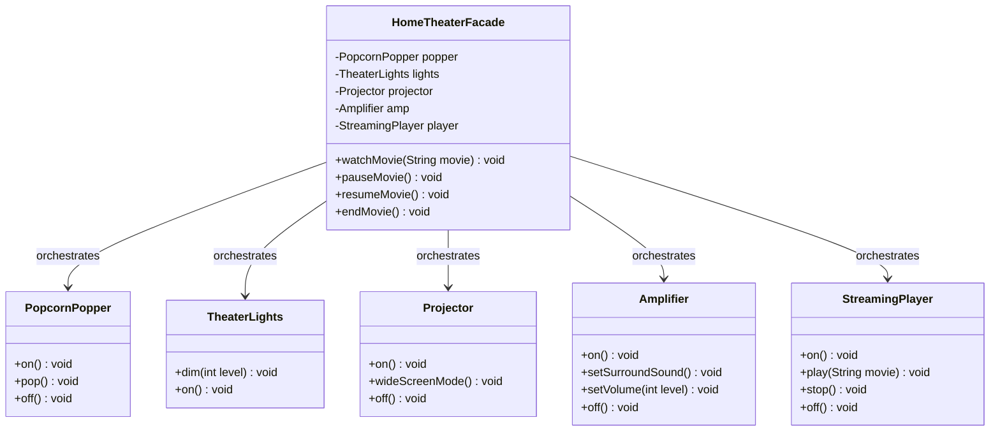

# Example 01: Home Theater Subsystem Facade

## 1. Problem Statement
A modern smart home entertainment setup consists of multiple independent hardware devices:
- `PopcornPopper`: must be turned on, popped, and turned off.
- `TheaterLights`: must be dimmed to 10% during movie playback and brought up to 100% on exit.
- `Projector`: must be turned on and set to widescreen mode.
- `Amplifier`: must be turned on, routed to the streaming player, set to Dolby Atmos surround sound, and tuned to comfortable volume.
- `StreamingPlayer`: must be turned on and instructed to play the target movie title.

Without a facade, every client (mobile app, voice controller, wall tablet) must manually invoke 10-15 calls in strict sequence. If a caller misses turning off the popper or restoring lights, appliances remain powered on, wasting electricity or posing hazards.

## 2. Bad Design vs Good Design

### Bad Design (Client-Orchestrated Chaos)
```java
public class BadHomeTheaterClient {
    public void watchMovie(String movie) {
        popper.on();
        popper.pop();
        lights.dim(10);
        projector.on();
        projector.wideScreenMode();
        amp.on();
        amp.setSurroundSound();
        amp.setVolume(7);
        player.on();
        player.play(movie);
    }
}
```
**Weaknesses:**
1. **Severe Coupling:** The client has direct dependencies on 5 different classes.
2. **Brittle Sequences:** Any missing step (e.g. forgot `popper.off()` on movie end) corrupts room state.
3. **Duplication:** Every client UI repeats the same orchestration ritual.

### Good Design (Facade Pattern)
```java
public class HomeTheaterFacade {
    private final PopcornPopper popper;
    private final TheaterLights lights;
    private final Projector projector;
    private final Amplifier amp;
    private final StreamingPlayer player;

    public void watchMovie(String movie) {
        popper.on();
        popper.pop();
        lights.dim(10);
        projector.on();
        projector.wideScreenMode();
        amp.on();
        amp.setSurroundSound();
        amp.setVolume(12);
        player.on();
        player.play(movie);
    }

    public void endMovie() {
        popper.off();
        lights.on();
        projector.off();
        amp.off();
        player.stop();
        player.off();
    }
}
```
**Benefits:**
1. **Single Entry Point:** Clients invoke `watchMovie("Interstellar")` and `endMovie()`.
2. **Decoupled Architecture:** Subsystems can evolve internal protocols without breaking client code.
3. **Retains Power-User Access:** Direct getters allow custom volume or light adjustments without bypassing the facade entirely.

## 3. Class Diagram


## 4. Execution Flow
```text
[User / Mobile App]
       │
       ▼ watchMovie("Inception")
[HomeTheaterFacade]
       ├──► popper.on() & popper.pop()
       ├──► lights.dim(10)
       ├──► projector.on() & projector.wideScreenMode()
       ├──► amp.on(), amp.setSurroundSound(), amp.setVolume(12)
       └──► player.on() & player.play("Inception")
```

## 5. SOLID Principles Genuine Demonstration
- **Single Responsibility Principle (SRP):** Subsystem classes focus solely on their domain functions (`Amplifier` manages audio amplification; `Projector` renders video). The `HomeTheaterFacade` focuses purely on workflow lifecycle orchestration.
- **Open/Closed Principle (OCP):** Introducing new hardware components (e.g. motorized blackout shades) can be integrated inside the facade without altering client call sites.
- **Least Knowledge (Law of Demeter):** Clients only speak to their immediate friend (`HomeTheaterFacade`), never reaching through multiple objects to configure internal sound cards or light dimmers.
