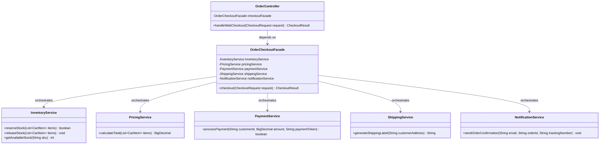

# Example 02: E-Commerce Checkout Orchestration Facade

## 1. Problem Statement
In an e-commerce platform, completing a customer checkout requires coordinating five distinct subsystems:
1. `InventoryService`: Validates stock availability and reserves items.
2. `PricingService`: Calculates item subtotals, applies promo codes, and computes state taxes.
3. `PaymentService`: Authorizes and charges the customer's payment method.
4. `ShippingService`: Generates delivery courier labels and tracking numbers.
5. `NotificationService`: Dispatches email/SMS receipts to the buyer.

In naive architectures, web controllers or API route handlers directly invoke all five services. This causes critical business failures:
- **Missing Compensating Transactions (Rollbacks):** When `PaymentService` declines a transaction after inventory is reserved, controllers frequently forget to call `inventory.releaseStock()`, causing inventory leaks.
- **Leaky Business Workflow:** Presentation controllers are cluttered with tax rounding rules, inventory locks, and tracking generation.
- **Duplication Across Channels:** Mobile apps, web frontends, and POS terminals all duplicate this multi-step sequence.

## 2. Bad Design vs Good Design

### Bad Design (Controller-Orchestrated Leak)
```java
public class BadCheckoutController {
    public boolean checkout(String customerId, String address, List<CartItem> items, String token) {
        inventoryService.reserveStock(items);
        BigDecimal total = calculateTotal(items);
        boolean paid = paymentService.charge(customerId, total, token);
        if (!paid) {
            // BUG: Exits without releasing reserved inventory! Stock is locked forever!
            return false;
        }
        shippingService.createShipment(address);
        return true;
    }
}
```
**Weaknesses:**
1. **State Inconsistency / Resource Leak:** Failure in mid-flight operations leaves prior steps in half-committed states.
2. **Tight Coupling:** The presentation layer directly depends on 5 infrastructure services.
3. **Hard to Test:** Controllers cannot be unit-tested without assembling the entire subsystem.

### Good Design (Facade Pattern)
```java
public class OrderCheckoutFacade {
    public CheckoutResult checkout(CheckoutRequest request) {
        if (!inventoryService.reserveStock(request.items())) {
            return CheckoutResult.failed(orderId, "Out of stock");
        }
        BigDecimal total = pricingService.calculateTotal(request.items());
        if (!paymentService.processPayment(request.customerId(), total, request.paymentToken())) {
            // AUTOMATIC COMPENSATING ROLLBACK:
            inventoryService.releaseStock(request.items());
            return CheckoutResult.failed(orderId, "Payment declined");
        }
        String tracking = shippingService.generateShippingLabel(request.shippingAddress());
        notificationService.sendOrderConfirmation(request.customerEmail(), orderId, tracking);
        return CheckoutResult.success(orderId, tracking, total);
    }
}
```
**Benefits:**
1. **Encapsulated Transactional Integrity:** The facade guarantees that failed steps trigger compensating rollbacks (e.g., releasing inventory).
2. **Simplified Client Layer:** `OrderController` only calls `checkoutFacade.checkout(request)`.
3. **Consistent Business Logic:** The exact same rules and error handling govern web, mobile, and third-party partner checkouts.

## 3. Class Diagram


## 4. Execution Flow
```text
[Client / OrderController]
       │
       ▼ checkout(CheckoutRequest)
[OrderCheckoutFacade]
       ├──► 1. InventoryService.reserveStock(...)
       ├──► 2. PricingService.calculateTotal(...)
       ├──► 3. PaymentService.processPayment(...)
       │        └─ (If Payment Fails: InventoryService.releaseStock(...) -> Return Failure)
       ├──► 4. ShippingService.generateShippingLabel(...)
       └──► 5. NotificationService.sendOrderConfirmation(...)
       │
       ▼ Return CheckoutResult(SUCCESS)
[Client / OrderController]
```

## 5. SOLID Principles Genuine Demonstration
- **Single Responsibility Principle (SRP):** Subsystem classes focus strictly on their domain (`PaymentService` charges credit cards; `InventoryService` checks stock). `OrderCheckoutFacade` handles the high-level workflow orchestration and rollback coordination.
- **Open/Closed Principle (OCP):** Adding fraud checks or tax calculations happens within the subsystem and facade without altering any controller callers.
- **Dependency Inversion Principle (DIP):** Clients depend on the unified `OrderCheckoutFacade` instead of multiple concrete microservice clients.
