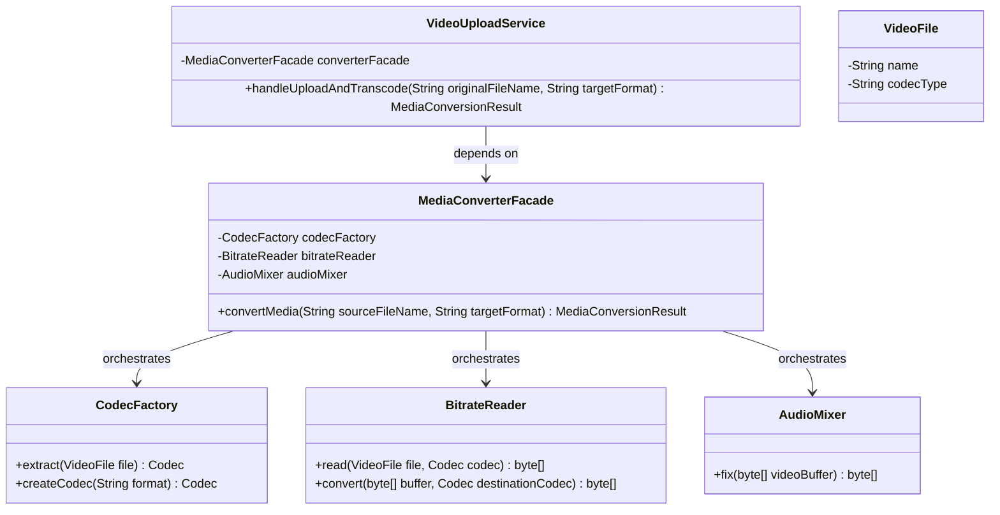

# Example 03: Media Conversion Pipeline Facade

## 1. Problem Statement
Media transcoding engines (such as FFmpeg bindings) involve multiple intricate low-level components:
- `VideoFile`: extracts file headers and identifies source file formats.
- `CodecFactory`: inspects and dynamically creates source and destination video codecs (e.g., MPEG4, Ogg).
- `BitrateReader`: reads binary frame bitstreams and transcodes pixel data from one compression format to another.
- `AudioMixer`: extracts audio tracks, synchronizes timecodes, and resamples sample rates (e.g., 44.1kHz stereo).

When clients (e.g. video upload handlers, mobile encoders, automated pipeline jobs) invoke this pipeline directly:
- Callers must execute a strict multi-step sequence across four separate classes.
- If a developer misses the `AudioMixer.fix(...)` call, the video produces silent or out-of-sync audio.
- Changes to internal bitstream buffer allocators or codec types break every caller in the codebase.

## 2. Bad Design vs Good Design

### Bad Design (Manual Pipeline Coupling)
```java
public class BadMediaClient {
    public byte[] convertVideo(String fileName, String targetFormat) {
        VideoFile file = new VideoFile(fileName);
        Codec source = CodecFactory.extract(file);
        Codec dest = "mp4".equals(targetFormat) ? new MPEG4CompressionCodec() : new OggCompressionCodec();
        byte[] raw = BitrateReader.read(file, source);
        byte[] converted = BitrateReader.convert(raw, dest);
        AudioMixer mixer = new AudioMixer();
        return mixer.fix(converted);
    }
}
```
**Weaknesses:**
1. **Law of Demeter Violation:** Callers navigate through file abstractions, codec factories, low-level bitstream converters, and audio processors.
2. **Brittle Sequence:** Forgetting audio synchronization corrupts the media payload.
3. **Hard to Maintain:** Any change to codec constructors or bitstream signatures breaks every upload controller.

### Good Design (Facade Pattern)
```java
public class MediaConverterFacade {
    private final CodecFactory codecFactory;
    private final BitrateReader bitrateReader;
    private final AudioMixer audioMixer;

    public MediaConversionResult convertMedia(String sourceFileName, String targetFormat) {
        VideoFile file = new VideoFile(sourceFileName);
        Codec sourceCodec = codecFactory.extract(file);
        Codec destinationCodec = codecFactory.createCodec(targetFormat);
        byte[] rawBuffer = bitrateReader.read(file, sourceCodec);
        byte[] convertedBuffer = bitrateReader.convert(rawBuffer, destinationCodec);
        byte[] finalOutput = audioMixer.fix(convertedBuffer);
        return MediaConversionResult.ok(sourceFileName, outputFileName, targetFormat, finalOutput);
    }
}
```
**Benefits:**
1. **One Simple Call:** `VideoUploadService` only calls `converterFacade.convertMedia("drone.ogg", "mp4")`.
2. **Guaranteed Pipeline Safety:** Bitstream extraction, transcoding, and audio synchronization always happen in exact order.
3. **Subsystem Isolation:** Codecs and bitstream readers can be refactored with zero impact on client services.

## 3. Class Diagram


## 4. Execution Flow
```text
[VideoUploadService]
       │
       ▼ calls convertMedia("clip.ogg", "mp4")
[MediaConverterFacade]
       ├──► 1. VideoFile("clip.ogg")
       ├──► 2. CodecFactory.extract(file) -> OggCompressionCodec
       ├──► 3. CodecFactory.createCodec("mp4") -> MPEG4CompressionCodec
       ├──► 4. BitrateReader.read(...) -> Raw Byte Stream
       ├──► 5. BitrateReader.convert(...) -> Transcoded Byte Stream
       └──► 6. AudioMixer.fix(...) -> Mixed & Synchronized Audio/Video Stream
       │
       ▼ returns MediaConversionResult(SUCCESS)
[VideoUploadService]
```

## 5. SOLID Principles Genuine Demonstration
- **Single Responsibility Principle (SRP):** `CodecFactory` manages codec lifecycle; `BitrateReader` handles binary frame transformation; `AudioMixer` synchronizes sound; `MediaConverterFacade` manages end-to-end pipeline coordination.
- **Open/Closed Principle (OCP):** Supporting new formats (e.g., AV1, WebM) requires adding new `Codec` classes and factory mappings without modifying any `VideoUploadService` callers.
- **Least Knowledge (Law of Demeter):** Upload controllers only interact with `MediaConverterFacade`, remaining completely shielded from low-level codecs and audio synchronization tools.
