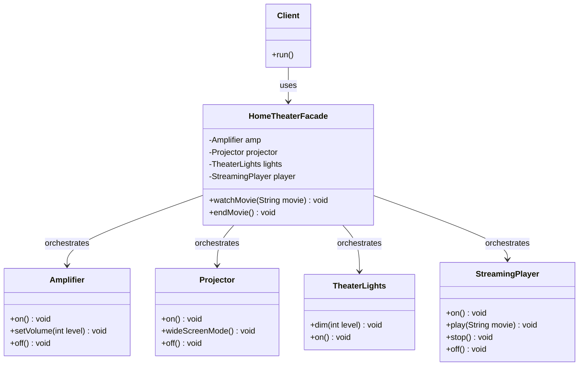
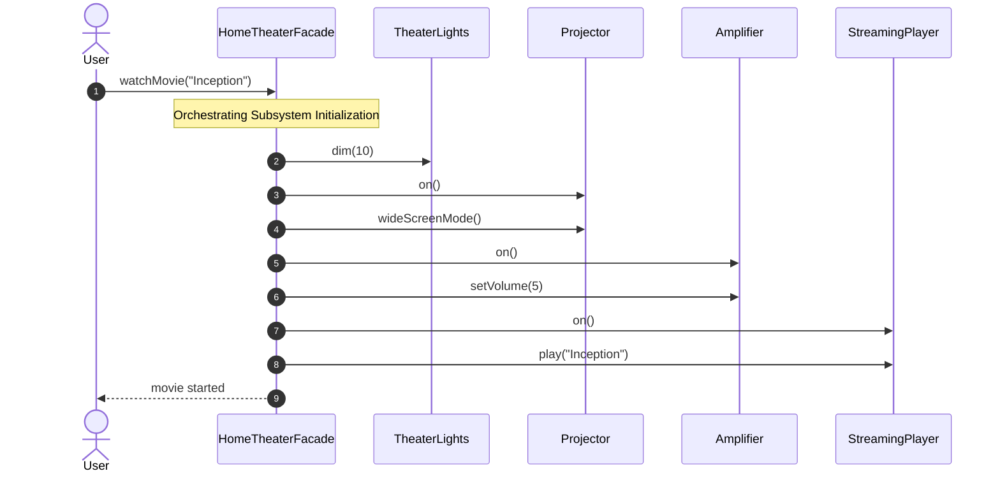

# Facade Design Pattern: Comprehensive Guide & Engineering Handbook

## 1. What the Pattern Is and Why It Exists

The **Facade Pattern** is a structural design pattern that provides a simplified, higher-level interface to a complex subsystem composed of many interacting classes, libraries, or frameworks.

As software evolves, subsystems grow increasingly sophisticated:
- An audio/video rendering pipeline might involve codecs, bitstream parsers, audio synchronizers, GPU texture buffers, and display drivers.
- An e-commerce checkout flow might touch inventory reservation, pricing and discount engines, fraud detection services, payment gateways, tax calculation engines, and notification dispatchers.

If every client (e.g. mobile app controller, web API endpoint, batch scheduler) interacts directly with dozens of low-level subsystem classes, two severe problems occur:
1. **Pervasive Tight Coupling**: Changes to any low-level class ripple across all client modules.
2. **Cognitive Overhead and Misconfiguration**: Callers must know the exact, fragile sequence of low-level calls to perform common tasks without introducing state corruption.

The **Facade Pattern** solves this by placing a single, easy-to-use "front desk" in front of the subsystem. It encapsulates the complex interactions and provides high-level convenience methods (like `watchMovie()` or `checkoutOrder()`), while still leaving low-level classes accessible for advanced use cases if needed.

---

## 2. Real-World Analogy

Consider placing an order at a sit-down restaurant:
- The restaurant kitchen is a complex subsystem: chefs, line cooks, dishwashers, inventory managers, butchers, pastry bakers, and expeditors.
- You (the client) do not walk into the kitchen, coordinate with the butcher for meat cuts, instruct the line cook on gas burners, and supervise the dishwasher for clean plates.
- Instead, you interact with a **Waiter (the Facade)**.
- You say: *"I'd like the steak dinner, please."*
- The waiter handles the internal orchestration across all kitchen stations and brings your dinner when ready.

```
[ Customer (Client) ]
         │ "Steak dinner, please"
         ▼
  [ Waiter (Facade) ]
    ├──► [ Line Cook ]
    ├──► [ Butcher ]
    ├──► [ Wine Sommelier ]
    └──► [ Pastry Chef ]
```

---

## 3. The Problem Without the Pattern

Imagine a smart Home Theater setup consisting of `PopcornPopper`, `TheaterLights`, `Projector`, `Amplifier`, and `StreamingPlayer`.

Without a facade, any caller wanting to watch a movie must execute a brittle 10-step initialization ritual:

```java
// Client code without Facade
popper.on();
popper.pop();
lights.dim(10);
projector.on();
projector.wideScreenMode();
amp.on();
amp.setStreamingPlayer(player);
amp.setSurroundSound();
amp.setVolume(5);
player.on();
player.play("Inception");
```

### Consequences:
1. **Duplicated Setup Across Clients**: Mobile apps, voice assistants, and hardware remotes must all duplicate this exact sequence.
2. **Shutting Down Is Equally Fragile**: Stopping the movie requires reversing every call in proper order; missing one leaves appliances running and wasting power.
3. **Subsystem Upgrades Break Everything**: If `Projector` replaces `wideScreenMode()` with `setAspectRatio(Ratio.CINEMA_16_9)`, every single client file breaks.

---

## 4. How the Pattern Works Step by Step

1. **Subsystem Classes**: A set of classes implementing specialized functionality (`Amplifier`, `Projector`, `Lights`, etc.). They have no reference to the Facade; they operate independently.
2. **Facade Class**:
   - Holds references to instances of the subsystem classes.
   - Exposes clean, high-level methods (`watchMovie(String title)`, `endMovie()`).
   - Knows which subsystem class is responsible for which step and the required ordering.
3. **Client**:
   - Communicates solely with the Facade.
   - Remains completely decoupled from the internal mechanics and dependencies of the subsystem.
4. **Optional Direct Access**: The subsystem classes remain `public` (or package-private within a module) so advanced power-users can bypass the facade if rare custom tuning is required.

---

## 5. Class Diagram and Sequence Diagram

### Class Diagram



**Explanation of Class Diagram:**
The `Client` has a single dependency on `HomeTheaterFacade`. The facade encapsulates four subsystem components (`Amplifier`, `Projector`, `TheaterLights`, and `StreamingPlayer`), coordinating their lifecycles.

### Sequence Diagram



**Explanation of Sequence Diagram:**
The user makes a single high-level call `watchMovie("Inception")`. The facade executes all necessary subsystem calls in the correct order, hiding the complexity from the caller.

---

## 6. Each Participant's Responsibility

| Participant | Responsibility |
|---|---|
| **Facade** | Encapsulates subsystem complexity; exposes straightforward methods; delegates calls to appropriate subsystem classes in the right order. |
| **Subsystem Classes** | Implement specialized subsystem functionality; perform actual work; have no knowledge of the Facade. |
| **Client** | Interacts only with the Facade to perform common tasks without managing subsystem details. |

---

## 7. Relationships Between Classes and Why They Exist

- **Client to Facade (`uses`)**: The client only needs the high-level simplified interface, dramatically reducing cognitive load and coupling.
- **Facade to Subsystems (`has-a / composition`)**: The facade owns or references the constituent parts of the subsystem to configure and trigger them in coordination.
- **Subsystem to Subsystem**: Subsystem classes can collaborate directly among themselves without needing the Facade. The Facade does not hide or isolate subsystem classes from each other.

---

## 8. Bad vs Good Design Comparison

| Dimension | Bad Design (Direct Subsystem Coupling) | Good Design (Facade Pattern) |
|---|---|---|
| **Client Coupling** | High: Client imports 5–10 low-level classes. | Low: Client imports exactly 1 Facade class. |
| **Ordering Bugs** | High: Callers frequently forget setup/cleanup steps. | Zero: The facade guarantees correct step ordering. |
| **Subsystem Evolution** | Fragile: Changing an internal parameter breaks all clients. | Safe: Internal changes only touch the Facade wrapper. |
| **Code Duplication** | Orchestration rituals are copied across many services. | Orchestration logic is defined once inside the Facade. |

---

## 9. SOLID Principles Genuinely Demonstrated

- **Single Responsibility Principle (SRP):**
  Low-level subsystem classes focus entirely on their specific domain (e.g. `Amplifier` handles audio amplification). The `HomeTheaterFacade` focuses solely on workflow orchestration across devices.
- **Open/Closed Principle (OCP):**
  If a new step is needed (e.g. motorized curtains closing before movie starts), you can introduce a new specialized subclass or update the facade without modifying the callers.
- **Dependency Inversion Principle (DIP):**
  Clients depend on a high-level facade (which can also implement an interface) rather than concrete details of low-level subsystem classes.

---

## 10. When to Use It and When NOT to Use It

### When to Use
- You want to provide a simple, default interface to a complex subsystem.
- Subsystems are becoming tightly coupled to multiple client layers.
- You want to layer your subsystems: use facades as entry points for each subsystem level (e.g., Domain Facade over Core Infrastructure).

### When NOT to Use
- When the subsystem is already small, simple, and self-explanatory (1-2 classes).
- When clients genuinely need customized, granular control over every configuration parameter that a facade would needlessly obscure.
- Avoid the **"God Object" Anti-Pattern**: Do not let your facade become a massive monolithic class with thousands of unrelated methods. If needed, split into multiple focused facades (e.g., `AudioFacade`, `VideoFacade`).

---

## 11. Benefits, Limitations, and Trade-Offs

### Benefits
- **Shields Clients**: Isolates clients from subsystem components.
- **Promotes Weak Coupling**: Changes in subsystem classes do not propagate to client code.
- **Simplifies Learning Curve**: New developers only need to learn the facade methods.

### Limitations & Trade-Offs
- **Risk of God Facade**: A facade can easily grow into an all-knowing mega-class coupled to every class in the application.
- **Limited Control**: Callers needing specialized parameters might be forced to bypass the facade or request continual additions to the facade API.

---

## 12. How to Recognize Incorrect Use

1. **Facade Doing Low-Level Work**: If the facade contains raw parsing, socket connections, or arithmetic instead of delegating to subsystem classes, it is doing too much.
2. **Blocking Subsystem Access**: Forcing 100% of calls through the facade and making low-level subsystem classes impossible to use for advanced users.
3. **Facade as an Adapter**: If you are wrapping an incompatible class just to match a different interface signature, that is an **Adapter**, not a Facade.

---

## 13. Differences from Similar Patterns

| Pattern | Primary Intent | Interface Difference |
|---|---|---|
| **Facade** | Simplifies access to a **complex subsystem** of multiple classes. | Defines a **brand new, simpler interface**. |
| **Adapter** | Makes an **incompatible interface** collaborate with an existing target. | Converts an existing interface to match an expected contract. |
| **Mediator** | Facilitates and centralizes **bidirectional communication** between peer objects. | Coordinates peers who know the mediator; peers notify mediator of changes. |
| **Proxy** | Controls access to a single object (lazy loading, security, caching). | Implements the **exact same interface** as the subject. |

---

## 14. Common Interview Questions and Answers

### Q1: Can a system have multiple facades?
**Answer:** Yes. In large enterprise systems, creating a single facade for the entire application leads to a giant "God Object". Instead, you create domain-specific facades: e.g., `CheckoutFacade`, `CatalogFacade`, `IdentityFacade`.

### Q2: Does the Facade pattern prevent clients from accessing subsystem classes directly?
**Answer:** No! This is a common misconception. A facade provides a convenient, default path for 90% of use cases. If a power user or specialized service needs fine-grained control over low-level subsystem classes, they are still allowed to instantiate and use them directly.

### Q3: What is the main difference between Facade and Mediator?
**Answer:** 
- In **Facade**, communication is **unidirectional**: the client calls the facade, and the facade calls the subsystem classes. Subsystem classes have no knowledge of the facade.
- In **Mediator**, communication is **bidirectional**: colleague/peer components send events into the mediator, and the mediator orchestrates interactions among the colleagues.

---

## 15. Concise Revision Checklist

- [ ] Subsystem consists of multiple complex, interacting classes.
- [ ] Facade exposes high-level, intuitive methods that orchestrate subsystem operations.
- [ ] Facade delegates work; it does NOT implement low-level business logic itself.
- [ ] Subsystem classes remain unaware of the facade (unidirectional dependency).
- [ ] Clients depend only on the Facade for standard operations.
- [ ] Subsystem classes remain accessible for advanced/custom workflows when needed.
