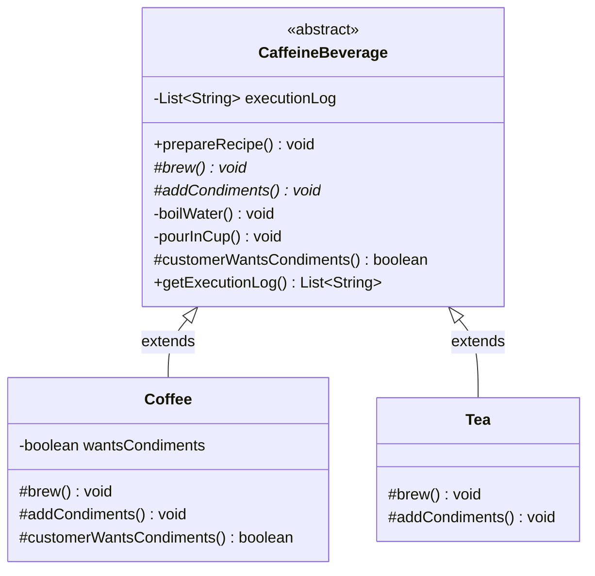

# Example 01: Beverage Preparation Template Method

## 1. Problem Statement
In a cafeteria or beverage-dispensing system, hot caffeinated beverages (like Coffee and Tea) follow a shared 4-step preparation recipe:
1. Boil fresh water.
2. Brew the drink (drip coffee grounds vs steep tea leaves).
3. Pour the hot drink into a ceramic cup.
4. Add condiments (milk & sugar vs lemon).

Without the Template Method pattern:
- `Coffee` and `Tea` classes each implement `boilWater()`, `pourInCup()`, and the sequencing independently.
- Shared logic (water boiling temperature, cup handling) is duplicated across classes.
- A change to water safety standards (e.g. heating to 100°C for 30 seconds) requires updating every beverage class.
- Subclasses can mistakenly omit steps or reorder them (e.g. pouring condiments into an empty cup before brewing).

## 2. Bad Design vs Good Design

### Bad Design (Duplicated Recipe Algorithms)
```java
public class BadCoffee {
    public void prepareRecipe() {
        boilWater();
        brewCoffeeGrinds();
        pourInCup();
        addSugarAndMilk();
    }
}

public class BadTea {
    public void prepareRecipe() {
        boilWater();
        steepTeaBag();
        pourInCup();
        addLemon();
    }
}
```
**Weaknesses:**
1. **DRY Violation:** Boilerplate methods (`boilWater`, `pourInCup`) are duplicated verbatim.
2. **Brittle Evolution:** Modifying the high-level recipe requires changes to all beverage implementations.
3. **No Hook Mechanism:** Cannot easily accommodate customer preferences (such as black coffee without condiments).

### Good Design (Template Method Pattern)
```java
public abstract class CaffeineBeverage {
    // The Template Method: Final to lock the recipe sequence
    public final void prepareRecipe() {
        boilWater();
        brew();
        pourInCup();
        if (customerWantsCondiments()) {
            addCondiments();
        }
    }

    private void boilWater() { ... }
    protected abstract void brew();
    private void pourInCup() { ... }
    protected abstract void addCondiments();

    // Hook method with default implementation
    protected boolean customerWantsCondiments() {
        return true;
    }
}
```
**Benefits:**
1. **DRY & Centralized:** Invariant steps (`boilWater`, `pourInCup`) exist in exactly one location.
2. **Guaranteed Execution Order:** Marked `final`, so subclasses cannot change the sequence.
3. **Flexible via Hooks:** Subclasses can selectively toggle condiment addition by overriding `customerWantsCondiments()`.

## 3. Class Diagram


## 4. Execution Flow
```text
[Client] ---> Coffee.prepareRecipe()
                │
                ├──► 1. CaffeineBeverage.boilWater() [Private Invariant]
                ├──► 2. Coffee.brew()               [Abstract Primitive]
                ├──► 3. CaffeineBeverage.pourInCup() [Private Invariant]
                └──► 4. Coffee.customerWantsCondiments() [Hook]
                          └─ (If true) Coffee.addCondiments()
```

## 5. SOLID Principles Genuine Demonstration
- **Open/Closed Principle (OCP):** New beverages (e.g., `MatchaLatte`, `HotChocolate`) can be added without modifying `CaffeineBeverage` or existing beverage subclasses.
- **Single Responsibility Principle (SRP):** `CaffeineBeverage` controls the algorithm's lifecycle and invariant utilities; `Coffee` and `Tea` focus strictly on their ingredient-specific brewing and condiment logic.
- **Liskov Substitution Principle (LSP):** Any `CaffeineBeverage` subclass can be served polymorphically through the base type without breaking recipe contracts.
