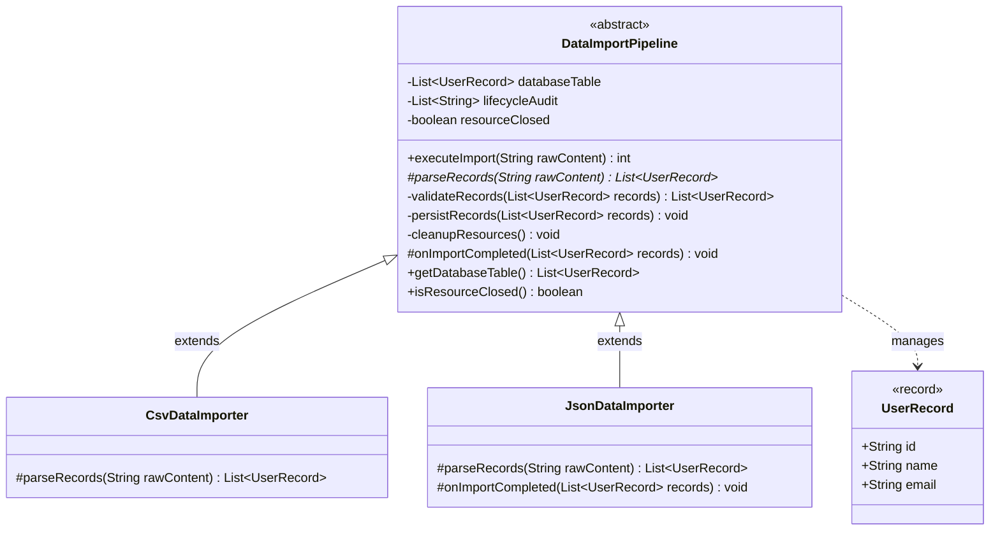

# Example 02: Data Import Pipeline Template Method

## 1. Problem Statement
Enterprise applications often ingest data from heterogeneous sources (CSV files, JSON payloads, XML feeds) into a relational database.

Regardless of the input data format, every ingestion pipeline must execute the exact same critical stages:
1. **Parse**: Extract raw format syntax into domain objects (`UserRecord`).
2. **Validate**: Enforce business invariants (e.g. non-null ID, valid RFC email format).
3. **Persist**: Batch insert valid records into the database.
4. **Hook (Post-Process)**: Notify external caches or search clusters of newly ingested data.
5. **Cleanup**: Guarantee that open file/stream handles are closed, even if parsing throws an exception.

Without a template method:
- Importers duplicate validation regexes, SQL persistence loops, and stream cleanup.
- A new developer writing an `XmlImporter` might forget validation or omit the `finally` cleanup block, leading to resource leaks and dirty database records.

## 2. Bad Design vs Good Design

### Bad Design (Duplicated Pipeline Logic)
```java
public class BadCsvDataImporter {
    public int importData(String raw) {
        // CSV parsing...
        // Duplicated email validation loop...
        // Duplicated DB insert loop...
        // Stream close...
    }
}

public class BadJsonDataImporter {
    public int importData(String raw) {
        // JSON parsing...
        // DUPLICATED email validation loop...
        // DUPLICATED DB insert loop...
        // Stream close...
    }
}
```
**Weaknesses:**
1. **Validation Drift:** If validation rules change (e.g. require mobile phone numbers), developers must update every importer class.
2. **Resource Leaks:** Omitting a `try/finally` block leaves file handles or connections hanging.
3. **Inconsistent Hooks:** Post-import indexing or cache invalidation is haphazardly applied.

### Good Design (Template Method Pattern)
```java
public abstract class DataImportPipeline {
    public final int executeImport(String rawContent) {
        try {
            List<UserRecord> records = parseRecords(rawContent); // Primitive
            List<UserRecord> valid = validateRecords(records);    // Invariant
            persistRecords(valid);                                // Invariant
            onImportCompleted(valid);                             // Hook
            return valid.size();
        } finally {
            cleanupResources();                                   // Invariant cleanup
        }
    }

    protected abstract List<UserRecord> parseRecords(String raw);
    private List<UserRecord> validateRecords(...) { ... }
    private void persistRecords(...) { ... }
    protected void onImportCompleted(List<UserRecord> records) { }
    private void cleanupResources() { ... }
}
```
**Benefits:**
1. **Bulletproof Resource Safety:** The `finally { cleanupResources(); }` block guarantees file closure across all subclasses.
2. **Single Source of Truth:** Validation rules and persistence transactions are centralized.
3. **Format Focus:** Subclasses implement only `parseRecords(...)`.

## 3. Class Diagram


## 4. Execution Flow
```text
[Client] ---> CsvDataImporter.executeImport(csvPayload)
                │
                ├──► 1. CsvDataImporter.parseRecords(...)      [Abstract Primitive]
                ├──► 2. DataImportPipeline.validateRecords(...) [Private Invariant]
                ├──► 3. DataImportPipeline.persistRecords(...)  [Private Invariant]
                ├──► 4. JsonDataImporter.onImportCompleted(...) [Optional Hook]
                └──► 5. DataImportPipeline.cleanupResources()   [Guaranteed Finally]
```

## 5. SOLID Principles Genuine Demonstration
- **Open/Closed Principle (OCP):** Subclasses can introduce support for Protobuf, XML, or Parquet without touching the validation, persistence, or cleanup lifecycle logic.
- **Single Responsibility Principle (SRP):** `DataImportPipeline` owns the workflow governance and data integrity guarantees; concrete subclasses own syntax-specific parsing.
- **Liskov Substitution Principle (LSP):** Clients invoke `DataImportPipeline.executeImport()` polymorphically without needing to know whether the backing source is CSV or JSON.
