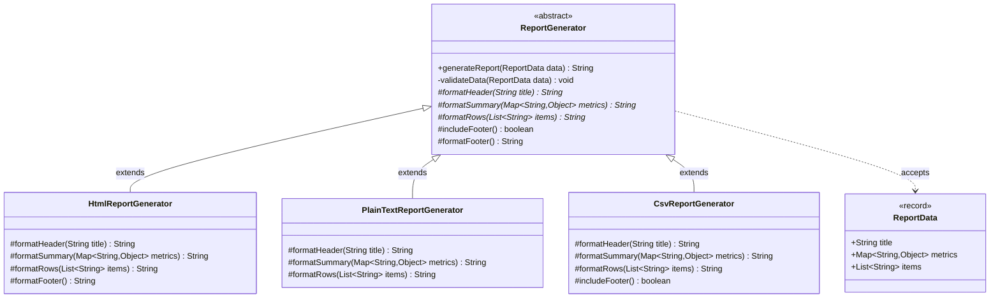

# Example 03: Report Generation Pipeline Template Method

## 1. Problem Statement
Business software must export operational data (KPIs, summaries, rows) into multiple output formats:
- Rich Web HTML reports
- Monospaced ASCII text reports
- Machine-parsable CSV exports

All report generation follows the exact same logical document structure:
1. Validate input data (non-null check, title validation).
2. Generate the document header.
3. Render the summary metric highlights.
4. Render the detail rows.
5. Render a timestamped audit footer (except for CSV exports, where freeform footer text breaks parsers).

Without a template method:
- Subclasses duplicate input validation and metric iteration logic.
- Adding a mandatory security classification header requires updating every report exporter.
- Formatters risk omitting validation, resulting in runtime `NullPointerException`s when handling empty datasets.

## 2. Bad Design vs Good Design

### Bad Design (Independent Duplicated Exporters)
```java
public class BadHtmlReportGenerator {
    public String generateReport(ReportData data) {
        if (data == null || data.title().isBlank()) throw new IllegalArgumentException();
        // HTML header formatting...
        // HTML summary formatting...
        // HTML rows formatting...
        // Footer timestamp...
    }
}

public class BadTextReportGenerator {
    public String generateReport(ReportData data) {
        if (data == null || data.title().isBlank()) throw new IllegalArgumentException(); // DUPLICATED
        // Text header formatting...
        // Text summary formatting...
        // Text rows formatting...
        // Footer timestamp... // DUPLICATED
    }
}
```
**Weaknesses:**
1. **Validation Inconsistency:** One developer might forget to check for empty titles or null collections.
2. **Duplicated Formatting Helpers:** Date and timestamp formatting code is copied across classes.
3. **No Hook Mechanism:** CSV generators have no clean way to opt-out of footers without duplicating the entire algorithm.

### Good Design (Template Method Pattern)
```java
public abstract class ReportGenerator {
    public final String generateReport(ReportData data) {
        validateData(data); // Invariant
        StringBuilder sb = new StringBuilder();
        sb.append(formatHeader(data.title()));     // Primitive
        sb.append(formatSummary(data.metrics()));   // Primitive
        sb.append(formatRows(data.items()));        // Primitive
        if (includeFooter()) {                      // Hook
            sb.append(formatFooter());              // Default or Overridden
        }
        return sb.toString();
    }

    protected abstract String formatHeader(String title);
    protected abstract String formatSummary(Map<String, Object> metrics);
    protected abstract String formatRows(List<String> items);

    protected boolean includeFooter() { return true; } // Hook
    protected String formatFooter() { return "Generated on " + LocalDate.now(); }
}
```
**Benefits:**
1. **Guaranteed Structure:** `generateReport` is `final`, ensuring all formats adhere to company standards.
2. **Selective Hook Customization:** `CsvReportGenerator` overrides `includeFooter() -> false` without modifying the overarching document flow.
3. **Centralized Data Governance:** Input validation occurs strictly once in the parent class.

## 3. Class Diagram


## 4. Execution Flow
```text
[Client] ---> CsvReportGenerator.generateReport(data)
                │
                ├──► 1. ReportGenerator.validateData(data)        [Private Invariant]
                ├──► 2. CsvReportGenerator.formatHeader(title)    [Abstract Primitive]
                ├──► 3. CsvReportGenerator.formatSummary(metrics) [Abstract Primitive]
                ├──► 4. CsvReportGenerator.formatRows(items)      [Abstract Primitive]
                └──► 5. CsvReportGenerator.includeFooter()        [Hook: Returns false]
                          └─ (Footer omitted to preserve valid CSV syntax)
```

## 5. SOLID Principles Genuine Demonstration
- **Open/Closed Principle (OCP):** New report formats (e.g. `MarkdownReportGenerator`, `JsonReportGenerator`) can be added without modifying `ReportGenerator` or breaking existing formats.
- **Single Responsibility Principle (SRP):** `ReportGenerator` ensures document assembly and data validity; subclasses focus exclusively on syntax-specific tag formatting.
- **Liskov Substitution Principle (LSP):** Any concrete report generator can be used interchangeably by the reporting service.
