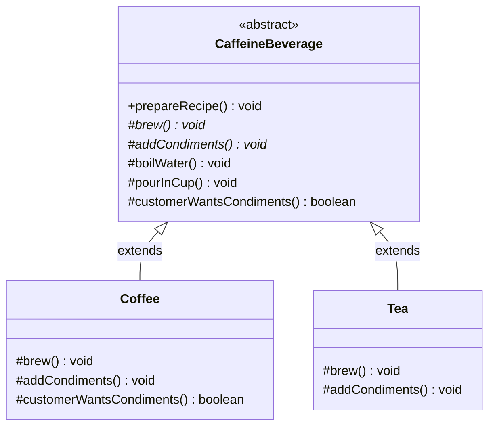
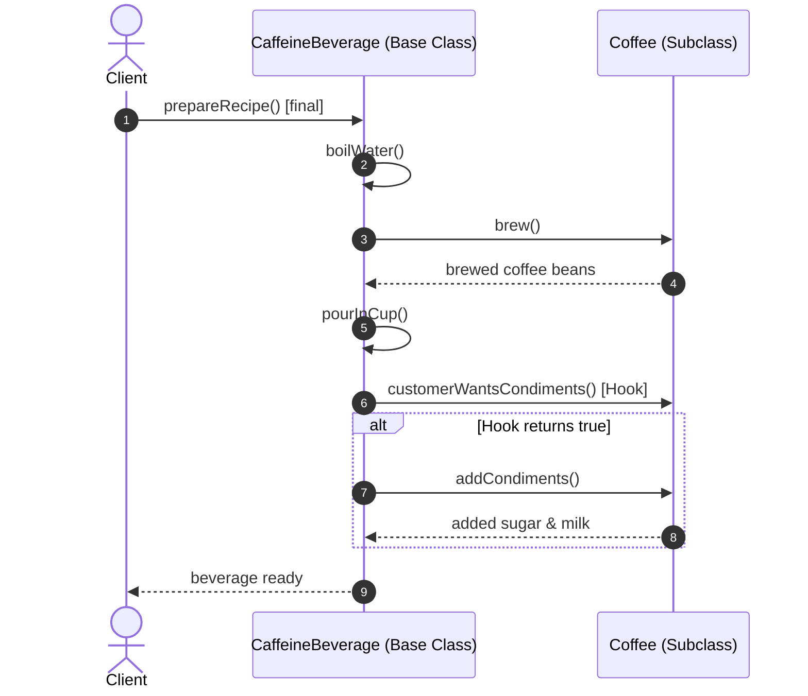

# Template Method Design Pattern: Comprehensive Guide & Engineering Handbook

## 1. What the Pattern Is and Why It Exists

The **Template Method Pattern** is a behavioral design pattern that defines the skeleton of an algorithm in a superclass method, deferring some specific steps to subclasses without altering the overall algorithm's structure.

In software design, you frequently encounter algorithms that share an identical high-level workflow, but differ in the granular details of individual steps. For example:
- Building an automated CI/CD pipeline: `checkoutCode() -> compile() -> runTests() -> packageArtifact() -> deploy() -> notify()`. A Java project compiles with `mvn`, while a Node.js project compiles with `npm build`.
- Preparing hot caffeinated beverages: `boilWater() -> brew() -> pourInCup() -> addCondiments()`. Coffee and tea share boiling and pouring, but differ in brewing and condiments.
- Data ingestion pipelines: `openSource() -> readRecords() -> parse() -> validate() -> persist() -> close()`. CSV, JSON, and XML share validation and database persistence, but differ in reading and parsing.

Without the Template Method pattern, developers typically:
1. Copy and paste the entire algorithm into every subclass, duplicating the workflow sequence and boilerplate steps.
2. Risk workflow drift: one developer forgets the `validate()` step, another fails to `close()` database resources.

The **Template Method pattern** locks down the invariant invariant workflow in a `final` template method in the abstract base class, while delegating the variant steps (primitive operations or hooks) to concrete subclasses.

---

## 2. Real-World Analogy

Consider building a prefabricated house:
- An architectural firm creates a standard master construction plan:
  1. `layFoundation()` (Concrete slab — identical for all houses)
  2. `buildWalls()` (Customizable: wood framing, brick, or glass)
  3. `installRoof()` (Customizable: shingles, slate, or metal)
  4. `installPlumbingAndElectricity()` (Standard building code)
  5. `paintAndDecorate()` (Custom colors and finishes)

The construction company enforces the exact sequence: you cannot install the roof before laying the foundation! The homeowner chooses the materials for the walls and the roof (the variant steps), but the sequence and core engineering steps remain rigidly enforced by the master builder.

```
[ Master Construction Template (Base Class) ]
       │ 1. Lay Foundation (Fixed)
       │ 2. Build Walls (Subclass decides: Wood vs Brick)
       │ 3. Install Roof (Subclass decides: Metal vs Shingles)
       │ 4. Install Utilities (Fixed)
       ▼ 5. Paint & Furnish (Hook)
```

---

## 3. The Problem Without the Pattern

Suppose we are preparing hot beverages (`Coffee` and `Tea`).

Without the pattern, each class implements the complete preparation algorithm independently:

```java
public class Coffee {
    public void prepareRecipe() {
        boilWater();
        brewCoffeeGrinds();
        pourInCup();
        addSugarAndMilk();
    }
    // boiling and pouring logic duplicated...
}

public class Tea {
    public void prepareRecipe() {
        boilWater();
        steepTeaBag();
        pourInCup();
        addLemon();
    }
    // boiling and pouring logic duplicated...
}
```

### Consequences:
1. **Code Duplication**: `boilWater()` and `pourInCup()` are identical across all beverage classes.
2. **Algorithm Inconsistency**: If sanitation guidelines require `filterWater()` before boiling, you must locate and edit 15 different beverage classes.
3. **No Invariant Enforcement**: Subclasses can accidentally reorder steps (e.g. adding condiments before pouring into the cup).

---

## 4. How the Pattern Works Step by Step

1. **Abstract Base Class**:
   - Declares the **Template Method** (usually marked `final` in Java so subclasses cannot override the execution order).
   - Contains concrete implementations of shared/invariant steps (`boilWater()`, `pourInCup()`).
   - Declares **abstract primitive operations** that subclasses *must* implement (`brew()`, `addCondiments()`).
   - Optionally declares **hooks**—methods with default (often empty) implementations that subclasses *may* optionally override (`customerWantsCondiments()`).
2. **Concrete Subclasses**:
   - Implement the abstract primitive steps.
   - Override hook methods to customize optional behavior.
   - Do **not** touch or override the template method itself.
3. **The Hollywood Principle**:
   - *"Don't call us, we'll call you."*
   - High-level base classes call low-level subclass operations, not the other way around.

---

## 5. Class Diagram and Sequence Diagram

### Class Diagram



**Explanation of Class Diagram:**
`CaffeineBeverage` contains the template method `prepareRecipe()`. Concrete steps `boilWater()` and `pourInCup()` are defined directly in the base class. `brew()` and `addCondiments()` are abstract methods implemented differently by `Coffee` and `Tea`.

### Sequence Diagram



**Explanation of Sequence Diagram:**
The client calls `prepareRecipe()` on the base class. The base class controls the entire lifecycle, calling back into the subclass (`Coffee`) only when specific variant steps (`brew`, `addCondiments`) need execution.

---

## 6. Each Participant's Responsibility

| Participant | Responsibility |
|---|---|
| **AbstractClass** | Defines the template method specifying the invariant skeleton of the algorithm. Implements shared steps and declares abstract steps and hooks. |
| **ConcreteClass** | Implements the primitive operations and optionally overrides hooks to supply subclass-specific behavior without changing the overall sequence. |
| **Client** | Invokes the template method on an instance of ConcreteClass (polymorphically via AbstractClass). |

---

## 7. Abstract Methods vs Concrete Methods vs Hooks

A well-crafted Template Method pattern utilizes three types of methods:

1. **Abstract Methods (Mandatory Steps)**:
   - Declared as `abstract void step()`.
   - Must be implemented by every concrete subclass.
   - Used when every variant must supply its own unique logic.
2. **Concrete Methods (Invariant Steps)**:
   - Implemented in the base class (often `private` or `protected final`).
   - Shared verbatim across all subclasses. Cannot be modified.
3. **Hook Methods (Optional Steps / Feature Toggles)**:
   - Implemented in the base class with a default body (e.g. `protected boolean hook() { return true; }` or empty `{}`).
   - Subclasses can choose to override them if they want to hook into the algorithm, or ignore them completely.

---

## 8. Bad vs Good Design Comparison

| Dimension | Bad Design (Duplicated Algorithms) | Good Design (Template Method) |
|---|---|---|
| **DRY Principle** | Invariant boilerplate copied across every class. | Invariant code written exactly once in the base class. |
| **Workflow Integrity** | Callers or subclasses can miss steps or alter execution order. | Sequence is locked down using `final` template method. |
| **Maintainability** | Adding a step requires editing N classes. | Adding a step requires editing 1 base class method. |
| **Extensibility** | New classes must re-invent and re-test the entire flow. | New classes implement only 1 or 2 small primitive methods. |

---

## 9. SOLID Principles Genuinely Demonstrated

- **Open/Closed Principle (OCP):**
  The algorithm's structure is closed for modification (locked in the base class template method), but open for extension by deriving new subclasses that implement primitive steps.
- **Single Responsibility Principle (SRP):**
  The base class handles algorithm workflow orchestration and shared utilities; the concrete subclasses handle domain-specific step details.
- **Liskov Substitution Principle (LSP):**
  Subclasses can be substituted anywhere the base class is expected because they never change the algorithm contract, only the internal primitive operations.

---

## 10. When to Use It and When NOT to Use It

### When to Use
- When multiple classes share an identical multi-step workflow with only small differences in individual steps.
- When you want to control the exact sequence of an algorithm centrally and prevent subclasses from changing the order.
- In frameworks and libraries where clients supply plugin logic at predefined lifecycle points (e.g. JUnit test lifecycles, Servlet lifecycle: `service() -> doGet()/doPost()`).

### When NOT to Use
- **When the steps are entirely different**: If algorithms share no common structure or sequence, forcing an inheritance hierarchy produces bloated, awkward base classes. Use **Strategy** instead.
- **When you need runtime algorithm swapping**: Template Method relies on compile-time class inheritance. If you need to switch algorithms dynamically at runtime on the same object, use **Strategy**.

---

## 11. Benefits, Limitations, and Trade-Offs

### Benefits
- **Maximum Code Reuse**: Eliminates duplicate boilerplate.
- **Enforced Governance**: Invariant architectural rules (logging, auditing, transaction commits, cleanup) cannot be bypassed by junior developers.
- **Inversion of Control**: The base class controls the flow (Hollywood Principle).

### Trade-Offs & Limitations
- **Inheritance Rigidity**: Bound by Java's single class inheritance limitation. A class extending an abstract template base cannot inherit from another class.
- **Liskov Substitution Hazards**: If a subclass tries to disable a mandatory base step by throwing `UnsupportedOperationException`, it violates LSP.
- **Maintenance Complexity**: As more hooks and optional steps are added over years, abstract base classes can become fragile "God Classes".

---

## 12. How to Recognize Incorrect Use

1. **Overriding the Template Method**: If a subclass overrides `prepareRecipe()` itself, the entire purpose of the pattern is defeated. In Java, always declare the template method `public final`.
2. **Too Many Abstract Methods**: If a base class has 20 abstract methods that every subclass must implement, subclassing becomes a chore. Use hooks with reasonable defaults instead.
3. **Forcing Unrelated Classes into One Base**: Trying to force `Coffee` and `CarManufacture` into one `ProcessTemplate` because they both have a "start" and "finish".

---

## 13. Differences from Similar Patterns

| Pattern | Mechanism | Decision Point |
|---|---|---|
| **Template Method** | **Inheritance** (compile-time subclassing). Defines the algorithm skeleton in a base class. | Subclasses fill in the blanks of an invariant workflow. |
| **Strategy** | **Composition** (runtime delegation via interfaces). Encapsulates entire interchangeable algorithms. | Client selects and swaps the whole algorithm at runtime. |
| **Factory Method** | Specialized specialization of Template Method where the deferred step is object creation. | Subclasses decide which class to instantiate. |

---

## 14. Common Interview Questions and Answers

### Q1: What is the "Hollywood Principle" and how does it relate to Template Method?
**Answer:** The Hollywood Principle states: *"Don't call us, we'll call you."* In traditional programming, subclass code calls parent/library code directly. In the Template Method pattern, the flow of control is inverted: the parent class template method calls the child class methods when needed. The child never calls the parent's primitive operations directly.

### Q2: Why should the template method be declared `final` in Java?
**Answer:** Making the template method `final` prevents subclasses from overriding the algorithm's skeleton and altering the required execution sequence. It guarantees that invariant steps (like security checks, transaction commits, and resource closures) cannot be skipped or reordered.

### Q3: How do you choose between Template Method and Strategy?
**Answer:** 
- Choose **Template Method** when you have a fixed, invariant workflow with a few variable steps, and compile-time inheritance is acceptable.
- Choose **Strategy** when you want to change the whole algorithm at runtime, when you want to avoid class inheritance, or when different strategies do not share a common workflow sequence.

---

## 15. Concise Revision Checklist

- [ ] Template method is declared `public final` in the abstract base class.
- [ ] Invariant steps are implemented as concrete methods in the base class.
- [ ] Variant steps are declared as `protected abstract` methods.
- [ ] Optional customization points are implemented as `protected` hook methods with default implementations.
- [ ] Concrete subclasses implement only the abstract/hook methods.
- [ ] Subclasses do NOT call or override the template method.
- [ ] Algorithm sequence is guaranteed and cannot be broken by callers.
