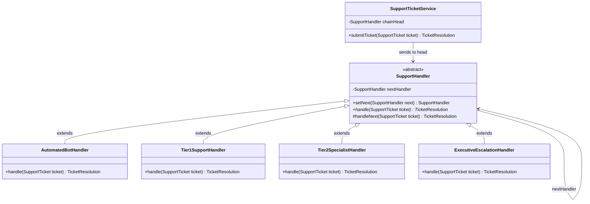

# Example 01: Customer Support Ticket Routing

## 1. Problem Statement
In an enterprise customer support platform, incoming tickets arrive with varying severity levels:
- `LOW`: Simple FAQs, password reset requests (handled by Automated Bot).
- `MEDIUM`: General account management, billing inquiries (handled by Tier 1 Support Agent).
- `HIGH`: Software bugs, database latency, deep technical issues (handled by Tier 2 Specialist).
- `CRITICAL`: Complete service outages, security breaches (escalated to Executive Command).

Without the Chain of Responsibility pattern:
- A central monolithic router checks ticket severity using a giant `switch` or `if/else` block.
- Adding a new tier (e.g. `SecurityOfficerHandler`) requires modifying the central routing class.
- The router is tightly coupled to every single department's resolution details.
- Chains cannot be dynamically reordered (e.g. bypassing Tier 1 during off-peak hours).

## 2. Bad Design vs Good Design

### Bad Design (Monolithic Dispatcher Switch)
```java
public class BadTicketRouter {
    public String routeTicket(SupportTicket ticket) {
        if (ticket.priority() == Priority.LOW) {
            return "Resolved by AutomatedBot: FAQ sent.";
        } else if (ticket.priority() == Priority.MEDIUM) {
            return "Resolved by Tier1Support: Account updated.";
        } else if (ticket.priority() == Priority.HIGH) {
            return "Resolved by Tier2Specialist: Diagnostics run.";
        } else if (ticket.priority() == Priority.CRITICAL) {
            return "Resolved by Executive: War room started.";
        }
        return "UNHANDLED";
    }
}
```
**Weaknesses:**
1. **OCP Violation:** Adding an `EnterpriseKeyAccountHandler` requires editing `BadTicketRouter`.
2. **Coupling:** The router knows the operational rules and responses of all support departments.
3. **Static Topology:** Hierarchy is hardcoded at compile time.

### Good Design (Chain of Responsibility)
```java
public abstract class SupportHandler {
    private SupportHandler nextHandler;

    public SupportHandler setNext(SupportHandler next) {
        this.nextHandler = next;
        return next;
    }

    public abstract TicketResolution handle(SupportTicket ticket);

    protected TicketResolution handleNext(SupportTicket ticket) {
        if (nextHandler != null) return nextHandler.handle(ticket);
        return TicketResolution.unhandled(ticket.ticketId());
    }
}
```
**Benefits:**
1. **Single Responsibility:** Each handler focuses solely on its own tier.
2. **Dynamic Assembly:** Handlers can be linked in any order at runtime: `bot.setNext(tier1).setNext(tier2).setNext(exec)`.
3. **Decoupled Sender:** `SupportTicketService` passes the ticket to the head of the chain; it is completely unaware of which tier will ultimately resolve it.

## 3. Class Diagram


## 4. Execution Flow
```text
[Client] ---> SupportTicketService.submitTicket(Ticket: HIGH)
                │
                ▼ calls handle(ticket)
        [AutomatedBotHandler]
                │ Priority != LOW; calls handleNext()
                ▼
        [Tier1SupportHandler]
                │ Priority != MEDIUM; calls handleNext()
                ▼
        [Tier2SpecialistHandler]
                │ Priority == HIGH! Matches!
                │ Fulfills request & returns TicketResolution(SUCCESS)
                ▼
[Client] receives TicketResolution from Tier 2 Specialist
```

## 5. SOLID Principles Genuine Demonstration
- **Single Responsibility Principle (SRP):** Each concrete handler has exactly one reason to change: modifications to its own departmental resolution procedures.
- **Open/Closed Principle (OCP):** New support tiers can be introduced without modifying existing handler classes or the ticket service.
- **Dependency Inversion Principle (DIP):** Senders and handlers depend strictly on the abstract `SupportHandler` class.
