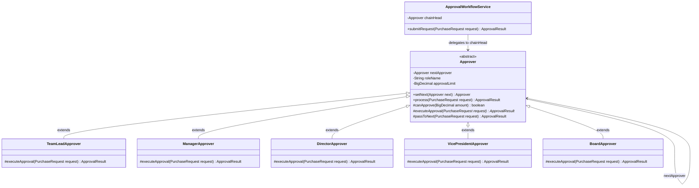

# Example 02: Corporate Purchase Approval Workflow

## 1. Problem Statement
In corporate finance, purchase requests and capital expenditures require managerial sign-off based on strict delegation of fiscal authority:
- Team Lead: up to $1,000
- Department Manager: up to $10,000
- Director: up to $50,000
- Vice President: up to $100,000
- Board of Directors: above $100,000

When implemented naively:
- A single manager class contains hardcoded `if-else` blocks checking dollar amounts.
- Adjusting spending limits or adding new intermediate roles (e.g. Senior Director up to $75,000) requires editing and recompiling core business workflows.
- Senders must know specific authority limits.
- Bypassing unavailable managers or delegating authority dynamically is impossible.

## 2. Bad Design vs Good Design

### Bad Design (Monolithic If/Else Ladder)
```java
public class BadApprovalManager {
    public String approve(PurchaseRequest request) {
        BigDecimal amt = request.amount();
        if (amt.compareTo(BigDecimal.valueOf(1000)) <= 0) {
            return "Approved by Team Lead";
        } else if (amt.compareTo(BigDecimal.valueOf(10000)) <= 0) {
            return "Approved by Manager";
        } else if (amt.compareTo(BigDecimal.valueOf(50000)) <= 0) {
            return "Approved by Director";
        } ...
    }
}
```
**Weaknesses:**
1. **OCP Violation:** Adding or re-ordering managerial approval levels requires modifying `BadApprovalManager`.
2. **Hardcoded Thresholds:** Spending limits are baked into code literals rather than configurable per handler.
3. **Monolithic Testing:** Every approval tier must be verified inside a single unit test class.

### Good Design (Chain of Responsibility Pattern)
```java
public abstract class Approver {
    private Approver nextApprover;
    private final String roleName;
    private final BigDecimal approvalLimit;

    public ApprovalResult process(PurchaseRequest request) {
        if (canApprove(request.amount())) {
            return executeApproval(request);
        }
        return passToNext(request);
    }
}
```
**Benefits:**
1. **Open/Closed Principle:** New approval roles (e.g., `CFOApprover`) can be created without changing existing approvers.
2. **Configurable Thresholds:** Spending limits are parameters passed to individual approver instances.
3. **Dynamic Topology:** The chain can be assembled per department or adjusted at runtime (e.g. linking `lead.setNext(manager).setNext(director)`).

## 3. Class Diagram


## 4. Execution Flow
```text
[Employee / Service]
       │
       ▼ submitRequest(Purchase: $35,000)
[TeamLeadApprover] ($1,000 limit)
       │ $35,000 > $1,000 -> passToNext()
       ▼
[ManagerApprover] ($10,000 limit)
       │ $35,000 > $10,000 -> passToNext()
       ▼
[DirectorApprover] ($50,000 limit)
       │ $35,000 <= $50,000 -> Approved!
       ▼
[Employee / Service] receives ApprovalResult(APPROVED by Director)
```

## 5. SOLID Principles Genuine Demonstration
- **Single Responsibility Principle (SRP):** Each approver class models one specific role's signing logic and limit boundaries.
- **Open/Closed Principle (OCP):** Introducing new tiers or policies requires creating a new `Approver` subclass, leaving existing approvers untouched.
- **Dependency Inversion Principle (DIP):** Senders and handlers depend strictly on the abstract `Approver` contract.
