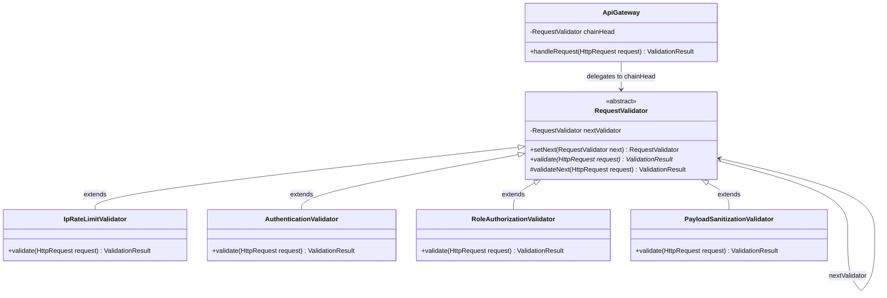

# Example 03: API Gateway Request Validation Pipeline

## 1. Problem Statement
Modern microservice API gateways must inspect every inbound HTTP request through a sequence of security and policy filters:
1. **IP Rate Limiting**: Guard against DDoS attacks and brute force loops (HTTP 429).
2. **Authentication**: Verify cryptographic Bearer JWT tokens (HTTP 401).
3. **Role Authorization**: Verify that the caller possesses required privileges for `/admin` or `/internal` routes (HTTP 403).
4. **Payload Sanitization**: Detect SQL injection fragments or cross-site scripting (`<script>`) vectors (HTTP 400).

Unlike Examples 1 and 2 (where the first matching handler finishes the request), a **Filter Validation Chain** is an **All-Must-Pass** pipeline:
- Every handler evaluates its concern.
- If valid, it forwards to the next filter.
- If invalid, it immediately **short-circuits** the pipeline and returns an HTTP error code.

Without the Chain of Responsibility pattern:
- All four security checks are hardcoded into one monolithic gateway class.
- Reusing filters across different routes (e.g. public endpoints that need rate limiting and sanitization, but no auth) requires messy boolean flag parameters.
- Adding a new filter (e.g. CORS or CSRF token validation) breaks the monolithic class.

## 2. Bad Design vs Good Design

### Bad Design (Monolithic Validator)
```java
public class BadApiGatewayValidator {
    public boolean validateRequest(HttpRequest req) {
        // Inlined Rate Limiting logic...
        // Inlined Bearer Token regex and signature check...
        // Inlined Role authorization conditionals...
        // Inlined SQL/XSS regex checks...
    }
}
```
**Weaknesses:**
1. **SRP Violation:** Rate limits, cryptography, role tables, and attack vectors live in one file.
2. **Inflexible Routing:** Cannot assemble custom pipelines for `/public` vs `/admin` endpoints.
3. **Fragile Testing:** Unit tests must provide valid tokens and IPs even when testing XSS sanitization.

### Good Design (Chain of Responsibility Filter Pipeline)
```java
public abstract class RequestValidator {
    private RequestValidator nextValidator;

    public RequestValidator setNext(RequestValidator next) {
        this.nextValidator = next;
        return next;
    }

    public abstract ValidationResult validate(HttpRequest request);

    protected ValidationResult validateNext(HttpRequest request) {
        if (nextValidator != null) {
            return nextValidator.validate(request);
        }
        return ValidationResult.pass(); // End of pipeline: All checks passed!
    }
}
```
**Benefits:**
1. **Composable Middleware:** Assemble pipelines per endpoint:
   - Private API: `rateLimiter.setNext(auth).setNext(roleAuth).setNext(sanitizer)`
   - Public API: `rateLimiter.setNext(sanitizer)`
2. **Clean Short-Circuiting:** Any failing validator terminates execution immediately without wasting CPU cycles on downstream checks.
3. **Isolated Testing:** Each validator has its own targeted unit tests.

## 3. Class Diagram


## 4. Execution Flow
```text
[HTTP Client]
       │
       ▼ Inbound Request (/admin/users)
[IpRateLimitValidator]
       │ IP count < Limit -> validateNext()
       ▼
[AuthenticationValidator]
       │ Valid Bearer Token -> validateNext()
       ▼
[RoleAuthorizationValidator]
       │ User Role is "ADMIN" -> validateNext()
       ▼
[PayloadSanitizationValidator]
       │ Payload free of <script> / SQL tokens -> validateNext()
       ▼
Pipeline Completed: ValidationResult(200 OK)
```

## 5. SOLID Principles Genuine Demonstration
- **Single Responsibility Principle (SRP):** `IpRateLimitValidator` manages IP counters; `AuthenticationValidator` checks token cryptographic signatures; `PayloadSanitizationValidator` inspects character encodings.
- **Open/Closed Principle (OCP):** Introducing new security filters (e.g. `CorsValidator`, `TlsCertificateValidator`) requires no modifications to existing filters.
- **Interface Segregation / Dependency Inversion:** The `ApiGateway` depends strictly on the `RequestValidator` abstraction.
