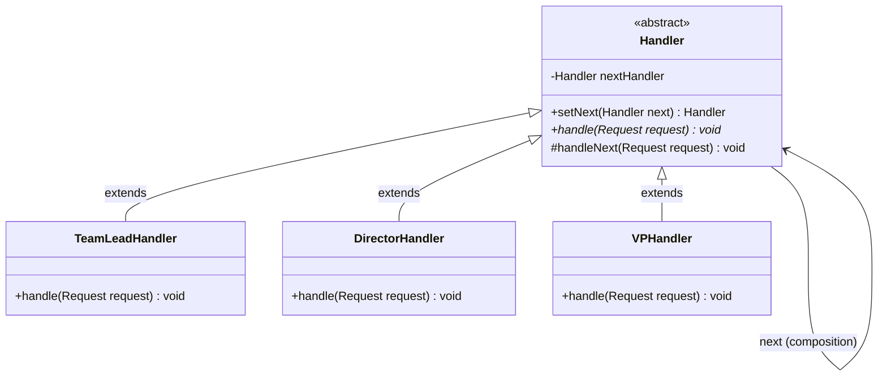

# Chain of Responsibility Design Pattern: Comprehensive Guide & Engineering Handbook

## 1. What the Pattern Is and Why It Exists

The **Chain of Responsibility Pattern** is a behavioral design pattern that passes requests along a chain of handlers. Upon receiving a request, each handler decides either to process the request or to pass it along the chain to the next handler.

In software engineering, requests often require evaluation by multiple potential processing entities:
- Customer support ticket routing: Basic questions answered by Tier-1 chatbot; billing questions escalated to Tier-2 specialist; system outages escalated to Tier-3 engineering lead.
- Corporate expense approval: An expense under $500 is approved by Team Lead; under $5,000 by Director; under $50,000 by VP; above $50,000 by CEO.
- Web request filters (Servlet Filters / Middleware): Request authentication -> rate limiting -> CORS validation -> request payload decryption -> controller execution.

Without this pattern, you end up with:
1. **Monolithic Decision Trees**: Giant `if-else` or `switch` blocks coupling the sender directly to every single possible handler.
2. **Rigid Reordering**: Changing the evaluation order or dynamically adding a new validation step requires rewriting and recompiling central dispatcher classes.
3. **Sender Coupling**: The sender must know which specific entity can handle the request.

The **Chain of Responsibility pattern** decouples senders from receivers by giving multiple objects a chance to handle the request.

---

## 2. Real-World Analogy

Imagine calling technical support for your home broadband:
1. **Automated Phone Bot (Tier 1)**: First listens to your query. If you forgot your password or need a router reboot instruction, it handles it immediately. If it's a technical line fault, it forwards your call.
2. **Help Desk Representative (Tier 2)**: Tests line signals and router diagnostics. If it is an active outage or physical fiber cut, they escalate.
3. **Field Network Engineer (Tier 3)**: Dispatches a repair crew to splice the severed fiber optic cable on your street.

You (the caller/client) only dialed one number. You did not know in advance which specific technician would resolve your issue. The request traveled through a chain of technicians until someone could handle it.

```
[ Customer (Sender) ]
         │ "Internet fiber severed"
         ▼
[ Tier 1: Auto Bot ] ────► (Cannot resolve) ────►
[ Tier 2: Help Desk ] ───► (Cannot resolve) ────►
[ Tier 3: Field Tech ] ──► [ RESOLVED: Dispatched Repair Truck ]
```

---

## 3. The Problem Without the Pattern

Consider an expense reimbursement system where approvals depend on monetary thresholds:

```java
public class BadExpenseApprover {
    public void approveExpense(Expense expense) {
        if (expense.getAmount() <= 500) {
            System.out.println("Team Lead approved $" + expense.getAmount());
        } else if (expense.getAmount() <= 5000) {
            System.out.println("Director approved $" + expense.getAmount());
        } else if (expense.getAmount() <= 50000) {
            System.out.println("Vice President approved $" + expense.getAmount());
        } else {
            System.out.println("CEO approved $" + expense.getAmount());
        }
    }
}
```

### Why This Is Flawed:
1. **Violates Open/Closed Principle (OCP)**: Adding a new approval tier (e.g. Senior Manager up to $2,000) requires editing this monolithic class.
2. **Hardcoded Hierarchy**: You cannot reconfigure the chain dynamically at runtime (e.g., skip VP if out on sabbatical).
3. **Violates Single Responsibility Principle (SRP)**: One class knows the business logic, thresholds, and limits of every managerial role in the company.

---

## 4. How the Pattern Works Step by Step

1. **Handler Interface / Abstract Class**:
   - Declares a method for handling requests: `handle(Request request)`.
   - Often maintains a reference to the `next` handler in the chain: `setNext(Handler next)`.
   - Provides a helper method to forward requests downstream: `handleNext(request)`.
2. **Concrete Handlers**:
   - Evaluate whether they can satisfy the request.
   - If yes: process the request (and optionally stop or continue).
   - If no: pass the request to `next.handle(request)`.
   - If end of chain is reached and unhandled: trigger fallback/default error.
3. **Client**:
   - Assembles the chain (or receives a pre-configured chain from a Factory or DI container).
   - Submits requests strictly to the **first handler** in the chain.

---

## 5. Class Diagram and Sequence Diagram

### Class Diagram



**Explanation of Class Diagram:**
`Handler` defines the contract and holds a reference to the `nextHandler`. Subclasses (`TeamLeadHandler`, `DirectorHandler`, `VPHandler`) extend `Handler` and link together sequentially to form a processing pipeline.

### Sequence Diagram

```mermaid
sequenceDiagram
    autonumber
    actor Client
    participant H1 as TeamLeadHandler ($500)
    participant H2 as DirectorHandler ($5,000)
    participant H3 as VPHandler ($50,000)

    Client->>H1: handle(Expense: $3,200)
    Note over H1: Amount $3,200 > $500<br/>Cannot handle; forward
    H1->>H2: handle(Expense: $3,200)
    Note over H2: Amount $3,200 <= $5,000<br/>Can handle!
    H2-->>Client: Approved by Director
```

**Explanation of Sequence Diagram:**
The client sends the expense to `TeamLeadHandler`. Because $3,200 exceeds the Team Lead's $500 authority, it forwards the request to `DirectorHandler`. The Director approves the expense and completes the request without bothering the VP.

---

## 6. Each Participant's Responsibility

| Participant | Responsibility |
|---|---|
| **Handler** | Defines the interface for handling requests and manages the successor link (`nextHandler`). |
| **ConcreteHandler** | Handles requests it is responsible for. If it cannot handle the request, it forwards it to the successor. |
| **Request** | Encapsulates the context, parameters, or data to be processed. |
| **Client** | Assembles the pipeline of handlers and sends requests to the first handler in the chain. |

---

## 7. Two Operational Styles: "Stop-at-First" vs "All-Must-Process"

The Chain of Responsibility manifests in two major styles across modern software:

### 1. Stop-at-First Handler (Disjunctive / Fallback Chain)
- The request travels until **one single handler** consumes and fulfills it.
- Examples: Support ticket routing, managerial approval tiers, exception handlers (`try-catch` blocks in JVM).

### 2. All-Must-Process Pipeline (Conjunctive / Filter Chain)
- Every handler inspects or mutates the request and passes it forward.
- If any handler fails (e.g. invalid auth token), it halts the chain immediately.
- Examples: Spring Security `FilterChain`, Express.js middleware, Servlet filters, request validation pipelines.

---

## 8. Bad vs Good Design Comparison

| Criteria | Bad Design (Monolithic If-Else) | Good Design (Chain of Responsibility) |
|---|---|---|
| **Coupling** | Client and dispatcher know all concrete handlers. | Client only knows the entry-point `Handler`. |
| **Extensibility (OCP)** | Adding a tier requires editing central dispatcher code. | Adding a tier requires writing one standalone class. |
| **Reconfigurability** | Fixed and hardcoded at compile time. | Chains can be dynamically reordered or altered at runtime. |
| **Unit Testability** | Must test every branch in one massive class. | Each handler is tested in total isolation. |

---

## 9. SOLID Principles Genuinely Demonstrated

- **Single Responsibility Principle (SRP):**
  Each concrete handler handles one specific responsibility (e.g. authenticating JWTs, checking rate limits, or approving sub-$500 expenses).
- **Open/Closed Principle (OCP):**
  New handlers can be introduced into the chain without breaking existing handlers or client code.
- **Dependency Inversion Principle (DIP):**
  Handlers and clients depend upon the abstract `Handler` contract, never upon concrete successor types.

---

## 10. When to Use It and When NOT to Use It

### When to Use
- More than one object may handle a request, and the handler isn't known *a priori*.
- You want to issue a request to one of several objects without specifying the receiver explicitly.
- The set of objects that can handle a request should be specified dynamically.
- You want to execute multiple checks in a specific order (e.g., authentication -> validation -> sanitization).

### When NOT to Use
- **When every request has a fixed, single known destination**: A direct method call or strategy pattern is simpler.
- **Performance-critical low-latency hot loops**: Traversing a chain of 50 objects adds stack frames and object allocations.
- **When requests can easily get dropped**: If a request reaching the end of the chain without a handler is catastrophic, you must add an explicit unhandled fallback handler.

---

## 11. Benefits, Limitations, and Trade-Offs

### Benefits
- **Reduced Coupling**: Senders and receivers have no explicit knowledge of each other.
- **Flexibility in Assigning Responsibilities**: Handlers can be added, removed, or re-ordered dynamically.
- **Composable Pipelines**: Handlers can be mixed and matched across different applications.

### Limitations & Trade-Offs
- **No Guarantee of Handling**: A request can fall off the end of the chain unhandled if no handler claims it.
- **Debugging Difficulty**: Tracing the path of a request through a long runtime chain can be tricky without proper logging.
- **Circular Reference Hazards**: If handler A points to B and B points to A, an infinite loop will trigger a `StackOverflowError`.

---

## 12. How to Recognize Incorrect Use

1. **Circular Links**: Handlers mistakenly pointing back to an earlier handler in the chain.
2. **Handlers Doing Unrelated Work**: A validation handler that also initiates database writes or credit card charges.
3. **Duplicated Passing Logic**: Forgetting to call `super.handleNext(request)` in custom handlers.

---

## 13. Differences from Similar Patterns

| Pattern | Primary Intent | Structural Difference |
|---|---|---|
| **Chain of Responsibility** | Passes a request sequentially along a dynamic chain of potential handlers until handled. | Handlers hold a reference to their successor (`next`). |
| **Command** | Encapsulates a request as a standalone object with parameters and execution logic. | Commands are executed by an Invoker, not linked in a succession chain. |
| **Decorator** | Dynamically wraps an object to add responsibilities to its interface. | Decorators wrap an object with the same interface to modify/augment return behavior, whereas CoR handlers can stop or bypass execution. |
| **Strategy** | Selects one interchangeable algorithm among several mutually exclusive options. | Exactly one Strategy is chosen upfront by the client; no chain is traversed. |

---

## 14. Common Interview Questions and Answers

### Q1: What happens if no handler in the chain can handle the request?
**Answer:** In a standard Chain of Responsibility, the request simply falls off the end of the chain. To prevent silent failures in production, best practice is to attach a **Terminal Fallback Handler** or default handler at the tail of the chain that logs a warning or throws an `UnhandledRequestException`.

### Q2: How is Chain of Responsibility used in the Java standard library and Spring?
**Answer:**
- **Java Servlet API**: `javax.servlet.FilterChain` and `Filter.doFilter(request, response, chain)`.
- **Spring Security**: `SecurityFilterChain` where requests pass through a chain of authentication, CSRF, and authorization filters.
- **Logging**: Java `Logger` instances forward log records up their parent logger hierarchy.

### Q3: Can a handler modify the request before passing it to the next handler?
**Answer:** Yes. In filter/middleware chains (such as HTTP request sanitization, decryption, or header enrichment), handlers routinely inspect, transform, or enrich the request object before calling `handleNext(request)`.

---

## 15. Concise Revision Checklist

- [ ] Base `Handler` declares `handle(Request)` and holds a `next` successor reference.
- [ ] Fluent `setNext(Handler next)` helper allows chaining: `h1.setNext(h2).setNext(h3)`.
- [ ] Each concrete handler checks its own condition: handles or forwards via `handleNext(request)`.
- [ ] Client interacts only with the head of the chain.
- [ ] A terminal fallback handler or unhandled exception strategy is in place.
- [ ] No circular handler references exist.
