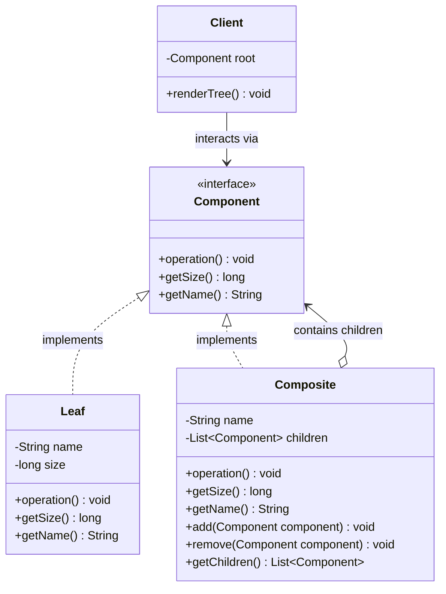
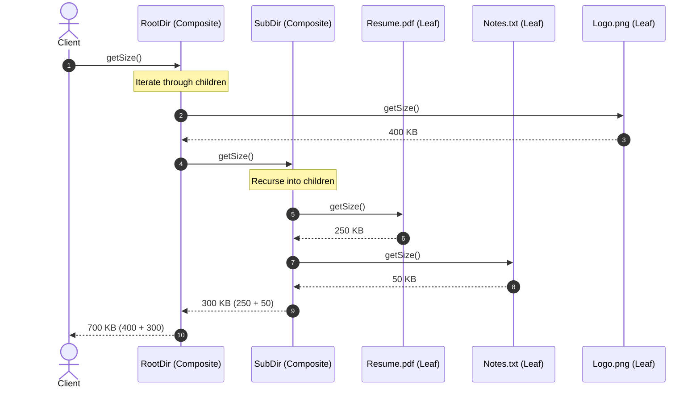

# Composite Design Pattern: Comprehensive Guide & Engineering Handbook

## 1. What the Pattern Is and Why It Exists

The **Composite Pattern** is a structural design pattern that allows you to compose objects into tree structures to represent part-whole hierarchies. It enables clients to treat individual objects (leaf nodes) and compositions of objects (composite nodes) uniformly through a common interface.

In software architectures, systems frequently deal with hierarchical structures:
- **File Systems**: A directory contains files as well as nested sub-directories. A client wanting to compute the total size of a folder shouldn't have to distinguish between a 5 MB file and a subfolder containing 20 files.
- **Corporate Organizational Structures**: An organization consists of individual contributors, managers, and departments. Calculating payroll or headcount involves rolling up figures from leaves (individual employees) and branches (departments containing employees and other departments).
- **GUI Component Hierarchies**: A window contains panels, buttons, and text fields. A panel can contain nested panels and buttons. Calling `paint()` or `resize()` on the root window recursively cascades through all containers and primitive widgets.
- **Restaurant Menus**: A menu contains individual food items and categorized sub-menus (e.g., "Desserts", "Beverages -> Cocktails"). Printing the menu or computing promotional discounts applies recursively to individual items and entire categories alike.

Without the Composite pattern, client code is plagued by nested loops, type checking (`instanceof`), and branching logic to distinguish single objects from collections of objects.

---

## 2. Real-World Analogy

Consider a shipping box in a logistics delivery warehouse:
- A shipping box can contain standalone products (like a hammer, a book, or a phone charger).
- It can also contain smaller boxes, which themselves contain products or even smaller packaging boxes.

```
[ Master Delivery Box ] (Composite)
   ├── [ Hammer (1.2 kg) ] (Leaf)
   ├── [ Book (0.5 kg) ] (Leaf)
   └── [ Small Gift Box ] (Composite)
         ├── [ Watch (0.2 kg) ] (Leaf)
         └── [ Perfume (0.3 kg) ] (Leaf)
```

When the customs officer or freight carrier wants to calculate the **total weight** of the shipment, they don't open every sub-box manually with custom instructions. They ask the master box: *"What is your total weight?"* The master box simply asks each item inside it for its weight. The standalone items return their weight directly, while the nested gift box asks its contents and returns their sum. To the customs officer, a box and an individual product both respond to `getWeight()`.

---

## 3. The Problem Without the Pattern

Consider a file system where files and directories are modeled as unrelated classes:

```java
public class BadDirectory {
    private String name;
    private List<BadFile> files = new ArrayList<>();
    private List<BadDirectory> subDirectories = new ArrayList<>();

    public long calculateTotalSize() {
        long total = 0;
        // Manual iteration over files
        for (BadFile f : files) {
            total += f.getSize();
        }
        // Manual recursive iteration over sub-directories
        for (BadDirectory d : subDirectories) {
            total += d.calculateTotalSize();
        }
        return total;
    }
}
```

### Why This Is Flawed:
1. **Tight Coupling and Inflexible Hierarchies**: The `BadDirectory` class must maintain distinct collections for every conceivable type of element (`files`, `subDirectories`, `symlinks`, `shortcuts`). If a new element type like `ArchiveFile` (.zip/.tar) is introduced, `BadDirectory` and all client traversal logic must be modified.
2. **Proliferation of `instanceof` and Type-Casting**: Client code operating over a mixed collection must check the runtime type of each element before calling methods.
3. **Inability to Treat Containers and Primitives Uniformly**: Clients cannot pass a file or a folder interchangeably to an indexer, backup utility, or renderer.

---

## 4. How the Pattern Works Step by Step

1. **Component Interface**:
   - Declares operations common to both primitive elements and complex containers (e.g., `execute()`, `getSize()`, `print()`).
   - May optionally declare child-management operations (`add()`, `remove()`, `getChild()`).
2. **Leaf Node**:
   - Represents the primitive building block (has no children).
   - Implements the component interface directly to perform the actual core business work.
3. **Composite Node**:
   - Stores child components (both Leaves and other Composites) in an internal collection (`List<Component>`).
   - Implements the component interface by delegating the operations recursively to its children, often aggregating their results (summing sizes, printing headers and indentation, cascading rendering calls).
4. **Client**:
   - Works strictly through the `Component` interface.
   - Treats a single leaf and an entire multi-level composite tree identically without type checks.

---

## 5. Class Diagram and Sequence Diagram

### Class Diagram



**Explanation of Class Diagram:**
`Component` provides the unified contract. Both `Leaf` (primitives) and `Composite` (containers) implement `Component`. A `Composite` maintains a collection of `Component` references (enabling recursive nesting of composites within composites). The `Client` only depends on the `Component` abstraction.

### Sequence Diagram



**Explanation of Sequence Diagram:**
When `Client` requests `getSize()` on the `RootDir`, the call cascades transparently down through nested directories and leaf files. Each node returns its size (leaves return their raw byte length; composites return the sum of their children's sizes).

---

## 6. Each Participant's Responsibility

| Participant | Responsibility | Example Entities |
|---|---|---|
| **Component** | Declares the uniform interface for all objects in the composition (both leaves and composites). Defines core business operations. | `FileSystemItem`, `OrgUnit`, `MenuComponent` |
| **Leaf** | Defines behavior for primitive objects that have no children. Performs real computational work. | `File`, `IndividualEmployee`, `MenuItem` |
| **Composite** | Stores child components, implements child-manipulation methods (`add`, `remove`), and delegates operations to children. | `Directory`, `Department`, `MenuCategory` |
| **Client** | Manipulates objects in the tree hierarchy through the `Component` interface without inspecting concrete types. | `BackupService`, `PayrollController`, `MenuViewer` |

---

## 7. Key Architectural Dilemma: Transparency vs Safety

A classic dilemma in the Composite pattern is where to declare child-management methods (`add`, `remove`, `getChildren`):

```
         [ Approach A: Transparency ]                 [ Approach B: Safety ]
         
             <<interface>>                                <<interface>>
               Component                                    Component
         +operation()                                 +operation()
         +add(Component)                                    ▲
         +remove(Component)                                 │
                 ▲                                   ┌──────┴──────┐
                 │                                   │             │
        ┌────────┴────────┐                        Leaf        Composite
        │                 │                                  +add(Component)
      Leaf            Composite                              +remove(Component)
 (throws Exception)  (manages children)
```

### Approach A: Transparency (Uniformity First)
- Child management methods (`add`, `remove`) are declared in the root `Component` interface.
- **Advantage**: Utmost uniformity. Clients can treat leaves and composites with the exact same API.
- **Disadvantage**: Violates the Interface Segregation Principle and type safety. A `Leaf` cannot have children; calling `file.add(otherFile)` either throws `UnsupportedOperationException` at runtime or fails silently.

### Approach B: Safety (Type Safety First)
- Child management methods are declared **only** on the `Composite` class.
- `Component` only defines pure domain operations (`operation()`, `getSize()`, `display()`).
- **Advantage**: Type-safe at compile time. You cannot accidentally call `add()` on a leaf file.
- **Disadvantage**: Client code constructing the tree must be aware of concrete `Composite` types, losing transparent polymorphism during tree assembly.

> **Industry Best Practice**:
> For modern Java applications, **Safety** or **Component with Safe Defaults / Query Methods** (e.g., `boolean isComposite()`) is generally preferred because compile-time type safety prevents runtime exceptions.

---

## 8. Bad vs Good Design Comparison

| Dimension | Bad Design (Procedural / Separate Types) | Good Design (Composite Pattern) |
|---|---|---|
| **Polymorphism** | No common abstraction; distinct classes for files and folders. | Unified `Component` interface implemented by both leaves and containers. |
| **Client Traversal** | Deeply nested `if (item instanceof Folder)` checks. | Pure polymorphic call: `item.operation()`. |
| **Extensibility (OCP)** | Adding a new container or leaf type requires updating all traversal code. | New components seamlessly plug in without changing client code. |
| **Tree Nesting Depth** | Hardcoded or brittle recursive methods tailored to specific types. | Arbitrarily deep, self-similar tree hierarchies supported natively. |
| **Unit Testing** | Complex setup testing multiple distinct collection types. | Mocking or testing single components in isolation is trivial. |

---

## 9. SOLID Principles Genuinely Demonstrated

- **Open/Closed Principle (OCP)**:
  You can introduce new leaf types (e.g., `SymbolicLink`, `CompressedArchive`) or new composite types (e.g., `VirtualDrive`, `MatrixDepartment`) without altering existing client code or tree traversal algorithms.
- **Single Responsibility Principle (SRP)**:
  `Leaf` is responsible purely for leaf-level calculations; `Composite` is responsible strictly for child coordination and aggregation.
- **Liskov Substitution Principle (LSP)**:
  Any `Component` reference can be substituted with a `Leaf` or a `Composite` without breaking the correctness of domain operations (`getSize()`, `getSalary()`).
- **Dependency Inversion Principle (DIP)**:
  Clients and parent composites depend on the high-level `Component` abstraction, never on concrete leaf implementations.

---

## 10. When to Use It and When NOT to Use It

### When to Use
- You need to represent a **part-whole hierarchy** of objects (trees, nests, nested categories).
- You want client code to ignore the difference between compositions of objects and individual objects.
- The structure can have arbitrary depth (folders within folders, departments within divisions).
- You want to apply an operation across an entire hierarchy recursively (calculating total price, finding items, rendering UI).

### When NOT to Use
- **When the domain model is flat**: If objects never contain other objects of the same family, Composite introduces unnecessary indirection.
- **When leaves and composites share almost no common operations**: Forcing an artificial common interface between fundamentally disparate objects violates cohesion.
- **When strict static type distinctions are paramount**: If the client frequently needs to perform leaf-specific operations that composites cannot meaningfully represent.

---

## 11. Benefits, Limitations, and Trade-Offs

### Benefits
- **Simplified Client Code**: Clients treat complex tree structures and individual components uniformly.
- **Recursive Composition Out of the Box**: Aggregation logic is distributed naturally across the tree rather than centralized in bloated service classes.
- **Easy Extensibility**: New component types integrate seamlessly into existing trees.

### Limitations & Trade-Offs
- **Overly Generalized Interface**: Making the interface general enough for both leaves and composites can lead to empty or meaningless method implementations.
- **Difficulty Restricting Component Types**: In a composite, any child implementing `Component` can be added. If a `SpecialFolder` must only accept `ImageFiles`, enforcing this constraint requires runtime checks rather than static typing.
- **Memory and Recursion Overhead**: Deeply nested composite structures can lead to high memory footprints or `StackOverflowError` if circular references are introduced.

---

## 12. How to Recognize Incorrect Use (Anti-Patterns)

1. **Circular Hierarchy Traversal**: A composite inadvertently adding one of its ancestors as a child, leading to infinite recursion in `operation()`.
2. **God Component Interface**: Stuffing child management, UI styling, persistence, and business logic into the root `Component` interface.
3. **Empty / Ignored Child Methods**: Using the Transparency approach and letting leaves swallow `add()` calls silently without alerting the caller.

---

## 13. Differences from Similar Patterns

| Pattern | Primary Intent | Structural Difference |
|---|---|---|
| **Composite** | Treat part-whole hierarchies uniformly. | Tree structure where both leaves and nodes implement the same interface. |
| **Decorator** | Dynamically augment or wrap behavior of an object. | Typically wraps a single target object (1-to-1 link), not an arbitrary tree of children. |
| **Chain of Responsibility** | Pass a request along a sequence of potential handlers. | Linear 1-to-1 successor link, whereas Composite forms a 1-to-N tree structure. |
| **Flyweight** | Share immutable state across thousands of fine-grained objects. | Leaf nodes in a Composite can sometimes be implemented as Flyweights to save memory. |
| **Iterator** | Sequentially traverse elements of a collection without exposing representation. | Frequently used alongside Composite to traverse tree nodes (depth-first or breadth-first). |

---

## 14. Common Interview Questions and Answers

### Q1: What is the difference between Transparent and Safe Composite patterns?
**Answer:**
- **Transparent Composite**: Declares child-management methods (`add`, `remove`, `getChildren`) in the top-level `Component` interface. This allows clients to treat leaves and composites completely identically, but sacrifices type safety because leaves must either throw an `UnsupportedOperationException` or provide no-op implementations.
- **Safe Composite**: Declares child-management methods only on concrete `Composite` classes. Leaves do not expose invalid methods (compile-time safety), but clients lose uniform treatment when constructing or modifying the tree structure.

### Q2: How do you prevent circular references in a Composite tree?
**Answer:**
Circular references occur when a composite node is added as a child to one of its descendants, causing an infinite loop during recursive operations. This can be prevented by:
1. Maintaining a `parent` pointer in each component and checking that the target child is not an ancestor of the current node before adding (`isAncestor(node)`).
2. Performing cycle detection (using a visited set) during hierarchy mutations.
3. Making tree construction immutable or validated via a dedicated Tree Builder.

### Q3: How do you implement caching in Composite nodes for expensive aggregations?
**Answer:**
Composites can cache aggregated metrics (such as total size or payroll). When a leaf changes state (or a child is added/removed), an invalidation event is propagated up the tree via parent references (`invalidateCache()`), ensuring composites only recompute values when their subtrees are modified.

---

## 15. Concise Revision Checklist

- [ ] Identify part-whole hierarchy (primitives vs containers).
- [ ] Define a common `Component` interface declaring uniform domain operations (`calculate()`, `display()`).
- [ ] Implement `Leaf` representing primitive elements with direct business logic.
- [ ] Implement `Composite` maintaining a `List<Component>` and delegating operations recursively.
- [ ] Decide between **Transparent** vs **Safe** composite design based on domain requirements.
- [ ] Guard against circular references if mutable parent-child relationships exist.
- [ ] Verify client code uses only the `Component` abstraction for querying and processing.
