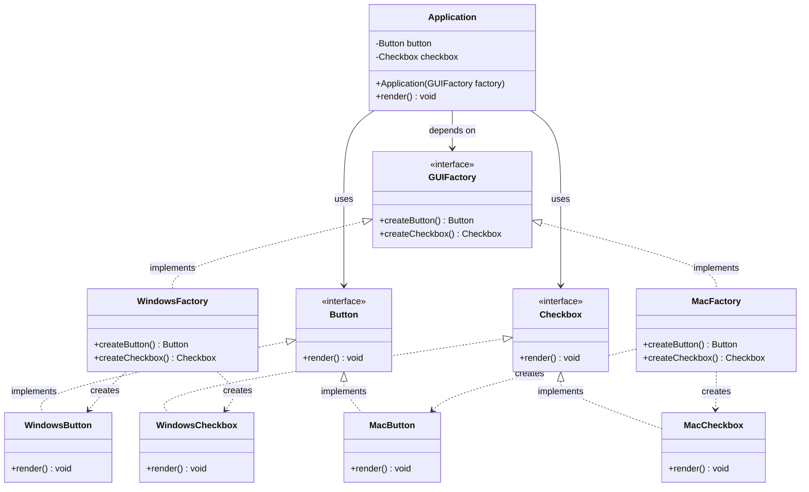
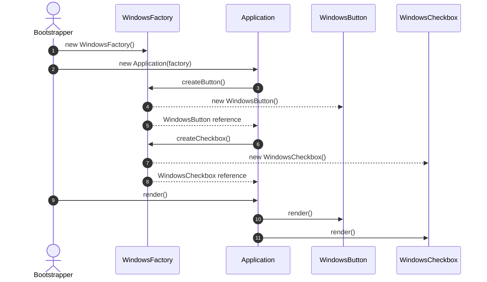

# Abstract Factory Design Pattern: Comprehensive Guide & Engineering Handbook

## 1. What the Pattern Is and Why It Exists

The **Abstract Factory Pattern** is a creational design pattern that provides an interface for creating families of related or dependent objects without specifying their concrete classes.

In software engineering, applications often need to operate across distinct environments, visual themes, hardware architectures, or vendor ecosystems where multiple related components must match each other:
- **Cross-Platform User Interfaces**: An application rendering buttons, checkboxes, and text fields on Windows vs macOS vs Linux. You cannot mix a Windows-styled button with a macOS-styled checkbox—the entire UI suite must belong to the same visual family.
- **Furniture Design Catalogs**: A furniture store produces suites in distinct styles: Modern, Victorian, or Art Deco. Each style comprises a Chair, a Sofa, and a Coffee Table. A customer ordering a Modern set must receive matching modern pieces, never a Victorian floral chair paired with a minimalist glass coffee table.
- **Database Driver Ecosystems**: An enterprise data access layer requires a `DbConnection`, a `DbCommand`, and a `DbTransaction`. If the runtime connects to PostgreSQL, all three objects must be PostgreSQL-specific; pairing an Oracle connection with a MySQL transaction causes immediate driver crashes.

Without the Abstract Factory pattern, client code is littered with conditional `if-else` or `switch` statements checking platform/theme flags whenever an object is instantiated, leading to brittle code and accidental mismatching of incompatible components.

---

## 2. Real-World Analogy

Consider an automobile assembly plant that builds vehicles for two distinct vehicle lines:
1. **Electric Vehicle (EV) Family**: Requires an Electric Motor, Lithium Battery Pack, and Regenerative Braking System.
2. **Combustion Engine (ICE) Family**: Requires an Internal Combustion V6 Engine, Fuel Tank, and Hydraulic Disc Braking System.

```
                  [ Vehicle Component Factory ]
                               │
            ┌──────────────────┴──────────────────┐
            ▼                                     ▼
   [ ElectricCarFactory ]                 [ CombustionCarFactory ]
   ├── creates ElectricMotor              ├── creates CombustionEngine
   ├── creates LithiumBattery             ├── creates FuelTank
   └── creates RegenBrake                 └── creates HydraulicBrake
```

If a mechanic or assembly robot receives components from different, incompatible families—such as trying to wire a Lithium Battery pack into a diesel fuel tank—the car will fail. The Abstract Factory ensures that the assembly line requests a complete, compatible set of parts from a single specialized factory.

---

## 3. The Problem Without the Pattern

Consider a cross-platform desktop application creating UI widgets based on an operating system configuration string:

```java
public class BadUiApplication {
    private String osType;

    public void renderLoginForm() {
        Button submitButton;
        Checkbox rememberMe;

        // Problem 1: Brittle conditional instantiation scattered across the codebase
        if ("WINDOWS".equalsIgnoreCase(osType)) {
            submitButton = new WindowsButton();
        } else if ("MAC".equalsIgnoreCase(osType)) {
            submitButton = new MacButton();
        } else {
            submitButton = new DefaultButton();
        }

        // Problem 2: Easy to introduce accidental mismatches
        if ("WINDOWS".equalsIgnoreCase(osType)) {
            rememberMe = new MacCheckbox(); // BUG! Incompatible theme mixed into Windows
        } else {
            rememberMe = new MacCheckbox();
        }

        submitButton.paint();
        rememberMe.paint();
    }
}
```

### Why This Is Flawed:
1. **Accidental Incompatibility**: Nothing prevents a developer from instantiating a `WindowsButton` alongside a `MacCheckbox`.
2. **Violates Open/Closed Principle (OCP)**: Adding a new platform (e.g., `Linux`) requires finding and updating every `if-else` block where widgets are instantiated.
3. **Violates Single Responsibility Principle (SRP)**: UI controllers become burdened with knowledge of concrete constructor signatures and instantiation rules for every platform.

---

## 4. How the Pattern Works Step by Step

1. **Abstract Product Interfaces**:
   - Declare interfaces for each distinct product type in the family (e.g., `Button`, `Checkbox`, `TextField`).
2. **Concrete Products**:
   - Provide platform-specific implementations of the abstract product interfaces grouped by variant (e.g., `WindowsButton`, `WindowsCheckbox`; `MacButton`, `MacCheckbox`).
3. **Abstract Factory Interface**:
   - Declares factory methods for creating each abstract product in the family (e.g., `createButton()`, `createCheckbox()`).
4. **Concrete Factories**:
   - Implement the creation methods to produce products belonging to a single specific family (e.g., `WindowsFactory` produces `WindowsButton` and `WindowsCheckbox`).
5. **Client**:
   - Takes an `AbstractFactory` through constructor dependency injection and creates all widgets strictly through this factory. The client code is 100% decoupled from concrete product classes.

---

## 5. Class Diagram and Sequence Diagram

### Class Diagram



**Explanation of Class Diagram:**
`GUIFactory` declares abstract creation methods for `Button` and `Checkbox`. `WindowsFactory` and `MacFactory` implement `GUIFactory`, each instantiating only components from their respective platform family. `Application` depends exclusively on `GUIFactory` and the product abstractions (`Button`, `Checkbox`), guaranteeing visual consistency.

### Sequence Diagram



**Explanation of Sequence Diagram:**
During application bootstrap, the runtime selects the concrete factory (`WindowsFactory`). The `Application` uses this factory to create its UI components without knowing their concrete classes. It then renders the matching widgets seamlessly.

---

## 6. Each Participant's Responsibility

| Participant | Responsibility | Example Entities |
|---|---|---|
| **Abstract Factory** | Declares an interface for operations that create abstract product objects. | `GUIFactory`, `FurnitureFactory`, `DatabaseProviderFactory` |
| **Concrete Factory** | Implements the operations to create concrete product objects belonging to a specific family. | `WindowsFactory`, `MacFactory`, `ModernFurnitureFactory` |
| **Abstract Product** | Declares an interface for a type of product object. | `Button`, `Chair`, `DbConnection` |
| **Concrete Product** | Defines a product object to be created by the corresponding concrete factory. | `WindowsButton`, `ModernChair`, `PgSqlConnection` |
| **Client** | Uses only interfaces declared by AbstractFactory and AbstractProduct classes. | `Application`, `InteriorDesigner`, `DatabaseRepository` |

---

## 7. Abstract Factory vs Factory Method (The Core Distinction)

| Dimension | Factory Method | Abstract Factory |
|---|---|---|
| **Scope** | Creates **one** product. | Creates **a family of related products**. |
| **Mechanism** | Relies on **inheritance** (subclasses override a method to specify the created class). | Relies on **object composition** (factory is injected into the client). |
| **Adding New Products** | Subclassing adds a single new concrete product. | A new factory provides a complete new suite of matching products. |
| **Complexity** | Simple, low initial overhead. | Higher initial abstraction; requires multiple interfaces and factory classes. |

---

## 8. Bad vs Good Design Comparison

| Dimension | Bad Design (Scattered Conditionals) | Good Design (Abstract Factory) |
|---|---|---|
| **Coupling** | Client directly calls `new WindowsButton()` and `new MacCheckbox()`. | Client depends only on `GUIFactory` and product interfaces. |
| **Component Compatibility** | Prone to mismatched component bugs (e.g. Windows Button + Mac Checkbox). | **Enforces 100% family compatibility** by construction. |
| **Extensibility (OCP)** | Adding a new theme requires editing conditional code across all views. | Adding a new theme requires adding one concrete factory class. |
| **Testability** | Hard to mock concrete platform constructors. | Trivial to inject a `MockUIFactory` generating test doubles. |

---

## 9. SOLID Principles Genuinely Demonstrated

- **Single Responsibility Principle (SRP)**:
  Product creation logic is centralized inside concrete factories, isolating the client from instantiation details.
- **Open/Closed Principle (OCP)**:
  You can introduce new families of products (e.g., `LinuxFactory`, `ArtDecoFactory`) without breaking existing client code.
- **Dependency Inversion Principle (DIP)**:
  Client code depends strictly on abstract interfaces (`GUIFactory`, `Button`, `Checkbox`), never on concrete implementation classes.

---

## 10. When to Use It and When NOT to Use It

### When to Use
- A system should be independent of how its products are created, composed, and represented.
- A system should be configured with one of multiple families of products.
- A family of related product objects is designed to be used together, and you must enforce this constraint.
- You want to provide a class library of products, and you want to reveal just their interfaces, not their implementations.

### When NOT to Use
- **When there is only one product type**: Use simple Factory Method or direct instantiation instead.
- **When products do not belong to strict families**: If buttons and checkboxes have zero interdependence or styling compatibility constraints, an Abstract Factory adds unwarranted complexity.
- **When new product types are added frequently**: Extending an Abstract Factory interface (e.g., adding `createSlider()`) forces updates to *every* existing concrete factory implementation.

---

## 11. Benefits, Limitations, and Trade-Offs

### Benefits
- **Guaranteed Compatibility**: Ensures products received by the client are always mutually compatible.
- **Decoupled Client Code**: Clients interact with abstract interfaces, facilitating easy theme/platform switching at runtime.
- **Consistent Product Branding**: Centralizes product lifecycle and aesthetic rules.

### Limitations & Trade-Offs
- **High Initial Boilerplate**: Many interfaces and classes must be created before writing any business logic.
- **Difficult to Support New Kinds of Products**: Adding a new product concept (e.g., `createDatePicker()`) breaks the `AbstractFactory` interface, requiring changes to every concrete factory subclass.

---

## 12. How to Recognize Incorrect Use (Anti-Patterns)

1. **God Abstract Factory**: Putting 50 unrelated product methods into one giant factory interface.
2. **Factory Method Masquerading as Abstract Factory**: Creating an "AbstractFactory" interface with only a single method (`createDocument()`). This is just a Factory Method.
3. **Hardcoded Internal Instantiation**: A client accepting an `AbstractFactory` but still performing `if (factory instanceof WindowsFactory)` inside its methods.

---

## 13. Differences from Similar Patterns

| Pattern | Primary Intent | Structural Difference |
|---|---|---|
| **Abstract Factory** | Creates whole families of related products. | Multiple factory methods on an injected factory object. |
| **Factory Method** | Creates one product via subclassing. | Single template/factory method overridden in subclasses. |
| **Builder** | Step-by-step construction of complex individual objects. | Focuses on assembling a single object with many options rather than families of distinct products. |
| **Prototype** | Creates new objects by cloning an existing prototype. | Avoids subclassing factories altogether by cloning pre-configured instances. |

---

## 14. Common Interview Questions and Answers

### Q1: How do you handle adding a new product to an existing Abstract Factory?
**Answer:**
Adding a new product type (e.g., `createColorPicker()`) requires modifying the `GUIFactory` interface, which breaks all existing concrete factories (`WindowsFactory`, `MacFactory`). To mitigate this in evolving frameworks:
1. Provide a default implementation returning `null` or a generic fallback in the interface (Java 8+ `default` methods).
2. Use parameter-driven creation (`<T extends UIComponent> T createComponent(Class<T> type)`).
3. If products evolve frequently, consider combining Abstract Factory with Prototype or Builder patterns.

### Q2: How does Abstract Factory enforce product compatibility?
**Answer:**
Because each concrete factory is solely responsible for instantiating the entire suite of products for its variant, client code calling `factory.createButton()` and `factory.createCheckbox()` is guaranteed to receive products produced by that same factory. The client never gets a chance to mix and match disparate concrete classes.

### Q3: How is Abstract Factory typically configured in real-world applications?
**Answer:**
Applications usually initialize a concrete factory as a **Singleton** during application startup, reading from a configuration file, environment variable (e.g. `OS_TYPE` or `DATABASE_PROVIDER`), or dependency injection container (like Spring `@Bean` or Google Guice module). The chosen factory is then injected into services that require product creation.

---

## 15. Concise Revision Checklist

- [ ] Identify multiple families of related or dependent products.
- [ ] Define abstract interfaces for each product type (`Button`, `Checkbox`).
- [ ] Implement concrete product classes grouped by family (`WindowsButton`, `MacButton`).
- [ ] Define an `AbstractFactory` interface with creation methods for each product type.
- [ ] Implement concrete factory classes producing family-consistent products (`WindowsFactory`, `MacFactory`).
- [ ] Inject `AbstractFactory` into client code via constructor injection.
- [ ] Ensure client code has zero direct imports of concrete product classes.
