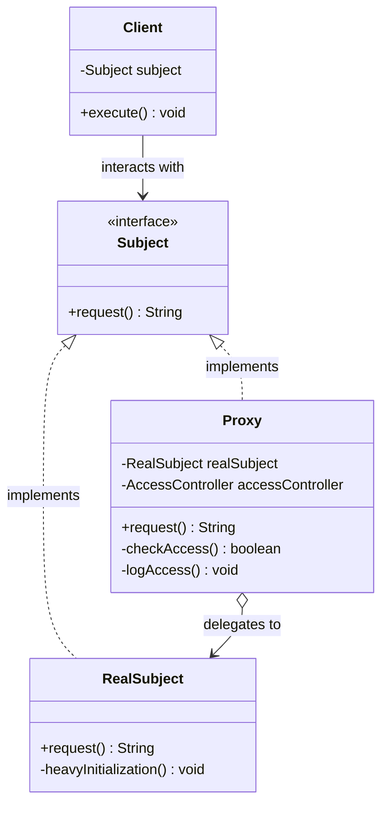
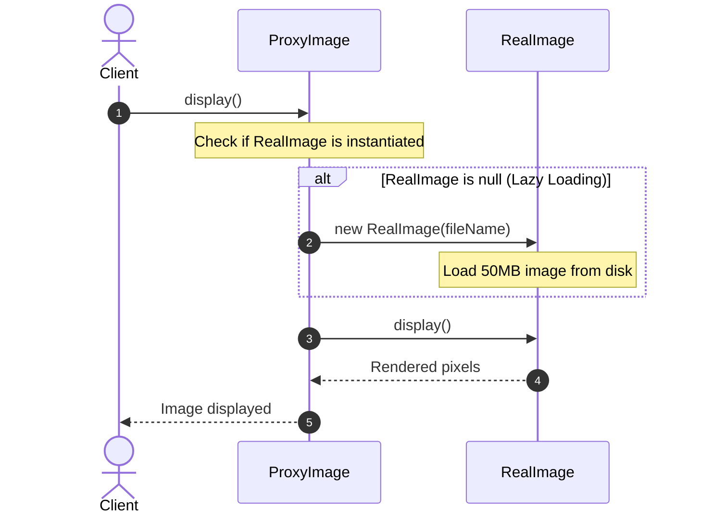

# Proxy Design Pattern: Comprehensive Guide & Engineering Handbook

## 1. What the Pattern Is and Why It Exists

The **Proxy Pattern** is a structural design pattern that provides a surrogate, placeholder, or intermediary object to control access to another underlying object.

In software engineering, accessing real service objects directly can be impractical, inefficient, or insecure:
- **Resource-Heavy Object Instantiation (Virtual Proxy)**: Loading high-resolution 4K images, large CAD models, or gigabyte-sized video streams directly into memory during application boot slows down startup. A virtual proxy delays instantiation until the exact moment the object is genuinely needed.
- **Access Control & Authorization (Protection Proxy)**: Unprivileged users should not be allowed to execute sensitive administrative operations (e.g., dropping database tables, deleting classified records). A protection proxy inspects credentials and permissions before delegating requests to the underlying subject.
- **Expensive Computations & Remote Network Calls (Caching Proxy)**: Repeated queries to slow third-party web services or heavy database aggregation jobs waste network bandwidth and CPU cycles. A caching proxy intercepts requests, returns stored results if available, and forwards only cache-miss requests.
- **Remote Service Communication (Remote Proxy)**: Interacting with an object running in another JVM, container, or cloud server. A remote proxy encapsulates network serialization, RPC calls, and socket management behind a standard local interface.

The Proxy pattern allows developers to perform operations before or after the request reaches the target object—without modifying the target object's code.

---

## 2. Real-World Analogy

Consider a **Credit Card / Debit Card**:
- A debit card acts as a proxy for the funds in your bank account.
- Both the debit card and cold hard cash implement the same abstract function: *paying for goods and services*.

```
[ Consumer (Client) ]
         │ "Pay $50 for groceries"
         ▼
[ Debit Card (Proxy) ]
   ├── Validates PIN & Expiration Date (Protection Proxy)
   ├── Checks Available Balance / Fraud Model
   └── Forwards transaction to:
         ▼
   [ Bank Central Vault (Real Subject) ]
```

You do not carry a bag of physical gold or cash everywhere you shop. The plastic card serves as a convenient, secure surrogate that checks your identity, verifies authorization, and settles the funds against the real bank account.

---

## 3. The Problem Without the Pattern

Consider a document viewing system that loads sensitive corporate records:

```java
public class BadDocumentViewer {
    public void openDocument(String documentId, User user) {
        // Problem 1: Heavy I/O and memory overhead occurs unconditionally
        byte[] rawDiskBytes = loadHeavyDocumentFromRemoteDisk(documentId);

        // Problem 2: Security checks are tangled directly inside presentation code
        if (!user.getRoles().contains("ADMIN")) {
            throw new SecurityException("Unauthorized access!");
        }

        renderDocument(rawDiskBytes);
    }
}
```

### Why This Is Flawed:
1. **Wasted Resources**: The system loads massive document files into RAM before verifying if the user even has permission to view them.
2. **Violates Single Responsibility Principle (SRP)**: The viewer is responsible for document rendering, remote disk I/O, security enforcement, and caching all at once.
3. **Violates Open/Closed Principle (OCP)**: Adding audit logging, rate limiting, or caching requires repeatedly modifying the core document viewer.

---

## 4. How the Pattern Works Step by Step

1. **Subject Interface**:
   - Declares common operations for both the `RealSubject` and the `Proxy` (e.g., `display()`, `download()`, `fetchData()`).
2. **RealSubject**:
   - Contains the core, resource-heavy, or sensitive business logic.
3. **Proxy**:
   - Implements the exact same `Subject` interface as the `RealSubject`.
   - Maintains a reference to the `RealSubject` (either passed via dependency injection or created lazily on demand).
   - Intercepts calls to perform ancillary concerns (lazy loading, caching, authentication, logging) and delegates the core execution to the `RealSubject`.
4. **Client**:
   - Operates on the `Subject` interface without knowing whether it is speaking to the proxy or the real subject.

---

## 5. Class Diagram and Sequence Diagram

### Class Diagram



**Explanation of Class Diagram:**
`Subject` is the shared interface implemented by both `RealSubject` and `Proxy`. `Proxy` holds a reference to `RealSubject` and controls access to it. The `Client` depends strictly on the `Subject` abstraction.

### Sequence Diagram



**Explanation of Sequence Diagram:**
When the client calls `display()`, the `ProxyImage` checks if the `RealImage` has been initialized. If not, it creates it lazily (saving disk and memory bandwidth until the exact time of rendering) and delegates the display call.

---

## 6. Each Participant's Responsibility

| Participant | Responsibility | Example Entities |
|---|---|---|
| **Subject** | Declares the common contract shared by the RealSubject and the Proxy. | `Image`, `Document`, `WeatherService` |
| **RealSubject** | Defines the real object containing genuine domain logic and heavy resource operations. | `HighResolutionImage`, `ConfidentialDocument`, `RemoteWeatherService` |
| **Proxy** | Maintains a reference to RealSubject, controls access to it, and handles cross-cutting concerns (lazy loading, security, caching). | `ProxyImage`, `DocumentAccessProxy`, `CachingWeatherProxy` |
| **Client** | Works with RealSubject and Proxy interchangeably through the Subject interface. | `ImageViewer`, `DocumentController`, `WeatherDashboard` |

---

## 7. The 4 Primary Proxy Variants

### 1. Virtual Proxy (Lazy Loading)
- Delays the expensive creation of an object until it is first accessed.
- *Examples*: Loading high-res images in an infinite scroll gallery, loading heavyweight database connection pools.

### 2. Protection Proxy (Access Control)
- Checks whether the caller has the necessary permissions before forwarding the request.
- *Examples*: Role-Based Access Control (RBAC) on financial documents, OS file system permissions.

### 3. Caching Proxy (Performance Optimization)
- Stores results of expensive operations and serves cached responses for identical inputs.
- *Examples*: HTTP reverse proxies (Nginx, Varnish), query result caching.

### 4. Remote Proxy (Ambient Network Intermediary)
- Encapsulates network communication, serialization, and socket management for remote services.
- *Examples*: Java RMI stubs, gRPC client stubs, Spring HTTP interfaces.

---

## 8. Bad vs Good Design Comparison

| Dimension | Bad Design (Monolithic Tangling) | Good Design (Proxy Pattern) |
|---|---|---|
| **Separation of Concerns** | Heavy computation, caching, and auth mixed into one class. | RealSubject handles core work; Proxy handles auxiliary access control. |
| **Memory Footprint** | Massive objects created eagerly during application startup. | Virtual proxy creates heavy objects strictly on-demand. |
| **Security Auditing** | Authorization checks scattered across UI and controller code. | Protection proxy enforces centralized access gates. |
| **Testability** | Hard to test security or caching in isolation. | Proxy and RealSubject can be tested independently with mocks. |

---

## 9. SOLID Principles Genuinely Demonstrated

- **Single Responsibility Principle (SRP)**:
  `RealSubject` focuses entirely on primary business logic; `Proxy` focuses strictly on access control, caching, or lazy loading.
- **Open/Closed Principle (OCP)**:
  You can introduce new proxies (e.g., `LoggingProxy`, `RateLimitingProxy`, `AuditProxy`) without changing `RealSubject` or client code.
- **Liskov Substitution Principle (LSP)**:
  A `Proxy` can be substituted anywhere a `Subject` is expected without altering the client's correctness.
- **Dependency Inversion Principle (DIP)**:
  The client and proxy depend on the abstract `Subject` interface, never on concrete implementation classes.

---

## 10. When to Use It and When NOT to Use It

### When to Use
- **Lazy Initialization (Virtual Proxy)**: When an object is memory/CPU intensive and not always needed.
- **Access Control (Protection Proxy)**: When only specific clients should be permitted to execute certain operations.
- **Caching (Caching Proxy)**: When operation results are slow to produce and do not change frequently.
- **Logging & Auditing (Logging Proxy)**: When you need to trace every invocation of a service transparently.

### When NOT to Use
- **When the RealSubject is lightweight**: If object creation takes nanoseconds, adding a proxy introduces needless indirection.
- **When operations alter state frequently**: Caching proxies add overhead and risk cache staleness for write-heavy services.
- **When client code genuinely needs concrete details**: If the client requires access to non-interface methods on the RealSubject.

---

## 11. Benefits, Limitations, and Trade-Offs

### Benefits
- **Transparent Control**: You can control the service object without clients ever knowing about it.
- **Resource Optimization**: Frees up memory and bandwidth via lazy loading and caching.
- **Security by Design**: Intercepts unauthorized requests before expensive operations are triggered.

### Limitations & Trade-Offs
- **Increased Latency**: Adding proxy layers introduces extra stack frames and cache lookup overhead.
- **Code Duplication in Dynamic Systems**: Writing compile-time static proxies for interfaces with 50 methods requires tedious delegation boilerplate (mitigated via Java Dynamic Proxies / ByteBuddy).

---

## 12. How to Recognize Incorrect Use (Anti-Patterns)

1. **Proxy Modifying Business Semantics**: A proxy that alters the core calculation logic of the RealSubject violates Liskov Substitution.
2. **Infinite Recursion**: A proxy calling another method on itself that routes back to the proxy without delegating to the RealSubject.
3. **Eager Instantiation Inside Virtual Proxy**: Constructing the heavy object inside the virtual proxy's constructor completely defeats the purpose of lazy loading.

---

## 13. Differences from Similar Patterns

| Pattern | Primary Intent | Structural Difference |
|---|---|---|
| **Proxy** | Controls **access** to an object while keeping the identical interface. | Same interface as target; controls *when* and *if* target is called. |
| **Decorator** | **Augments or extends** the behavior of an object. | Same interface as target; always delegates and adds extra features. |
| **Adapter** | Converts one **incompatible interface** into another. | Exposes a *different* interface to the client. |
| **Facade** | Provides a simplified high-level interface to a **complex subsystem**. | Wraps multiple subsystem objects behind a new, simplified interface. |

---

## 14. Common Interview Questions and Answers

### Q1: What is the key difference between Proxy and Decorator?
**Answer:**
Both patterns share the exact same class structure (implementing the same interface and holding a reference to a target object). The distinction lies in their **intent**:
- **Decorator** adds new responsibilities or enhances behavior (e.g., adding encryption or compression to a data stream). The client typically creates the real object and wraps decorators around it.
- **Proxy** controls access to an object (e.g., preventing access, delaying instantiation, or serving cached data). The proxy often manages the lifecycle of the RealSubject internally.

### Q2: What is a Java Dynamic Proxy (`java.lang.reflect.Proxy`)?
**Answer:**
Java provides built-in runtime proxy generation via `Proxy.newProxyInstance()` and `InvocationHandler`. Instead of manually coding a proxy class for every interface, an `InvocationHandler` intercepts all method calls reflectively. This is the foundational technology behind Spring AOP (`@Transactional`, `@Secured`) and Hibernate lazy loading.

### Q3: How does a Virtual Proxy handle thread safety during lazy instantiation?
**Answer:**
If multiple threads access a Virtual Proxy simultaneously before the RealSubject is instantiated, race conditions can cause duplicate heavy object creation. This is solved using **Double-Checked Locking** with a `volatile` reference, an atomic initializer, or initializing via a synchronized block.

---

## 15. Concise Revision Checklist

- [ ] Define a common `Subject` interface shared by `RealSubject` and `Proxy`.
- [ ] Implement `RealSubject` focusing purely on the heavy/sensitive core business logic.
- [ ] Implement `Proxy` implementing `Subject` and maintaining a reference to `RealSubject`.
- [ ] Implement specific proxy logic:
  - **Virtual**: Delay instantiation until first method call (`if (real == null) real = new RealSubject()`).
  - **Protection**: Validate user role/token before calling `real.action()`.
  - **Caching**: Check cache map; return cached value on hit, delegate and store on miss.
- [ ] Ensure the client depends strictly on `Subject`, remaining agnostic of the proxy.
