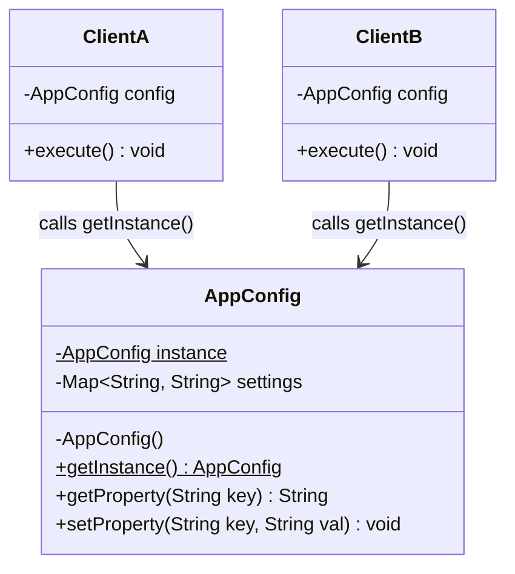
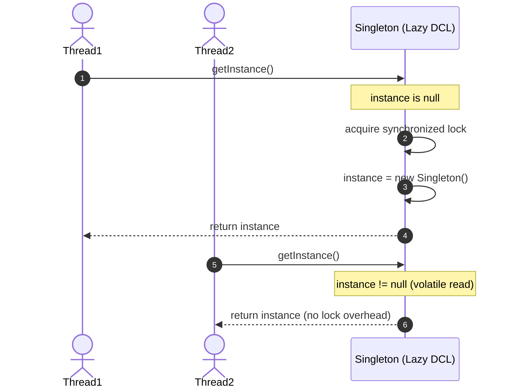

# Singleton Design Pattern: Comprehensive Guide & Engineering Handbook

## 1. What the Pattern Is and Why It Exists

The **Singleton Pattern** is a creational design pattern that guarantees a class has **only one instance** throughout the entire lifecycle of an application and provides a **global point of access** to that instance.

In software engineering, certain resources must coordinate actions across a whole system and logically represent a single physical or architectural entity:
- **Shared Application Configuration**: Reading YAML or environment properties once at startup and providing an immutable or synchronized view across all application threads.
- **Process-Wide Logging Subsystem**: Writing structured logs to a single log file or centralized stream without colliding thread file locks or interleaving broken bytes.
- **Service & Plugin Registry**: Maintaining a central directory where micro-services, extensions, or device drivers register and resolve instances by name or interface.
- **Hardware Device Drivers**: Controlling a single physical printer, graphics card context, or audio output device.

Without the Singleton pattern, different modules instantiate their own copies of these coordinators, causing inconsistent state, resource exhaustion, and file/database write locks.

---

## 2. Real-World Analogy

Consider the **Office of the President** or the **Central Bank of a Country**:
- In any sovereign nation, there is only one official Central Bank (e.g., the Federal Reserve or Bank of England).
- It is the sole authority responsible for minting currency and setting national interest rates.

```
[ Commercial Bank A ] ───┐
                         ├──► [ Central Bank (Singleton Instance) ]
[ Commercial Bank B ] ───┘    - Controls monetary policy & money supply
```

If every regional commercial bank could instantiate its own independent Central Bank, each would print money at different rates, leading to currency chaos. The single official institution ensures unified economic coordination.

---

## 3. The Problem Without the Pattern

Consider an application configuration loader where every component creates a new configuration instance:

```java
public class BadAppConfig {
    private Map<String, String> settings = new HashMap<>();

    public BadAppConfig() {
        // Problem 1: Re-reads from disk on every instantiation
        loadFromDisk("/etc/app.properties");
    }

    public void setSetting(String key, String value) {
        settings.put(key, value);
    }

    public String getSetting(String key) {
        return settings.get(key);
    }
}
```

### Why This Is Flawed:
1. **Divergent State**: If Service A updates a setting (`configA.setSetting("timeout", "5000")`), Service B which instantiated `configB` still sees the old or default timeout.
2. **Resource Waste**: Re-reading configuration files or database connection strings repeatedly wastes disk I/O and CPU cycles.
3. **No Thread Safety**: Multiple threads instantiating and mutating separate instances create subtle data races.

---

## 4. How the Pattern Works Step by Step

1. **Private Constructor**:
   - Suppresses the default public constructor so that no other class can call `new SingletonClass()`.
2. **Private Static Instance Variable**:
   - Holds the single unique instance of the class.
3. **Public Static Accessor Method (`getInstance()`)**:
   - Provides global access to the instance.
   - Handles initialization (either eagerly at class-loading time or lazily on first access).
4. **Defense Mechanisms (Production Standards)**:
   - Defend against reflection attacks (throw exception in private constructor if instance already exists).
   - Defend against deserialization duplicates (`readResolve()` method or Enum).

---

## 5. Class Diagram and Sequence Diagram

### Class Diagram



**Explanation of Class Diagram:**
`AppConfig` has a `private` constructor and a `private static` instance variable. Both `ClientA` and `ClientB` invoke `AppConfig.getInstance()`, receiving the exact same reference in memory.

### Sequence Diagram



**Explanation of Sequence Diagram:**
`Thread1` calls `getInstance()` first when `instance` is null. It acquires the class lock, creates the object, and returns. When `Thread2` calls `getInstance()`, the volatile instance check succeeds immediately without acquiring any locks, giving optimal performance.

---

## 6. Each Participant's Responsibility

| Participant | Responsibility | Example Entities |
|---|---|---|
| **Singleton** | Defines `getInstance()` to let clients access its unique instance. Ensures sole instantiation. | `AppConfig`, `SystemLogger`, `ServiceRegistry` |
| **Client** | Accesses the singleton instance strictly through `Singleton.getInstance()`. | `UserService`, `DatabasePool`, `PaymentController` |

---

## 7. The 5 Implementation Strategies in Java

### 1. Eager Initialization
```java
public class EagerSingleton {
    private static final EagerSingleton INSTANCE = new EagerSingleton();
    private EagerSingleton() {}
    public static EagerSingleton getInstance() { return INSTANCE; }
}
```
*Best for*: Lightweight singletons always needed at startup. Simple and inherently thread-safe.

### 2. Synchronized Accessor Method
```java
public class SyncSingleton {
    private static SyncSingleton instance;
    private SyncSingleton() {}
    public static synchronized SyncSingleton getInstance() {
        if (instance == null) instance = new SyncSingleton();
        return instance;
    }
}
```
*Downside*: Synchronization penalty on *every* read call, even after the instance is already created.

### 3. Double-Checked Locking (DCL) with `volatile`
```java
public class DclSingleton {
    private static volatile DclSingleton instance;
    private DclSingleton() {}
    public static DclSingleton getInstance() {
        if (instance == null) {
            synchronized (DclSingleton.class) {
                if (instance == null) {
                    instance = new DclSingleton();
                }
            }
        }
        return instance;
    }
}
```
*Best for*: Lazy loading where synchronization overhead must be eliminated after initialization. Requires `volatile` to prevent CPU instruction reordering.

### 4. Bill Pugh Static Inner Holder
```java
public class BillPughSingleton {
    private BillPughSingleton() {}
    private static class Holder {
        private static final BillPughSingleton INSTANCE = new BillPughSingleton();
    }
    public static BillPughSingleton getInstance() {
        return Holder.INSTANCE;
    }
}
```
*Best for*: Elegant lazy loading without explicit synchronization blocks. Utilizes the JVM's class-loading mechanism (the inner class is loaded only when `getInstance()` is called).

### 5. Enum Singleton (Effective Java by Joshua Bloch)
```java
public enum EnumSingleton {
    INSTANCE;
    public void doWork() { ... }
}
```
*Best for*: Production resilience. The JVM guarantees 100% thread safety and automatically prevents reflection and deserialization attacks.

---

## 8. Bad vs Good Design Comparison

| Dimension | Bad Design (Multiple Instances) | Good Design (Singleton Pattern) |
|---|---|---|
| **Instance Count** | Arbitrary number of instances created via `new`. | Strictly exactly one instance throughout JVM lifecycle. |
| **State Consistency** | Updates in one part of the app are invisible to others. | All clients share identical, synchronized state. |
| **Resource Usage** | Redundant file reads, duplicate sockets, memory waste. | Shared resource initialized once. |
| **Concurrency** | Race conditions between conflicting instances. | Centralized synchronization or thread-safe state. |

---

## 9. SOLID Principles & Singleton: Controversies & Genuine Demonstration

The Singleton pattern is often criticized as an anti-pattern when abused as a "global variable", but when applied with care:
- **Single Responsibility Principle (SRP)**:
  The class should be responsible *only* for managing its single domain role (e.g. holding configuration), while dependency injection frameworks (Spring, Guice) manage its lifecycle.
- **Open/Closed Principle (OCP)**:
  By having the Singleton implement an interface (e.g., `ConfigService`), client code depends on the interface, allowing easy substitution during tests.
- **Dependency Inversion Principle (DIP)**:
  Clients receive the singleton via interface injection rather than hardcoding static calls everywhere.

---

## 10. When to Use It and When NOT to Use It

### When to Use
- Exactly one instance of a class must be accessible to clients from a well-known access point.
- The sole instance should be extensible by subclassing, and clients should be able to use an extended instance without modifying their code.
- Managing shared, concurrent-access resources (logging buffers, config maps, service registries).

### When NOT to Use
- **As a dumping ground for global variables**: If objects just need to share temporary state, pass arguments or use dependency injection.
- **When testing requires mock isolation**: Hardcoded static calls (`Singleton.getInstance().doSomething()`) make unit testing difficult because state bleeds across tests.
- **In distributed multi-JVM systems**: A Singleton is only single per JVM/ClassLoader, not across a Kubernetes cluster.

---

## 11. Benefits, Limitations, and Trade-Offs

### Benefits
- Controlled access to sole instance.
- Reduced memory footprint.
- Avoids polluting global namespace.

### Limitations & Trade-Offs
- **Reflection Attacks**: Hackers can use `setAccessible(true)` on private constructors (defended by throwing an exception if instance != null).
- **Serialization Vulnerabilities**: Deserializing a singleton creates a second instance unless `readResolve()` is implemented or an Enum is used.
- **ClassLoader Isolation**: Multiple classloaders can load the class multiple times, resulting in multiple instances in the same JVM.

---

## 12. How to Recognize Incorrect Use (Anti-Patterns)

1. **Hidden Dependencies**: Methods hiding `MySingleton.getInstance()` inside deep private helper methods instead of taking dependencies explicitly.
2. **Missing `volatile` in DCL**: Writing Double-Checked Locking without `volatile` causes partially constructed objects to be read by concurrent threads due to instruction reordering.
3. **State Bleed in Tests**: Tests failing unpredictably because Test A mutated a singleton's state and Test B inherited it.

---

## 13. Differences from Similar Patterns

| Pattern | Primary Intent | Structural Difference |
|---|---|---|
| **Singleton** | Ensures exactly one instance of a class with global access. | Object with private constructor and static `getInstance()`. |
| **Monostate** | Multiple instances allowed, but all instances share static state. | Public constructors, but all fields are `static`. |
| **Static Utility Class** | Groups static helper methods (`java.lang.Math`). | No state, no instances, cannot be passed as an object. |
| **Factory Method** | Creates objects polymorphically. | Can be implemented to return a singleton instance. |

---

## 14. Common Interview Questions and Answers

### Q1: Why is the `volatile` keyword mandatory in Double-Checked Locking?
**Answer:**
Without `volatile`, the JVM compiler and CPU out-of-order execution can reorder instructions during object creation:
1. Allocate memory
2. Assign memory address to `instance`
3. Initialize the constructor

If thread A executes step 2 before step 3, thread B can observe `instance != null` and attempt to use a **partially initialized object**, resulting in crashes. `volatile` establishes a memory barrier ensuring step 3 happens-before step 2 becomes visible to other threads.

### Q2: How do you prevent breaking a Singleton via Reflection and Deserialization?
**Answer:**
1. **Reflection**: In the private constructor, check if `instance != null` and throw an `IllegalStateException("Singleton instance already exists!")`.
2. **Deserialization**: Implement `protected Object readResolve() { return getInstance(); }`.
3. **Or simply use an `Enum`**, which the JVM natively protects against both reflection instantiation and duplicate deserialization.

### Q3: What is the Bill Pugh Singleton implementation and why is it preferred?
**Answer:**
The Bill Pugh pattern uses a private static inner helper class:
```java
private static class Holder {
    private static final AppConfig INSTANCE = new AppConfig();
}
```
The inner class `Holder` is NOT loaded into memory until someone calls `getInstance()`. When `getInstance()` is called, the JVM's class loader loads `Holder` and initializes `INSTANCE` in a thread-safe manner guaranteed by the JVM specification, achieving lazy initialization with zero synchronization boilerplate.

---

## 15. Concise Revision Checklist

- [ ] Private constructor to prevent direct instantiation.
- [ ] Guard private constructor against reflection: `if (instance != null) throw ...`.
- [ ] Implement `readResolve()` if `Serializable`.
- [ ] If using Double-Checked Locking: declare instance `private static volatile`.
- [ ] If using Bill Pugh: place instance in `private static class Holder`.
- [ ] Implement a domain interface so client code can be unit tested with mocks.
- [ ] Provide clear reset/clear methods for test environments if state is mutable.
