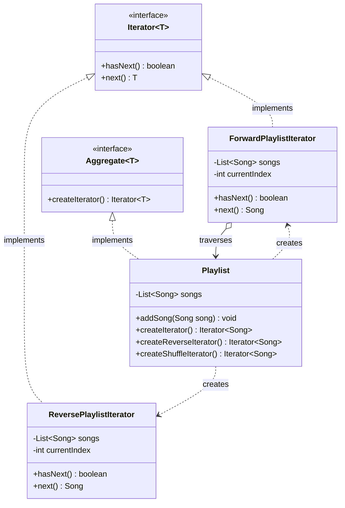
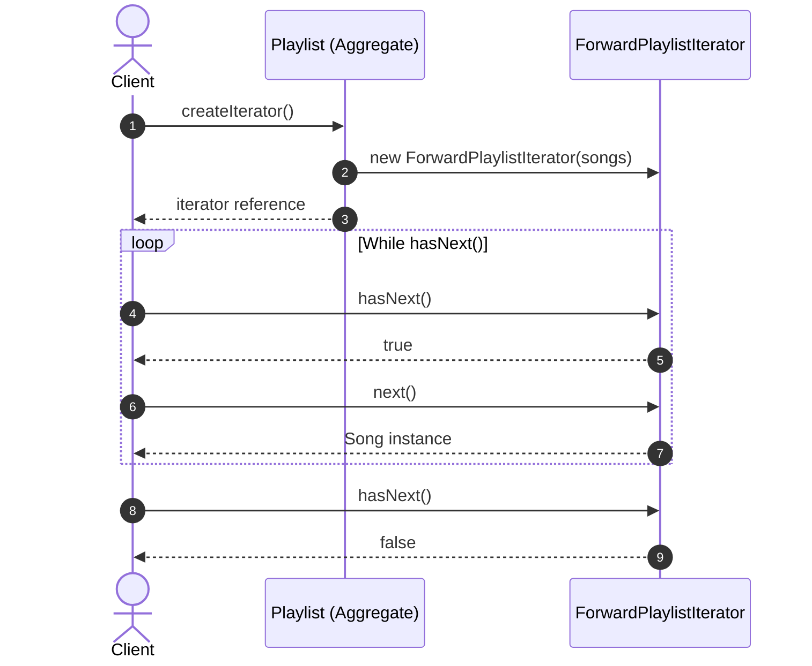

# Iterator Design Pattern: Comprehensive Guide & Engineering Handbook

## 1. What the Pattern Is and Why It Exists

The **Iterator Pattern** is a behavioral design pattern that allows sequential traversal through the elements of an aggregate collection without exposing its underlying representation (whether it is an array, a linked list, a hash table, a graph, or a balanced tree).

In software engineering, collections can store elements in varied data structures:
- **Audio Playlists**: Stored as dynamic lists or circular buffers; users want sequential traversal, reverse playback, or random shuffle traversal.
- **Library Catalogs**: Stored as hash maps or B-trees; librarians need to iterate by genre, publication date, or author without knowing database indexing details.
- **Tree and Graph Structures**: Corporate organizational charts or DOM nodes; consumers need Depth-First Search (DFS, preorder/postorder) or Breadth-First Search (BFS, level-order) traversal without cluttering the tree node data structures with traversal state.

Without the Iterator pattern, client code must reach into collection internals (e.g. `for (int i=0; i < collection.getRawArray().length; i++)`). If the backing structure changes from an `ArrayList` to a `LinkedList` or `ConcurrentSkipListMap`, all client traversal code breaks.

---

## 2. Real-World Analogy

Consider a **Guided City Tour in Rome**:
- The city of Rome consists of dozens of landmarks (Colosseum, Vatican, Trevi Fountain, Pantheon).
- Different tourists want different traversal experiences:
  1. *Chronological Ancient Roman Tour*: Colosseum -> Forum -> Pantheon.
  2. *Art & Architecture Tour*: Vatican Museums -> St. Peter's -> Piazza Navona.
  3. *Foodie Walking Tour*: Trastevere bakeries -> Campo de' Fiori markets -> Gelaterias.

```
                  [ City of Rome (Aggregate Collection) ]
                                    │
          ┌─────────────────────────┼─────────────────────────┐
          ▼                         ▼                         ▼
 [ Historical Tour Guide ]  [ Art Tour Guide ]     [ Culinary Tour Guide ]
   (Chronological Iterator)   (Spatial Iterator)     (Foodie Walking Iterator)
```

The landmarks in the city remain stationary. The city does not change. Instead, distinct **Tour Guides (Iterators)** maintain their own route, current position, and next-stop pointers, guiding tourists through the city without tourists needing to navigate complex city transit maps themselves.

---

## 3. The Problem Without the Pattern

Consider an audio playlist player that exposes its internal storage to clients:

```java
public class BadPlaylist {
    private Song[] songs = new Song[100];
    private int count = 0;

    public Song[] getSongs() {
        return songs; // Exposing internal representation!
    }

    public int getCount() {
        return count;
    }
}
```

### Client Traversal Code:
```java
public class BadMusicPlayer {
    public void playAll(BadPlaylist playlist) {
        Song[] array = playlist.getSongs();
        for (int i = 0; i < playlist.getCount(); i++) {
            System.out.println("Playing: " + array[i].getTitle());
        }
    }
}
```

### Why This Is Flawed:
1. **Tight Coupling to Implementation**: If `BadPlaylist` switches to `LinkedList<Song>` to avoid fixed array limits, `playlist.getSongs()` returns a different type, breaking every client.
2. **Duplicated Traversal Logic**: If clients want to play songs in reverse or shuffle order, every client must re-implement shuffle algorithms and index bounds checking.
3. **Breaks Encapsulation**: Returning raw internal arrays allows rogue clients to overwrite array slots (`array[0] = null`).

---

## 4. How the Pattern Works Step by Step

1. **Iterator Interface**:
   - Declares operations for traversing a collection: `hasNext()`, `next()`, and optionally `remove()` or `reset()`.
2. **Concrete Iterator**:
   - Implements the traversal algorithm (forward, reverse, BFS, DFS, filtering).
   - Tracks the current position in the traversal independently of the collection.
3. **Aggregate / Iterable Interface**:
   - Declares a factory method for producing an iterator: `Iterator<T> createIterator()` (or Java's `iterator()`).
4. **Concrete Aggregate**:
   - Stores the collection elements.
   - Instantiates and returns a concrete iterator, passing a reference to itself or its internal storage.
5. **Client**:
   - Uses the `Iterator` interface to step through elements (`while (it.hasNext()) { process(it.next()); }`).

---

## 5. Class Diagram and Sequence Diagram

### Class Diagram



**Explanation of Class Diagram:**
`Aggregate` declares the factory method to produce an `Iterator`. `Playlist` implements `Aggregate` and produces multiple specialized iterators (`ForwardPlaylistIterator`, `ReversePlaylistIterator`). Each iterator independently tracks its cursor without altering the `Playlist`.

### Sequence Diagram



**Explanation of Sequence Diagram:**
The client requests an iterator from `Playlist`. The returned `ForwardPlaylistIterator` is queried sequentially via `hasNext()` and `next()`. Multiple clients can traverse the same playlist concurrently with independent iterator cursors.

---

## 6. Each Participant's Responsibility

| Participant | Responsibility | Example Entities |
|---|---|---|
| **Iterator** | Declares methods for element traversal (`hasNext`, `next`). | `CustomIterator<T>`, `java.util.Iterator<T>` |
| **ConcreteIterator** | Maintains current traversal cursor and computes next element. | `LinearIterator`, `ShuffleIterator`, `BfsTreeIterator` |
| **Aggregate** | Declares interface for creating iterator objects. | `IterableCollection<T>`, `java.lang.Iterable<T>` |
| **ConcreteAggregate** | Holds elements and instantiates appropriate concrete iterators. | `SongPlaylist`, `BookCatalog`, `EmployeeTree` |
| **Client** | Traverses elements using only Iterator and Aggregate interfaces. | `AudioPlayer`, `LibrarySearchService`, `OrgChartReport` |

---

## 7. Traversal Paradigms: External vs Internal & Fail-Fast vs Fail-Safe

### External Iterator (Passive / Pull)
- The client controls the iteration loop:
  ```java
  Iterator<Song> it = playlist.iterator();
  while (it.hasNext()) {
      Song s = it.next();
  }
  ```
- **Benefit**: Flexibility. The client can pause, skip elements, or step through two iterators simultaneously.

### Internal Iterator (Active / Push)
- The collection controls iteration, accepting a functional callback/lambda:
  ```java
  playlist.forEach(song -> song.play());
  ```
- **Benefit**: Cleaner syntax, declarative pipelines, easy parallelization (`parallelStream()`).

### Fail-Fast vs Fail-Safe
- **Fail-Fast**: If the collection is structurally modified during iteration (elements added/removed outside the iterator), it immediately throws `ConcurrentModificationException` using a `modCount` check.
- **Fail-Safe / Weakly Consistent**: Iterates over a snapshot or clone (e.g. `CopyOnWriteArrayList`), tolerating concurrent modifications without throwing exceptions.

---

## 8. Bad vs Good Design Comparison

| Dimension | Bad Design (Exposing Raw Storage) | Good Design (Iterator Pattern) |
|---|---|---|
| **Encapsulation** | Exposes raw array or internal list references. | Backing data structure is completely encapsulated. |
| **Multiple Iterations** | Client must manage array indices, risking index out-of-bounds. | Multiple independent iterators can traverse the same collection simultaneously. |
| **Alternative Orders** | Traversal algorithms mixed into collection or client code. | Multiple traversal strategies (reverse, random, filtered) encapsulated in standalone iterators. |
| **Coupling** | Client breaks if backing structure changes from Array to Tree. | Zero impact on client when changing backing data structure. |

---

## 9. SOLID Principles Genuinely Demonstrated

- **Single Responsibility Principle (SRP)**:
  `Aggregate` focuses strictly on storage; `Iterator` focuses strictly on traversal algorithms and position tracking.
- **Open/Closed Principle (OCP)**:
  You can introduce new traversal algorithms (e.g. `GenreFilterIterator`, `BreadthFirstIterator`) without touching the collection class.
- **Dependency Inversion Principle (DIP)**:
  Clients depend on `Iterator<T>` and `Iterable<T>` abstractions, never on concrete arrays or linked nodes.

---

## 10. When to Use It and When NOT to Use It

### When to Use
- When your collection has a complex data structure (trees, graphs, composite hierarchies) and you want to hide its complexity from clients.
- When you need multiple traversal algorithms (depth-first, breadth-first, reverse, shuffle).
- When you want a uniform traversal interface across disparate data structures.

### When NOT to Use
- **When a simple linear array or `List` suffices**: Standard Java `for-each` loop on standard collections is already idiomatic.
- **When random access by index is paramount**: If performance requires `O(1)` index lookups (`list.get(500)`), forcing an iterator adds sequential stepping overhead.

---

## 11. Benefits, Limitations, and Trade-Offs

### Benefits
- **Clean Separation of Concerns**: Traversal state is isolated from collection data.
- **Concurrent Traversal**: Multiple threads or loops can iterate over the same collection independently without cursor collisions.
- **Polymorphic Traversal**: Interchangeable algorithms for trees and graphs.

### Limitations & Trade-Offs
- **Overkill for Simple Collections**: Unnecessary indirection for fixed-size lists.
- **Concurrent Modification Risks**: Mutating collections during external iteration causes stale reads or exceptions unless carefully coordinated.

---

## 12. How to Recognize Incorrect Use (Anti-Patterns)

1. **Leaking Internal Pointers**: Returning mutable internal pointers that let clients break collection invariants.
2. **Stateful Aggregates**: Storing `currentIndex` directly inside the collection class rather than inside the iterator (preventing simultaneous traversals).
3. **Ignoring `hasNext()` Contract**: Calling `next()` without checking `hasNext()` and returning `null` instead of throwing `NoSuchElementException`.

---

## 13. Differences from Similar Patterns

| Pattern | Primary Intent | Structural Difference |
|---|---|---|
| **Iterator** | Sequentially access elements of an aggregate without exposing structure. | Traversal cursor object created by collection. |
| **Visitor** | Execute operations across heterogeneous elements in an object structure. | Double-dispatch mechanism (`element.accept(visitor)`). |
| **Composite** | Model part-whole tree hierarchies uniformly. | Frequently traversed using DFS or BFS iterators. |
| **Stream API** | Declarative data pipeline operations (filter, map, reduce). | Uses internal spliterators and lazy evaluation. |

---

## 14. Common Interview Questions and Answers

### Q1: How does Java's enhanced for-each loop (`for (T x : collection)`) work?
**Answer:**
The Java compiler translates the enhanced `for-each` loop into bytecode that calls `Iterable.iterator()`, followed by a standard `while (it.hasNext())` loop invoking `it.next()`. Any custom class that implements `java.lang.Iterable<T>` can be used directly with the enhanced `for-each` syntax.

### Q2: How does a Fail-Fast iterator detect concurrent modification?
**Answer:**
Collections maintain an internal counter named `modCount` that increments on every structural modification (`add`, `remove`, `clear`). When an iterator is created, it records `expectedModCount = modCount`. On every `next()` or `remove()` call, the iterator verifies `if (modCount != expectedModCount) throw new ConcurrentModificationException()`.

### Q3: How do you traverse a composite tree using BFS vs DFS iterators?
**Answer:**
- **Depth-First Search (DFS)**: Uses an internal `Stack<Component>` (or recursion) to process child branches deeply before exploring sibling branches.
- **Breadth-First Search (BFS)**: Uses an internal `Queue<Component>` to process all sibling nodes at the current level before descending to child levels.

---

## 15. Concise Revision Checklist

- [ ] Define `CustomIterator<T>` with `hasNext()` and `next()`.
- [ ] Throw `NoSuchElementException` when `next()` is called but `hasNext()` is false.
- [ ] Implement `IterableCollection<T>` with factory methods (`iterator()`, `reverseIterator()`).
- [ ] Keep cursor state strictly in the iterator, never inside the collection.
- [ ] Protect backing collections against structural modification during traversal or use snapshots.
- [ ] Provide implementations for specialized traversal orders (reverse, shuffle, tree BFS/DFS).
