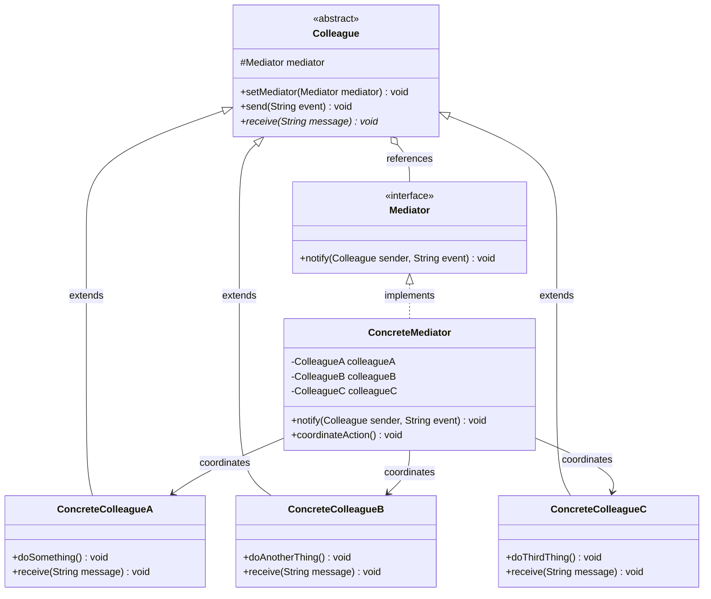
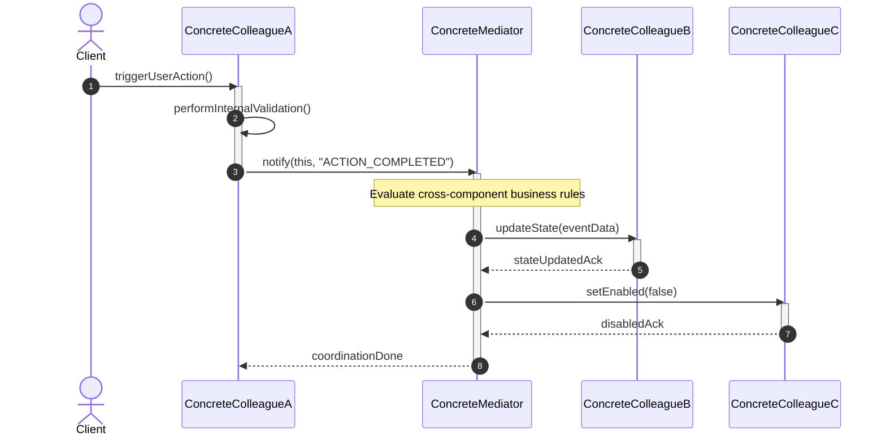

# Mediator Design Pattern: Comprehensive Architectural Guide

## 1. Real-World Analogy
Imagine an international airport with dozens of commercial airliners attempting to land, taxi, and take off simultaneously across intersecting runways. If every pilot had to communicate directly via radio with every other pilot in the airspace to negotiate right-of-way, landing sequences, and runway clearances, the result would be catastrophic cognitive overload, chaotic radio channel cross-talk, and an exponential $O(N^2)$ web of peer-to-peer dependencies.

Instead, airports introduce an **Air Traffic Control (ATC) Tower**. Pilots do not communicate directly with one another. A pilot approaching the airfield radios the ATC Tower with their altitude, speed, and intent. The tower evaluates overall airfield state, schedules runways, enforces safety buffers, and issues clear landing or holding clearances. The tower acts as the **Mediator**: it centralizes complex interaction rules, while individual aircraft (**Colleagues**) remain completely decoupled from one another.

---

## 2. The Problem It Solves
In complex software architectures, subsystems often evolve into dense webs of tightly coupled components. When Component A needs to notify Component B, B updates Component C, C queries Component D, and D calls back into A, the system exhibits severe design smells:

1. **Quadratic Coupling Complexity ($O(N^2)$):** For $N$ communicating components, direct peer connections grow exponentially toward $\frac{N(N-1)}{2}$. Each new component added requires knowledge of and wiring to many existing components.
2. **Impaired Reusability:** A colleague class cannot be reused in another module or test harness because it carries hard references to several other concrete collaborators.
3. **Scattered Coordination Logic:** Business workflows, mutual exclusion rules, and sequencing constraints are fragmented across dozens of individual classes rather than being auditable and maintainable in one place.
4. **Circular Dependencies:** Tightly coupled peer components frequently cause circular dependencies at the class, package, or build levels, complicating unit testing and lifecycle management.

The **Mediator Pattern** solves these challenges by encapsulating how a set of objects interact. It promotes loose coupling by preventing objects from referring to each other explicitly, allowing their interactions to be varied independently.

---

## 3. Step-by-Step Implementation Guide
Follow this systematic engineering approach to implement the Mediator pattern:

1. **Define the Mediator Interface (`Mediator`):**
   - Declare common communication methods used by colleagues to notify the mediator of events or state transitions (e.g., `notify(Colleague sender, String event)` or specialized message routing methods).
2. **Define the Abstract Colleague (`Colleague`):**
   - Create a base class or interface for participants that holds a reference to the `Mediator`.
   - Ensure colleagues only communicate outwards via the mediator reference, never retaining direct pointers to sibling colleagues.
3. **Implement Concrete Colleague Components:**
   - Focus each colleague strictly on its core domain responsibility (e.g., UI Button, User in a chat room, Aircraft in flight).
   - When an internal state change or event occurs, delegate communication to `mediator.notify(this, event)`.
4. **Implement the Concrete Mediator (`ConcreteMediator`):**
   - Maintain references to all relevant colleague instances.
   - Implement the coordination logic: receive events from colleagues, evaluate system-wide invariants, and invoke commands on target colleagues.
5. **Establish Component Registration:**
   - Wire colleagues to the mediator either via constructor injection, builder assembly, or mediator registration methods (`registerColleague(Colleague)`).

---

## 4. Class Diagram

### Detailed Diagram Explanation
- `Mediator`: Defines the abstract communication contract through which colleagues broadcast domain events without knowing who receives them.
- `ConcreteMediator`: Encapsulates all coordination logic and dependencies between colleague components. When `ColleagueA` sends an event, `ConcreteMediator` decides whether `ColleagueB`, `ColleagueC`, or both need to react.
- `Colleague`: Abstract base class holding a protected reference to the `Mediator`. Subclasses know only their own business logic and their mediator; they have zero knowledge of peer colleagues.
- `ConcreteColleagueA/B/C`: Individual domain entities. Their relationships change from an $O(N^2)$ mesh to an $O(N)$ star topology centered on the mediator.

---

## 5. Sequence Diagram

### Detailed Sequence Explanation
1. An external client or environment triggers a domain action on `ConcreteColleagueA`.
2. `ConcreteColleagueA` executes its localized logic (e.g., input parsing, local state mutation).
3. Instead of directly calling `ColleagueB` or `ColleagueC`, `ColleagueA` notifies the `Mediator` that `"ACTION_COMPLETED"` occurred.
4. The `Mediator` intercepts the notification and evaluates workflow rules (e.g., "when A completes, B must refresh its data and C must be temporarily disabled").
5. The `Mediator` orchestrates `ColleagueB.updateState(...)` and `ColleagueC.setEnabled(false)`.
6. Control returns cleanly through the mediator, keeping all colleagues isolated from one another.

---

## 6. Participant Roles & Responsibilities

| Participant | Primary Responsibility | Architectural Rule |
| :--- | :--- | :--- |
| **`Mediator` (Interface)** | Declares the unified communication contract for colleague notification. | Must remain agnostic of specific UI or transport details where possible. |
| **`ConcreteMediator`** | Implements coordination, choreographs multi-party workflows, and maintains references to colleagues. | Encapsulates routing rules, mutual exclusion, validation sequences, and lifecycle dependencies. |
| **`Colleague` (Abstract/Base)** | Holds a reference to the mediator and defines the interface for incoming mediator commands. | Subclasses MUST never hold direct references to peer colleague classes. |
| **`ConcreteColleague`** | Executes localized domain business logic and emits notifications when events happen. | Communicates exclusively through `mediator.notify(this, event)`. |

---

## 7. Relationships and Structural Insights
- **Star Topology vs. Mesh Topology:** The pattern transforms an uncontrolled mesh network of $N(N-1)/2$ connections into a hub-and-spoke star network requiring only $N$ bilateral connections.
- **Bi-directional Knowledge:** The concrete mediator knows all its colleagues intimately. The colleagues, conversely, know only the abstract `Mediator` interface.
- **Decoupled Life Cycles:** Colleagues can be dynamically registered, unregistered, pooled, or replaced at runtime without affecting sibling colleagues.

---

## 8. Bad vs Good Comparison Table

| Attribute | Bad Design (Direct Peer Connections) | Good Design (Mediator Pattern) |
| :--- | :--- | :--- |
| **Coupling** | $O(N^2)$ tight coupling; peer components hardcode concrete imports of each other. | $O(N)$ loose coupling; components only depend on an abstract `Mediator`. |
| **Reusability** | Near zero; extracting one component drags a transitive graph of collaborators. | High; individual components can be tested and reused in complete isolation. |
| **Coordination Logic** | Fragmented across dozens of handler methods in disparate classes. | Centralized in the mediator, providing a single source of truth for workflows. |
| **Extensibility** | Adding a new component requires modifying every interacting colleague. | Adding a new component requires updating only the mediator wiring. |
| **Testing** | Requires complex mock graphs simulating mutually dependent peer objects. | Colleague unit tests only need a dummy/mock `Mediator` verification. |

---

## 9. Genuine SOLID Alignment

- **Single Responsibility Principle (SRP):**
  - Colleagues focus exclusively on their core business logic (e.g., rendering a text field, piloting an aircraft).
  - The Mediator focuses exclusively on inter-component routing, sequencing, and workflow coordination.
- **Open/Closed Principle (OCP):**
  - New colleague types can be introduced without modifying existing colleague implementations.
  - New interaction policies (e.g., VIP priority routing, audit logging mediators) can be swapped by providing alternative mediator implementations.
- **Liskov Substitution Principle (LSP):**
  - Subclasses of `Colleague` can be substituted wherever the base colleague is expected.
  - Multiple `Mediator` implementations (e.g., `ProductionChatMediator`, `TestMockMediator`) can be substituted interchangeably.
- **Interface Segregation Principle (ISP):**
  - The `Mediator` contract specifies focused notification protocols rather than forcing colleagues to implement giant multi-purpose interfaces.
- **Dependency Inversion Principle (DIP):**
  - Colleagues depend on the high-level `Mediator` abstraction rather than concrete mediator or sibling implementations.

---

## 10. When to Use (and When NOT to Use)

### When to Use:
- A set of objects communicate in well-defined but complex ways, resulting in unstructured and hard-to-understand interdependencies.
- Reusing an object is difficult because it refers to and communicates with lots of other objects.
- A behavior distributed across several classes should be customizable without substantial subclassing.
- UI dialogs or forms where changes in one widget (dropdown selection) alter the state of multiple other widgets (enable button, clear inputs, display error banner).
- Multi-party collaboration systems like chat rooms, real-time gaming lobbies, air traffic coordination, and distributed microservice sagas.

### When NOT to Use:
- **Trivial Collaborations:** When only two objects communicate, introducing a mediator adds needless boilerplate without architectural benefit.
- **Simple Parent-Child Relationships:** If an object naturally owns and manages child entities, standard encapsulation and direct delegation are clearer.
- **Pure Event Broadcasting:** If the sender only needs to publish notifications to arbitrary unknown subscribers without receiving responses or coordinating mutual states, the **Observer Pattern** is lighter and more appropriate.

---

## 11. Design Trade-Offs

### Advantages (Pros):
- **Centralized Workflows:** Business workflow logic is gathered in one place, making audit trails and state machine enforcement straightforward.
- **Eliminates Circular Dependencies:** Breaks circular import graphs between collaborating peers.
- **Simplified Testing:** Individual colleagues can be unit-tested without instantiating complex graphs of concrete peers.

### Disadvantages (Cons):
- **Risk of God Object ("Hub-and-Spoke Bloat"):** As the system grows, the concrete mediator can become a monolithic God Object that knows too much and does too much.
- **Hidden Complexity:** The complexity does not disappear; it shifts from distributed interactions into the mediator itself.
- **Performance Overhead:** All inter-object traffic indirection passes through the mediator, which can introduce minor method dispatch overhead.

---

## 12. Common Anti-Patterns & Incorrect Usage

### Anti-Pattern 1: The Monolithic "God Mediator"
- **Symptom:** A single mediator class grows to thousands of lines of code, implementing data validation, business computation, database access, and UI rendering.
- **Fix:** Keep the mediator focused strictly on **orchestration and message routing**. Delegate business domain calculations and persistence to dedicated domain services.

### Anti-Pattern 2: Bypassing the Mediator (Backchannel Coupling)
- **Symptom:** Colleagues notify the mediator, but also retain direct references to specific peer colleagues for "convenience" or data fetching.
- **Fix:** Strictly enforce that colleagues communicate only through the mediator contract. If data is needed from peers, the mediator coordinates the query.

### Anti-Pattern 3: Chatty Fine-Grained Mediators
- **Symptom:** Emitting a mediator event for every single character typed or micro-step, overwhelming the mediator with high-frequency notifications.
- **Fix:** Batch domain events or use change-debouncing so the mediator coordinates discrete, meaningful state transitions.

---

## 13. Differences with Similar Patterns

| Dimension | Mediator Pattern | Observer Pattern | Facade Pattern | Command Pattern |
| :--- | :--- | :--- | :--- | :--- |
| **Primary Intent** | Coordinate complex, many-to-many interactions between peers. | One-to-many broadcast of events to unknown observers. | Provide a simplified structural interface to a subsystem. | Encapsulate an action and its parameters as a discrete object. |
| **Communication Flow** | Bi-directional; mediator receives events and invokes commands on colleagues. | Unidirectional; subject notifies observers, observers rarely direct the subject. | Unidirectional; clients call the facade, the facade calls subsystem classes. | Decoupled invoker triggers command, which delegates to receiver. |
| **Colleague Awareness** | Colleagues know the mediator exists and invoke its contract. | Subject doesn't care who observers are; loose observer registration. | Subsystem classes are unaware of the facade's existence. | Invoker knows the command interface; receiver knows nothing about invoker. |
| **Centralization** | High; interaction rules live in the mediator. | Low; observers independently handle updates. | High; subsystem entry point is unified. | Low; each command encapsulates an isolated operation. |

---

## 14. Real-World Interview Q&A

### Q1: What is the fundamental difference between the Mediator and Observer patterns?
**Answer:** While both patterns facilitate communication without tight coupling:
- **Observer** establishes a one-to-many unidirectional broadcast relationship. A subject does not know who is listening and does not coordinate complex multi-party interactions. Observers generally do not talk back to the subject to affect other observers.
- **Mediator** establishes a multi-directional coordination hub for many-to-many relationships. The mediator receives notifications from colleagues and explicitly decides how other colleagues must respond, centralizing workflow logic that would otherwise be distributed across the participants.

### Q2: How do you prevent a Mediator from becoming an unmaintainable "God Object"?
**Answer:** 
1. Adhere strictly to the **Single Responsibility Principle**: The mediator should only handle message routing and interaction policies, never core domain business logic, data calculations, or persistence.
2. Partition large systems into **hierarchical or federated mediators** (e.g., FormDialogMediator handles the UI form, while WorkflowMediator handles backend process steps).
3. Use specialized strategy objects or rule engines inside the mediator to evaluate complex dispatch rules rather than giant `switch`/`if-else` blocks.

### Q3: Can Colleagues use the Observer pattern to communicate with the Mediator?
**Answer:** Yes! In fact, Gang of Four explicitly notes that colleagues can communicate with the mediator using the Observer pattern: the mediator subscribes as an observer to colleague state change events. When a colleague triggers an event, the mediator intercepts it and coordinates reactions among other colleagues.

### Q4: How does the Mediator pattern impact concurrency and thread safety?
**Answer:** Since the mediator acts as the central transit hub for all colleague interactions, stateful mediators can become synchronization bottlenecks. If multiple colleagues invoke the mediator concurrently from different threads:
- The mediator must either be stateless (dispatching asynchronously),
- Or protect shared interaction state using appropriate synchronization primitives (`ReentrantLock`, `ConcurrentHashMap`, actor-based message queues).

### Q5: How does the Mediator pattern differ from the Facade pattern?
**Answer:** 
- **Facade** abstracts a subsystem from external clients by providing a simplified, unidirectional entry point. Subsystem components have no knowledge of the facade and do not communicate through it amongst themselves.
- **Mediator** enables internal subsystem components to collaborate amongst themselves. Colleagues are aware of the mediator and route their mutual communications through it.

---

## 15. Quick Revision Checklist
- [ ] Colleagues maintain references only to the abstract `Mediator` interface, never to sibling colleagues.
- [ ] All cross-component communication, sequencing, and mutual exclusion logic resides in the concrete mediator.
- [ ] Colleagues communicate outward by raising events: `mediator.notify(this, event)`.
- [ ] Network topology is reduced from $O(N^2)$ mesh to $O(N)$ star.
- [ ] Mediator is kept lean by delegating domain computations to dedicated services to avoid the God Object anti-pattern.
- [ ] Thread safety and concurrent invocation semantics are explicitly defined for shared mediators.
