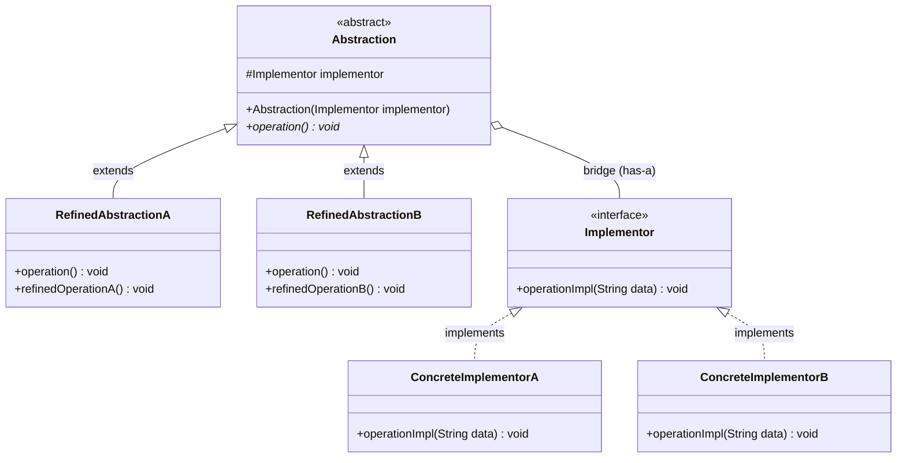
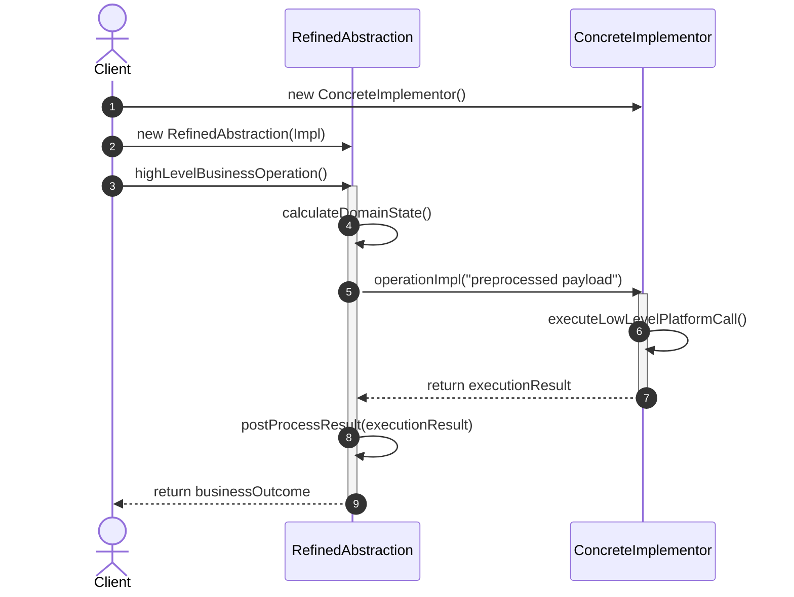

# Bridge Design Pattern: Comprehensive Architectural Guide

## 1. Real-World Analogy
Consider a modern universal remote control and consumer electronic appliances. In the early days of consumer electronics, a manufacturer might design a proprietary television with an integrated remote control circuitry tied directly to that specific TV chassis. If the manufacturer introduced an air conditioner, a sound system, and a projector, and then wanted to offer standard remotes, advanced touchscreen remotes, and voice-activated remotes, building a separate integrated controller for every combination would require $3 \text{ remotes} \times 4 \text{ appliances} = 12$ distinct hybrid products.

Instead, the electronics industry separates the **control interface (Abstraction)** from the **appliance hardware (Implementor)** using standardized communication protocols (such as Infrared or Bluetooth):
- The **Abstraction** dimension varies by user-facing control logic: Basic Remote, Advanced Touchscreen Remote, Voice Remote.
- The **Implementor** dimension varies by underlying appliance hardware: Television, Audio Receiver, Smart Light, Projector.

A remote communicates with any appliance through a standardized device contract. Now, adding a new remote type or a new smart appliance requires only $3 + 4 = 7$ classes instead of $3 \times 4 = 12$. The **Bridge** is the composition reference connecting the remote hierarchy to the appliance hierarchy.

---

## 2. The Problem It Solves
When a domain abstraction varies along two or more independent dimensions (for example, *Abstraction* = Notification urgency level, *Implementation* = Delivery channel; or *Abstraction* = Shape geometry, *Implementation* = Rendering backend), inheritance-based designs suffer from a severe architectural flaw known as **Cartesian Product Class Explosion**.

### The Cartesian Explosion Trap:
If you have $M$ shapes (`Circle`, `Square`, `Triangle`) and $N$ rendering platforms (`Vector`, `Raster`, `OpenGL`), subclassing produces $M \times N$ classes:
- `VectorCircle`, `RasterCircle`, `OpenGLCircle`
- `VectorSquare`, `RasterSquare`, `OpenGLSquare`
- `VectorTriangle`, `RasterTriangle`, `OpenGLTriangle`

Every new shape requires implementing $N$ new classes. Every new rendering platform requires subclassing all $M$ shapes. 

The **Bridge Pattern** solves this problem by replacing multi-dimensional class inheritance with object composition:
1. It splits the monolithic hierarchy into two separate, independent hierarchies:
   - **Abstraction:** The high-level control or domain logic.
   - **Implementor:** The low-level platform, execution, or backend operations.
2. The Abstraction maintains a composition reference (the "Bridge") to an instance of the Implementor interface, delegating low-level operations dynamically at runtime.

---

## 3. Step-by-Step Implementation Guide
Follow this systematic engineering approach to implement the Bridge pattern:

1. **Identify the Independent Dimensions of Variation:**
   - Determine what constitutes high-level business abstractions (e.g., UI abstractions, notification policies, vehicle types) versus low-level platform primitives (e.g., rendering engines, delivery protocols, engine types).
2. **Define the Implementor Interface (`Implementor`):**
   - Declare the low-level primitive operations required by the abstraction (e.g., `renderCircle(x, y, radius)`, `sendPayload(rawBytes)`).
   - Keep the implementor interface focused on primitive execution rather than high-level business workflows.
3. **Implement Concrete Implementors (`ConcreteImplementorA`, `ConcreteImplementorB`):**
   - Provide concrete, platform-specific implementations of the implementor interface (e.g., `VectorRenderer`, `RasterRenderer`, `SmsGatewayChannel`).
4. **Define the Base Abstraction (`Abstraction`):**
   - Create an abstract class or interface defining high-level operations.
   - Maintain a protected or private reference to the `Implementor` interface (the Bridge reference), initialized via constructor injection.
5. **Create Refined Abstractions (`RefinedAbstractionA`, `RefinedAbstractionB`):**
   - Extend the base abstraction with specialized business variations (e.g., `UrgentNotification`, `BasicRemoteControl`).
   - Implement business operations by composing calls to the underlying implementor's primitive methods.
6. **Assemble via Dependency Injection:**
   - Client code selects a refined abstraction and injects the desired concrete implementor, switching backends or channels at runtime without altering client code.

---

## 4. Class Diagram

### Detailed Diagram Explanation
- `Abstraction`: Defines the high-level control interface and holds a reference to an `Implementor`. It acts as the anchor point of the bridge.
- `RefinedAbstractionA/B`: Extends `Abstraction` to provide richer, specialized domain variants. These classes invoke primitive operations on the `implementor` reference.
- `Implementor`: Defines the interface for implementation classes. It typically offers primitive operations that the abstraction coordinates to fulfill complex business needs.
- `ConcreteImplementorA/B`: Encapsulates platform-specific or vendor-specific code, completely decoupled from the high-level abstraction classes.
- **The Bridge Reference (`#Implementor implementor`):** Replaces rigid compile-time inheritance with flexible runtime composition.

---

## 5. Sequence Diagram

### Detailed Sequence Explanation
1. The client instantiates a `ConcreteImplementor` (e.g., `VectorRenderer`).
2. The client injects this implementor into the constructor of a `RefinedAbstraction` (e.g., `CircleShape`).
3. The client calls a high-level business method on the abstraction (`highLevelBusinessOperation`).
4. The refined abstraction executes domain calculations (e.g., radius, bounding box).
5. The abstraction delegates low-level execution to the bridge reference (`operationImpl`), passing preprocessed arguments.
6. The implementor executes platform-specific logic and returns the raw execution result.
7. The refined abstraction post-processes the result and responds to the client.

---

## 6. Participant Roles & Responsibilities

| Participant | Primary Responsibility | Architectural Rule |
| :--- | :--- | :--- |
| **`Abstraction`** | Defines the abstract business logic interface and manages the reference to the implementor. | Does not contain low-level platform code; delegates primitives to the implementor. |
| **`RefinedAbstraction`** | Extends the abstraction with specialized variants and workflow rules. | Must only rely on the `Implementor` abstraction, never concrete implementors. |
| **`Implementor` (Interface)** | Declares low-level primitive methods executed by concrete backends. | Primitive operations only; should not know about high-level abstraction concepts. |
| **`ConcreteImplementor`** | Implements the primitive methods for a specific platform, OS, or channel. | Contains hardware/OS/API-specific logic without any dependency on the abstraction hierarchy. |

---

## 7. Relationships and Structural Insights
- **Linear Growth vs. Quadratic Explosion:** For $M$ abstractions and $N$ implementations, subclassing requires $M \times N$ classes. The Bridge pattern requires only $M + N$ classes.
- **Runtime Binding:** Because the implementor is a reference held by the abstraction, the backend implementation can be swapped dynamically at runtime (e.g., switching from Raster to Vector rendering upon zoom level change).
- **Dual Hierarchy Independence:** You can extend the abstraction hierarchy (add `Polygon` or `CriticalAlert`) without modifying implementors. You can extend the implementor hierarchy (add `MetalRenderer` or `SlackChannel`) without touching existing abstractions.

---

## 8. Bad vs Good Comparison Table

| Attribute | Bad Design (Class Explosion Inheritance) | Good Design (Bridge Pattern) |
| :--- | :--- | :--- |
| **Class Count** | $M \times N$ classes (combinatorial explosion). | $M + N$ classes (linear modular growth). |
| **Coupling** | High; domain logic and platform rendering are welded into single subclasses. | Loose; domain abstraction and platform implementation are completely decoupled. |
| **Runtime Adaptability** | None; rendering platform is fixed permanently at compile time. | High; implementors can be dynamically swapped at runtime. |
| **Extensibility** | Adding a new platform requires creating $M$ new classes. | Adding a new platform requires writing exactly 1 new concrete implementor. |
| **Testability** | Testing shapes requires real hardware/platform graphics drivers. | Shapes can be unit tested in isolation using mock `Implementor` instances. |

---

## 9. Genuine SOLID Alignment

- **Single Responsibility Principle (SRP):**
  - Abstraction handles high-level domain workflows and user-facing policies.
  - Implementor handles low-level platform execution, hardware access, or network protocol transport.
- **Open/Closed Principle (OCP):**
  - New abstractions can be introduced without modifying existing implementors.
  - New implementors can be plugged in without changing existing abstractions or client code.
- **Liskov Substitution Principle (LSP):**
  - Any `RefinedAbstraction` can substitute for `Abstraction`.
  - Any `ConcreteImplementor` can substitute for `Implementor`.
- **Interface Segregation Principle (ISP):**
  - Implementor interfaces focus strictly on primitive execution calls rather than monolithic multi-purpose APIs.
- **Dependency Inversion Principle (DIP):**
  - High-level abstractions depend strictly on the abstract `Implementor` interface, never on concrete vendor implementations.

---

## 10. When to Use (and When NOT to Use)

### When to Use:
- You need to avoid a permanent binding between an abstraction and its implementation (e.g., when the implementation must be selected or switched at runtime).
- Both abstractions and implementations should be extensible independently by subclassing.
- Changes in the implementation of an abstraction should have no impact on clients (client code does not need recompilation).
- You encounter or anticipate a combinatorial explosion of classes due to two orthogonal dimensions of variation.
- Cross-platform graphical systems, multi-channel messaging platforms, multi-database query builders, device drivers.

### When NOT to Use:
- **Single Dimension of Variation:** If only the shape varies and rendering is fixed forever, introducing Bridge is over-engineering.
- **Simple Pluggable Strategies:** If you only need to swap a single algorithm without varying the abstraction hierarchy itself, use the lighter **Strategy Pattern**.

---

## 11. Design Trade-Offs

### Advantages (Pros):
- **Prevents Class Explosion:** Replaces $M \times N$ combinatorial proliferation with $M + N$ linear classes.
- **Decoupled Life Cycles:** Independent compile and deploy lifecycles for domain business logic vs platform drivers.
- **Runtime Swappability:** Switch implementations on the fly (e.g., fallback from SMS to Email when offline).
- **Enhanced Testability:** Abstraction logic can be verified with mock implementors without spawning real hardware or platform subsystems.

### Disadvantages (Cons):
- **Increased Architectural Complexity:** Introduces indirection and extra interfaces which may confuse junior developers.
- **Indirection Overhead:** Slight performance cost of extra virtual method calls through the bridge reference.

---

## 12. Common Anti-Patterns & Incorrect Usage

### Anti-Pattern 1: The Degenerate One-to-One Bridge
- **Symptom:** Creating an `Abstraction` with only one `RefinedAbstraction` and an `Implementor` with only one `ConcreteImplementor`.
- **Fix:** Do not apply Bridge preemptively. If there is only one implementation dimension, use standard interface-implementation or direct classes until a second dimension emerges.

### Anti-Pattern 2: Leaking Implementor Details to Abstraction
- **Symptom:** The `Implementor` interface exposes platform-specific data structures (like DirectX device handles) that the `Abstraction` must manipulate.
- **Fix:** Keep the `Implementor` contract high enough that any concrete platform can satisfy it without leaking proprietary types.

### Anti-Pattern 3: Confusing Bridge with Adapter
- **Symptom:** Retrofitting Bridge onto two legacy systems after they have already been designed and built.
- **Fix:** Bridge is an **upfront architectural choice** designed to let two hierarchies evolve independently. Adapter is an **after-the-fact wrapper** making incompatible existing interfaces work together.

---

## 13. Differences with Similar Patterns

| Dimension | Bridge Pattern | Adapter Pattern | Strategy Pattern | Abstract Factory |
| :--- | :--- | :--- | :--- | :--- |
| **Primary Intent** | Decouple abstraction and implementation so both vary independently. | Adapt an existing incompatible interface to match an expected contract. | Encapsulate interchangeable algorithms behind a single interface. | Create families of related or dependent objects without specifying concrete classes. |
| **When Applied** | Upfront architectural design. | After-the-fact integration of legacy or third-party code. | Dynamic algorithm selection at runtime. | Object creation and family configuration. |
| **Hierarchies** | **Two separate hierarchies** (Abstraction + Implementor). | Single hierarchy (Target + Adapter wrapping Adaptee). | Single hierarchy of algorithm implementations. | Factory hierarchy producing product hierarchies. |
| **Structure** | Abstraction *has-a* Implementor bridge. | Adapter *has-a* Adaptee and *is-a* Target. | Context *has-a* Strategy. | Client *uses* AbstractFactory to create Products. |

---

## 14. Real-World Interview Q&A

### Q1: What is the core problem that the Bridge pattern solves?
**Answer:** The Bridge pattern prevents the **Cartesian Product Class Explosion** that occurs when an inheritance hierarchy tries to model two orthogonal dimensions of variation simultaneously. Instead of creating $M \times N$ subclasses representing every possible combination, Bridge decouples the system into two independent hierarchies (Abstraction and Implementor) connected via composition, reducing the total class count to $M + N$.

### Q2: How does Bridge differ fundamentally from Adapter?
**Answer:**
- **Timing:** Bridge is designed **upfront** during system architecture to allow two dimensions to evolve independently. Adapter is applied **after the fact** to make two existing, otherwise incompatible interfaces work together.
- **Structure:** Bridge features two parallel, independent hierarchies (e.g., `Shape` $\rightarrow$ `Renderer`). Adapter wraps an existing class (`Adaptee`) to make it conform to a target interface (`Target`).

### Q3: How does Bridge differ from Strategy?
**Answer:** While both use composition to delegate operations:
- **Strategy** focuses on swappable algorithms for a single context. There is typically only one hierarchy: the strategy implementations.
- **Bridge** features two distinct hierarchies: the abstraction hierarchy (which refines business rules) and the implementor hierarchy (which executes platform operations).

### Q4: Can an Abstraction swap its Implementor dynamically at runtime?
**Answer:** Yes! Because the bridge is maintained as an object reference (`Implementor implementor`), the abstraction can expose a setter (`setImplementor(Implementor newImpl)`) allowing dynamic runtime switching (e.g., switching a video player from Software Decoding to Hardware GPU Decoding on the fly).

### Q5: In Java, where do we see the Bridge pattern in the standard library?
**Answer:**
- **JDBC (Java Database Connectivity):** The JDBC API (`Connection`, `Statement`, `ResultSet`) represents the abstraction hierarchy used by application developers. The JDBC Drivers (`com.mysql.cj.jdbc.Driver`, `org.postgresql.Driver`) represent the concrete implementor hierarchy provided by database vendors.
- **AWT (Abstract Window Toolkit):** AWT components (`Button`, `TextField`) act as abstractions, while AWT peer classes (`ButtonPeer`, `TextFieldPeer`) act as native OS platform implementors.

---

## 15. Quick Revision Checklist
- [ ] Identify two orthogonal dimensions: **Abstraction** (business policy) and **Implementor** (platform execution).
- [ ] Ensure the class count scales as $M + N$ instead of $M \times N$.
- [ ] Base `Abstraction` holds a composition reference to the `Implementor` interface (the Bridge).
- [ ] `RefinedAbstraction` invokes primitive methods on the implementor reference.
- [ ] `ConcreteImplementor` implements primitive methods with zero dependencies on the abstraction hierarchy.
- [ ] Implementors can be injected or swapped at runtime.
- [ ] Implementor interface does not leak platform-specific structures to the abstraction.
