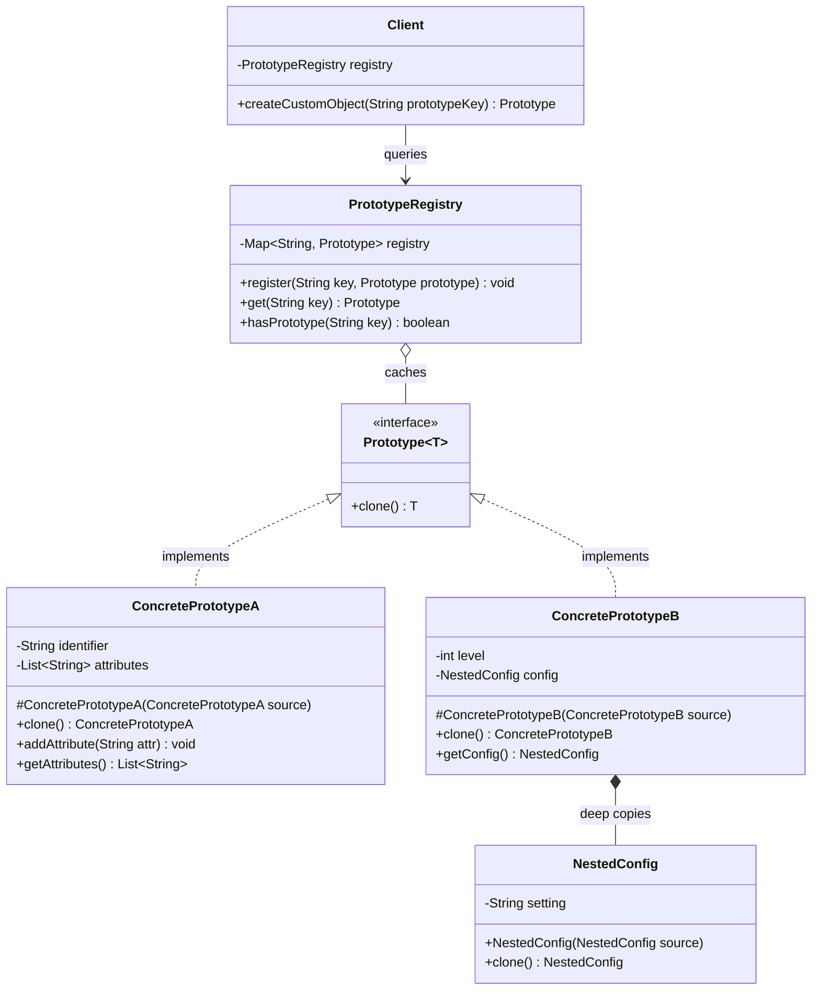
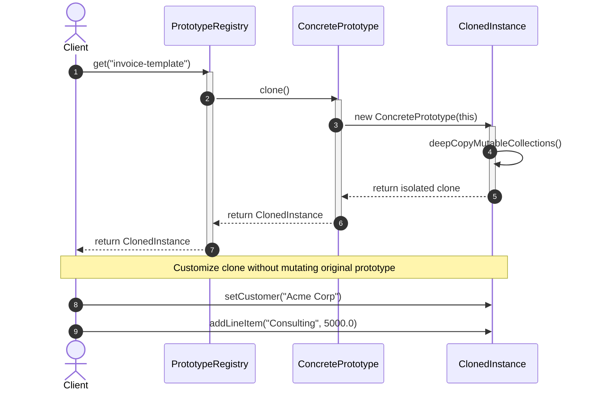

# Prototype Design Pattern: Comprehensive Architectural Guide

## 1. Real-World Analogy
Consider biological cell division (mitosis). When a eukaryotic cell needs to reproduce or heal tissue, nature does not synthesize a brand new cell from raw organic molecules, amino acids, and nucleotides from scratch by executing a complex biochemical recipe. Doing so would be computationally and energetically prohibitive.

Instead, the existing cell unzips its double helix, duplicates its complete genetic blueprint, and cleaves into an exact clone of itself. The daughter cell inherits all cytoplasmic structures, organelles, and epigenetic configurations from the parent **Prototype**. Once duplicated, the new cell can differentiate or mutate independently without altering the original parent cell.

In software, the **Prototype Pattern** allows an application to clone existing, pre-configured object instances rather than instantiating classes from scratch and re-executing expensive database queries, network calls, or complex configuration parsing.

---

## 2. The Problem It Solves
Direct object construction via `new ConcreteClass(...)` introduces severe design and performance limitations:

1. **Expensive Initialization Costs:** An object graph may require costly disk I/O, network roundtrips, database lookups, or heavy mathematical computations during construction (e.g., loading textures, compiling ASTs, parsing XML/JSON templates). Creating thousands of similar objects from scratch degrades latency and throughput.
2. **Coupling to Concrete Classes:** When a client needs an exact copy of an object, relying on `new` forces the client to know the object's concrete class and read all its private fields. If the object is passed through an interface (`Document` or `Character`), the client cannot construct a copy without casting or violating encapsulation.
3. **Complex Internal Object Graphs:** Objects frequently contain nested collections, metadata maps, and child references. Manually copying these fields outside the class leaks implementation details and invites disastrous **shallow-copy reference aliasing bugs** (where modifying a clone accidentally corrupts the original prototype's nested state).

The **Prototype Pattern** delegates cloning directly to the object being copied. It specifies an interface with a `clone()` or `copy()` method, enabling callers to create identical duplicates polymorphically without knowing concrete classes or violating encapsulation.

---

## 3. Step-by-Step Implementation Guide
Follow this systematic engineering approach to implement the Prototype pattern:

1. **Define the Prototype Interface (`Prototype<T>`):**
   - Declare a generic or typed cloning contract: `T clone()` or `T deepCopy()`.
   - Avoid implementing Java's legacy `Cloneable` interface (which relies on `Object.clone()` and throws `CloneNotSupportedException`). Use clean, type-safe custom interfaces.
2. **Implement Copy Constructors in Concrete Classes:**
   - Create a private or protected copy constructor: `protected ConcretePrototype(ConcretePrototype source)`.
   - Ensure primitive fields are copied by value, and mutable reference fields (lists, maps, nested domain objects) are cloned deeply.
3. **Implement the `clone()` Method:**
   - Delegate the `clone()` implementation directly to the copy constructor:
     ```java
     @Override
     public ConcretePrototype clone() {
         return new ConcretePrototype(this);
     }
     ```
4. **Build a Prototype Registry (`PrototypeRegistry`):**
   - Create a central catalog/cache holding pre-configured baseline prototypes indexed by key (e.g., `"standard-invoice"`, `"warrior-hero"`).
   - Expose factory methods: `registerPrototype(key, prototype)` and `create(key)`.
5. **Consume and Differentiate Clones:**
   - Client queries the registry for a cloned instance and modifies only the fields that differ for the current transaction (e.g., recipient address, custom character name).

---

## 4. Class Diagram



### Detailed Diagram Explanation
- `Prototype<T>`: The generic interface declaring the contract for polymorphic duplication.
- `ConcretePrototypeA/B`: Domain classes implementing `clone()`. Each class implements a copy constructor that performs thorough deep copying of all mutable nested state (such as `attributes` lists or `NestedConfig` objects).
- `NestedConfig`: Child component supporting deep copy to ensure clones never share mutable references with the prototype.
- `PrototypeRegistry`: Key-value registry holding pre-configured, gold-standard prototype instances.
- `Client`: Interacts only with the registry and the `Prototype` interface to instantiate and specialize new objects.

---

## 5. Sequence Diagram



### Detailed Sequence Explanation
1. The client requests a pre-configured template from the `PrototypeRegistry`.
2. The registry retrieves the baseline prototype and invokes its polymorphic `clone()` method.
3. The prototype invokes its internal copy constructor, passing `this` as the source.
4. The constructor allocates a new object and deeply duplicates all nested collections and mutable references.
5. The freshly allocated, completely isolated clone is returned to the registry.
6. The registry returns the clone to the client.
7. The client customizes clone-specific fields (`customer`, `line items`) with absolute safety, knowing the prototype remains uncorrupted.

---

## 6. Participant Roles & Responsibilities

| Participant | Primary Responsibility | Architectural Rule |
| :--- | :--- | :--- |
| **`Prototype<T>`** | Declares the polymorphic cloning contract. | Must guarantee type safety and clear deep-copy semantics. |
| **`ConcretePrototype`** | Implements the cloning mechanism and copy constructor. | MUST deeply copy all mutable references, collections, and nested objects. |
| **`PrototypeRegistry`** | Stores and manages a catalog of pre-configured prototype instances. | Returns freshly cloned instances upon lookup, never raw prototype references. |
| **`Client`** | Requests clones from prototypes or registries and customizes them. | Interacts via the `Prototype` abstraction, avoiding concrete class construction. |

---

## 7. Deep Copy vs. Shallow Copy Mechanics

```text
SHALLOW COPY (Dangerous Reference Sharing):
[Prototype] --------> [Mutable Items List: Item1, Item2]
     ^                                ^
     | (shared pointer)               |
[Clone]     ---------------------------
Result: Clone modifying Item1 silently corrupts Prototype!

DEEP COPY (Complete Architectural Isolation):
[Prototype] --------> [Original List: Item1, Item2]
[Clone]     --------> [Cloned List:   Item1_copy, Item2_copy]
Result: Complete mutational independence.
```

- **Shallow Copy (`clone.field = this.field`):** Duplicates only the primitive fields and the top-level object memory block. Object references point to the exact same memory locations as the original. If the clone mutates an element in an array or map, the prototype is corrupted.
- **Deep Copy:** Recursively clones the entire object graph, allocating distinct memory for all nested collections, maps, and child objects. The clone and prototype share zero mutable state.

---

## 8. Bad vs Good Comparison Table

| Attribute | Bad Design (`new` + Manual External Copy) | Good Design (Prototype Pattern) |
| :--- | :--- | :--- |
| **Encapsulation** | Broken; external client must inspect private/protected getters and reconstruct objects. | Preserved; the object itself encapsulates its duplication logic. |
| **Polymorphic Cloning** | Impossible; cannot instantiate a copy when holding only an interface reference. | Native; calling `interfaceRef.clone()` yields an exact concrete duplicate. |
| **Setup Cost** | High; re-executes heavy database, file parsing, or network initialization every time. | Minimal; clones pre-warmed memory state instantaneously. |
| **Shallow Copy Risk** | High; clients easily forget to copy nested lists, causing shared-state bugs. | Zero; deep copy logic is centralized and thoroughly unit-tested in one place. |
| **Class Proliferation** | Requires creating subclasses for every minor configuration variant. | Replaces subclasses with pre-configured prototype instances in a registry. |

---

## 9. Genuine SOLID Alignment

- **Single Responsibility Principle (SRP):**
  - Concrete prototypes take responsibility for cloning their own internal graph safely.
  - The registry takes responsibility for cataloging and retrieving baseline templates.
- **Open/Closed Principle (OCP):**
  - New prototype classes can be introduced and registered without modifying existing client code.
  - New baseline templates can be added to the registry dynamically at runtime.
- **Liskov Substitution Principle (LSP):**
  - Any clone produced by `ConcretePrototype.clone()` fulfills the contract of `Prototype` and is substitutable for any consumer of that type.
- **Interface Segregation Principle (ISP):**
  - The `Prototype<T>` contract requires only a single method (`clone()`), without forcing implementors to adopt bloated lifecycle interfaces.
- **Dependency Inversion Principle (DIP):**
  - Clients depend on the abstract `Prototype` interface and registry contracts rather than concrete constructors.

---

## 10. When to Use (and When NOT to Use)

### When to Use:
- Object creation is resource-expensive (e.g., requires database roundtrips, complex math, or network calls), but identical or near-identical objects are needed repeatedly.
- The system must be independent of how its products are created, composed, and represented.
- Classes to instantiate are specified at runtime (e.g., dynamic plugin loading).
- You want to avoid an explosion of factory hierarchies parallel to product class hierarchies.
- Game entity spawning (monsters, obstacles, bullets), document templating, CI/CD pipeline stage cloning, simulation agents.

### When NOT to Use:
- **Trivial POJOs:** For simple data transfer objects with 2 or 3 primitive fields, `new MyDto(...)` is clearer and lighter.
- **Complex Graphs with Circular References:** Objects with bidirectional parent-child-sibling pointers require specialized graph-traversal cloning algorithms (e.g., identity hash maps) to prevent infinite recursion and stack overflows.
- **Immutable Value Objects:** If an object is completely immutable (e.g., `String`, `BigDecimal`, Java `record`), cloning provides zero benefit; the instance can simply be shared safely.

---

## 11. Design Trade-Offs

### Advantages (Pros):
- **High Performance:** Drastically accelerates object instantiation by bypassing heavy constructors and I/O.
- **Eliminates Subclassing:** Pre-configured prototype instances replace complex subclass hierarchies.
- **Encapsulation Protection:** Copies complex private internal states without exposing them to external callers.

### Disadvantages (Cons):
- **Complex Deep Copying:** Implementing deep copy for complex graphs with arrays, nested maps, and foreign dependencies is labor-intensive and error-prone.
- **Circular Reference Hazards:** Graphs containing cycles will trigger infinite loops or stack overflows unless an identity map tracks visited instances.

---

## 12. Common Anti-Patterns & Incorrect Usage

### Anti-Pattern 1: Relying on Java's `Cloneable` and `Object.clone()`
- **Symptom:** Implementing `java.lang.Cloneable` and calling `super.clone()`.
- **Why it's broken:** `Cloneable` is a marker interface without a public `clone()` method. `Object.clone()` bypasses constructors, performs only a shallow field copy, and throws `CloneNotSupportedException`.
- **Fix:** Use a custom `Prototype<T>` interface paired with clean **copy constructors**.

### Anti-Pattern 2: The Leaky Shallow Copy
- **Symptom:** A clone's collection (`List<Item>`) points to the exact same heap list as the prototype.
- **Fix:** Explicitly instantiate new collections in the copy constructor and deeply clone individual items:
  ```java
  this.items = source.items.stream().map(Item::clone).collect(Collectors.toList());
  ```

### Anti-Pattern 3: Prototype as Singleton Variant
- **Symptom:** The registry returns the original prototype reference directly instead of cloning it.
- **Fix:** The registry's `get(key)` method MUST unconditionally call `.clone()` before returning.

---

## 13. Differences with Similar Patterns

| Dimension | Prototype Pattern | Factory Method | Abstract Factory | Builder Pattern |
| :--- | :--- | :--- | :--- | :--- |
| **Creation Mechanism** | Cloning existing instance memory graph. | Subclass overriding factory method with `new`. | Factory object producing family of products. | Step-by-step assembly of complex object. |
| **Object State** | Preserves pre-configured, dynamic runtime state. | Produces clean, newly initialized objects. | Produces clean family of related objects. | Assembles custom permutations sequentially. |
| **Initialization Cost** | Very low (bypasses constructors/I/O). | Standard (invokes constructors). | Standard (invokes constructors). | Moderate (step-by-step validation). |
| **Hierarchy Need** | No parallel factory hierarchy required. | Requires parallel creator hierarchy. | Requires parallel factory hierarchy. | Requires separate builder class. |

---

## 14. Real-World Interview Q&A

### Q1: Why did Joshua Bloch (author of Effective Java) recommend against Java's `Cloneable` interface?
**Answer:** `Cloneable` is widely considered an architectural failure in the Java standard library:
1. It does not actually contain a `clone()` method (it is an empty marker interface); the method is protected in `Object`.
2. Calling `super.clone()` creates an object without invoking any constructor, breaking class invariants and final field initialization rules.
3. It performs a shallow bitwise copy by default, easily corrupting mutable reference fields.
4. It throws a checked `CloneNotSupportedException`, forcing unnecessary `try-catch` boilerplate.
**Best Practice:** Use copy constructors or factory copy methods (`public MyClass(MyClass source)`) with a custom `Prototype` interface.

### Q2: How do you handle circular references during deep cloning?
**Answer:** When an object graph contains cycles (e.g., Node A references Node B, and Node B references Node A), standard recursive cloning enters infinite recursion resulting in a `StackOverflowError`.
To resolve this:
- Maintain a `Map<Object, Object> visited = new IdentityHashMap<>()` context during the clone traversal.
- Before cloning an object, check `visited.containsKey(original)`.
- If present, return the existing cloned reference from the map; otherwise, instantiate the clone, put it in `visited`, and then recursively clone its child fields.

### Q3: When is Serialization-based cloning acceptable, and what are its trade-offs?
**Answer:** Serialization cloning (serializing an object to a byte stream and deserializing it) produces a complete deep copy without manual copy constructors.
- **Trade-offs:** It is significantly slower (10x-50x CPU overhead due to reflection and stream parsing), requires all classes in the graph to implement `Serializable`, and cannot serialize transient fields or external file/socket handles. It is useful as a fallback for deeply nested third-party graphs, but copy constructors are far superior for performance-critical systems.

### Q4: How does the Prototype pattern support dynamic plugin architectures?
**Answer:** When an application loads plugins at runtime, the core application cannot know the concrete classes at compile time. Plugins register a prototype of their custom entity or component with the application's central `PrototypeRegistry`. Whenever the application needs a new instance of that plugin's component, it clones the registered prototype without needing compile-time class dependencies or complex reflection calls.

### Q5: How do prototypes compare with the Builder pattern when assembling complex objects?
**Answer:** 
- **Builder** is ideal when an object must be constructed from scratch through distinct, step-by-step configurations with many optional parameters.
- **Prototype** is ideal when an object already has a known, complex baseline state, and hundreds of instances are needed that share 90% of the configuration, differing only in 1 or 2 transactional fields.
- **Hybrid synergy:** Builders are frequently used to construct the initial "golden" prototypes, which are then cloned via the Prototype pattern for rapid execution.

---

## 15. Quick Revision Checklist
- [ ] Use a clean `Prototype<T>` interface rather than Java's broken `Cloneable`.
- [ ] Implement copy constructors that deeply duplicate all mutable reference fields and collections.
- [ ] Ensure the Prototype Registry returns `.clone()`, never the cached prototype reference itself.
- [ ] Verify complete mutational isolation between prototype and clones via unit tests.
- [ ] Guard against circular references using an identity map if graph contains cycles.
- [ ] Differentiate clones by mutating only the specialized transactional attributes.
