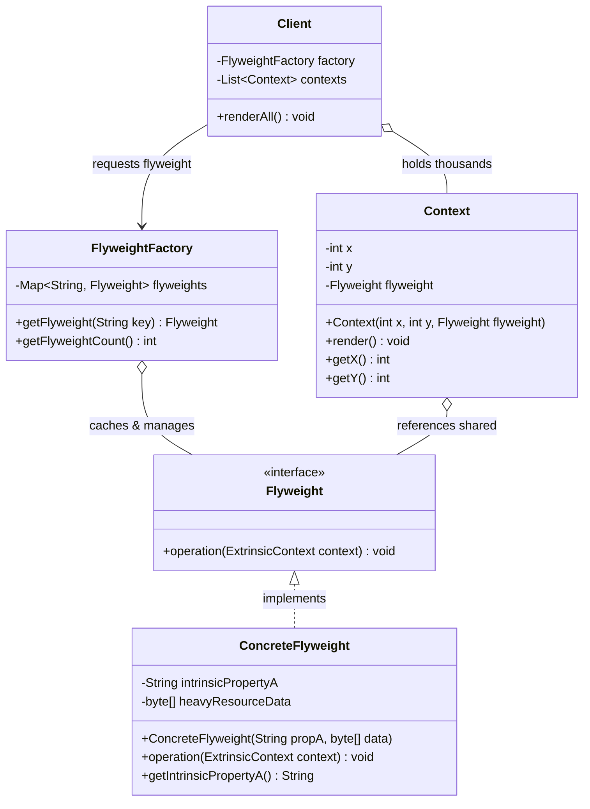
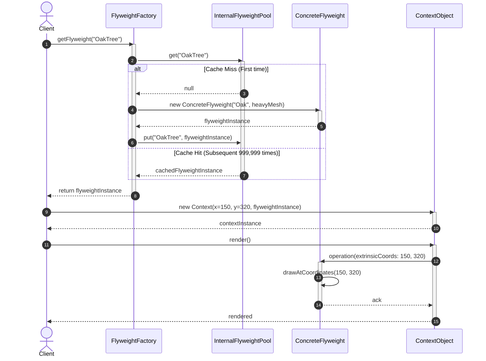

# Flyweight Design Pattern: Comprehensive Architectural Guide

## 1. Real-World Analogy
Consider a physical library or university bookstore holding hundreds of copies of a bestselling textbook, such as *Introduction to Algorithms*. 

If the publisher printed a unique, custom-bound edition for every single student enrolled in a university course—printing student names, assigned student IDs, and current checkout dates into the actual paper margins of each copy—the publisher would need to re-typeset and re-bind thousands of distinct books. Warehousing and production costs would be exorbitant.

Instead, the publisher prints identical, standardized book volumes containing the **intrinsic, invariant content**: chapters, mathematical formulas, diagrams, and glossary. These volumes are completely agnostic of who borrows them. 

The library then manages a slim checkout ledger (or barcode system) recording the **extrinsic, variant context**: `(Copy #10492, Student Alice, Due Oct 30)`. The 1,000-page book data (**Flyweight**) is shared across millions of reader interactions, while the individual checkout record consumes only a few bytes in a database table.

In software, the **Flyweight Pattern** minimizes memory usage by sharing as much invariant data as possible across large numbers of similar objects.

---

## 2. The Problem It Solves
Modern software applications frequently model millions of fine-grained entities:
- A digital game rendering a dense forest with 1,000,000 trees.
- A word processor or code editor rendering 500,000 formatted characters in a large document.
- A mapping engine rendering 2,000,000 points of interest (restaurants, gas stations, ATMs) on a global map.

### The Memory Exhaustion Crisis ($O(N)$ Bloat):
If each tree object encapsulates its $(x, y)$ coordinates alongside heavy 3D mesh arrays, high-resolution textures (e.g., 20 MB of texture buffers), and shader materials, instantiating $10^6$ trees requires:
$$1{,}000{,}000 \times 20\text{ MB} = 20{,}000{,}000\text{ MB} \approx 20\text{ Terabytes of RAM!}$$

The application will immediately crash with an `OutOfMemoryError` or choke under extreme Garbage Collection thrashing.

### The Core Solution: State Bifurcation
The Flyweight pattern resolves this crisis by dividing an object's state into two distinct halves:
1. **Intrinsic State (The Flyweight):** Invariant, read-only data that is identical across thousands of instances (e.g., Tree species, bark texture, 3D mesh data, canopy color). This state is stored *inside* the shared Flyweight object and never changes.
2. **Extrinsic State (The Context):** Unique, contextual data that varies with each occurrence (e.g., specific $(x, y, z)$ world coordinate, individual scale factor, health points). This state is stored *outside* the flyweight in lightweight context objects and passed into flyweight methods as method parameters.

Now, instead of 1,000,000 texture objects, the JVM allocates **only 3 shared `TreeType` flyweights** (Oak, Pine, Birch). The 1,000,000 tree instances store only coordinate primitives `(float x, float y)`, dropping total RAM usage from 20 Terabytes to under 16 Megabytes.

---

## 3. Step-by-Step Implementation Guide
Follow this systematic engineering approach to implement the Flyweight pattern:

1. **Partition State into Intrinsic vs. Extrinsic:**
   - Review fields: Are they immutable and identical across many objects? $\rightarrow$ **Intrinsic**.
   - Do they change depending on position, time, or context? $\rightarrow$ **Extrinsic**.
2. **Define the Flyweight Interface (`Flyweight`):**
   - Declare operational methods where extrinsic state is passed as arguments:
     ```java
     void render(int x, int y, double scale);
     ```
3. **Implement the Concrete Flyweight (`ConcreteFlyweight`):**
   - Encapsulate the intrinsic state in final, immutable fields.
   - Ensure the flyweight has no reference to any specific extrinsic context.
   - Guarantee strict **immutability and thread safety** because thousands of threads and contexts will invoke the same instance simultaneously.
4. **Implement the Flyweight Factory (`FlyweightFactory`):**
   - Maintain an internal cache (e.g., `ConcurrentHashMap<String, Flyweight>`).
   - Implement a factory method: `getFlyweight(key)`. If a matching flyweight already exists, return the cached reference; otherwise, construct, cache, and return it.
5. **Create the Context Class (`Context` / Extrinsic Wrapper):**
   - Construct lightweight objects holding the extrinsic fields (e.g., coordinates, unique identifier) and a pointer to the shared Flyweight instance.
6. **Client Orchestration:**
   - Clients create context objects by obtaining shared flyweights from the factory, avoiding direct instantiation of heavy intrinsic data.

---

## 4. Class Diagram



### Detailed Diagram Explanation
- `Flyweight`: Defines the common contract for handling operations that accept extrinsic state as parameters.
- `ConcreteFlyweight`: Stores intrinsic state (e.g., `heavyResourceData`) in immutable fields. Must be completely thread-safe.
- `FlyweightFactory`: Creates and manages flyweight objects, ensuring instances are shared properly and never duplicated in memory.
- `Context`: Extremely lightweight object containing extrinsic data `(x, y)` and a single reference to the shared `Flyweight`.
- `Client`: Maintains or computes extrinsic state and passes it to flyweight operations during runtime execution.

---

## 5. Sequence Diagram



### Detailed Sequence Explanation
1. The client requests a flyweight matching a key from the `FlyweightFactory`.
2. On the first request (cache miss), the factory instantiates the heavy `ConcreteFlyweight` and stores it in the pool.
3. On all subsequent requests (cache hits), the factory returns the exact same shared reference instantaneously.
4. The client wraps extrinsic parameters `(x=150, y=320)` alongside the shared flyweight reference into a lightweight `Context` object.
5. When `context.render()` is called, the context forwards its coordinates into the flyweight's `operation(x, y)`.
6. The flyweight executes using its shared intrinsic textures combined with the caller's transient coordinates.

---

## 6. Participant Roles & Responsibilities

| Participant | Primary Responsibility | Architectural Rule |
| :--- | :--- | :--- |
| **`Flyweight` (Interface)** | Declares the contract through which flyweights receive and act upon extrinsic state. | Must not declare state-mutating methods for intrinsic properties. |
| **`ConcreteFlyweight`** | Stores invariant, heavy intrinsic state. | MUST be strictly immutable and thread-safe. |
| **`FlyweightFactory`** | Creates, pools, and dispenses flyweight instances. | Ensures that flyweights are shared; prevents redundant instantiation. |
| **`Context`** | Stores extrinsic state unique to a specific occurrence in time or space. | References the shared flyweight; remains as memory-compact as possible. |
| **`Client`** | Maintains collections of contexts and drives rendering/processing loops. | Obtains flyweights exclusively through the factory. |

---

## 7. Memory Footprint Analysis (Forest Benchmark)

| Configuration | 1,000,000 Trees WITHOUT Flyweight | 1,000,000 Trees WITH Flyweight | Savings Factor |
| :--- | :--- | :--- | :--- |
| **Flyweight Objects** | None (1,000,000 duplicate instances) | **3 instances** (Oak, Pine, Birch) | 99.9997% reduction |
| **Heavy Mesh / Texture Memory** | $1{,}000{,}000 \times 20\text{ MB} = 20\text{ TB}$ | $3 \times 20\text{ MB} = 60\text{ MB}$ | **~333,000x reduction** |
| **Context Primitives** | Embedded in heavy class | $1{,}000{,}000 \times 24\text{ bytes} = 24\text{ MB}$ | Clean cache locality |
| **Total Memory Required** | **~20 Terabytes (OOM Crash)** | **~84 Megabytes** | **99.9996% Saved** |

---

## 8. Bad vs Good Comparison Table

| Attribute | Bad Design (Heavy Independent Objects) | Good Design (Flyweight Pattern) |
| :--- | :--- | :--- |
| **Memory Consumption** | $O(N \times \text{HeavyData})$; scales linearly with entity count into gigabytes/terabytes. | $O(\text{UniqueTypes} \times \text{HeavyData} + N \times \text{SmallContext})$; minimal memory. |
| **Object Allocation** | Millions of heavy objects allocated on the heap, triggering frequent stop-the-world GC. | Millions of tiny primitives/contexts; only a handful of heavy flyweights allocated once. |
| **State Organization** | Intrinsic and extrinsic fields are welded together inside a single class. | Clear architectural separation between invariant intrinsic data and variant extrinsic context. |
| **Instance Sharing** | Zero sharing; every object carries its own duplicate textures, fonts, and buffers. | Maximized sharing; all identical archetypes reference a single pooled flyweight. |
| **Thread Safety** | Prone to race conditions if shared without locks. | Flyweights are strictly immutable and naturally thread-safe across concurrent readers. |

---

## 9. Genuine SOLID Alignment

- **Single Responsibility Principle (SRP):**
  - Concrete Flyweights handle invariant representation and domain calculation algorithms.
  - Context objects handle spatial placement, lifetime, and transient parameters.
  - The Factory handles pooling, caching, and lifecycle management.
- **Open/Closed Principle (OCP):**
  - New flyweight types (e.g., `RedwoodTreeType`, `UnderlinedBoldFormat`) can be registered and used without changing existing client or factory code.
- **Liskov Substitution Principle (LSP):**
  - Any `ConcreteFlyweight` can substitute for `Flyweight` across contexts.
- **Interface Segregation Principle (ISP):**
  - The `Flyweight` interface is lean and focused strictly on the operations requiring extrinsic parameters.
- **Dependency Inversion Principle (DIP):**
  - Contexts and clients depend on the abstract `Flyweight` interface, not concrete rendering implementations.

---

## 10. When to Use (and When NOT to Use)

### When to Use:
- An application uses a vast number of objects ($10^4$ to $10^7$).
- Storage costs are high because of the sheer quantity of objects.
- Most object state can be made extrinsic.
- Many groups of objects may be replaced by relatively few shared objects once extrinsic state is removed.
- The application doesn't depend on object identity (since shared flyweights will return `true` for `==` comparisons).
- Game engines (foliage, particles, bullets), text formatting engines (glyphs, fonts), GIS mapping systems (pins, tiles), financial order books.

### When NOT to Use:
- **Low Object Counts:** If the application instantiates dozens or hundreds of objects, the indirection and factory overhead outweigh any memory savings.
- **Non-Shareable Invariant State:** If every object instance has unique textures or completely unique properties with zero overlap, Flyweight cannot help.
- **Critical Identity Dependence:** If client code relies on `obj1 != obj2` memory address identity for objects that have identical visual properties.

---

## 11. Design Trade-Offs

### Advantages (Pros):
- **Drastic Memory Reductions:** Prevents `OutOfMemoryError` and slashes RAM consumption by orders of magnitude.
- **Garbage Collection Optimization:** Massively reduces heap churn and GC pauses because heavy objects are never deallocated.
- **High CPU Cache Locality:** Millions of small context structs or packed coordinate arrays fit into CPU L1/L2 caches far better than scattered heavy objects.

### Disadvantages (Cons):
- **CPU Time vs. Memory Space Trade-off:** Extrinsic state must be recalculated, looked up, or passed as method parameters on every call, trading minor CPU cycles for huge memory savings.
- **Implementation Complexity:** Code is more complicated because state is split across classes, requiring developers to distinguish intrinsic from extrinsic.

---

## 12. Common Anti-Patterns & Incorrect Usage

### Anti-Pattern 1: Mutable Intrinsic State
- **Symptom:** Adding a setter method (e.g., `setColor(newColor)`) to a `ConcreteFlyweight`.
- **Catastrophic Impact:** Because the flyweight is shared across 100,000 contexts, changing the color of one tree inadvertently turns the entire forest pink!
- **Fix:** Keep concrete flyweights strictly **immutable** (use `final` fields, defensive copies, or Java `record`).

### Anti-Pattern 2: Leaking Extrinsic State into the Flyweight
- **Symptom:** Storing coordinates `(x, y)` inside the `TreeType` flyweight.
- **Impact:** Destroys shareability; the factory is forced to create a new `TreeType` for every coordinate, defeating the entire pattern.
- **Fix:** Pass extrinsic parameters into methods: `treeType.render(x, y)`.

### Anti-Pattern 3: Bypassing the Factory
- **Symptom:** Clients call `new TreeType(...)` directly instead of `factory.getTreeType(...)`.
- **Fix:** Make flyweight constructors package-private and place the factory in the same package, or enforce factory instantiation.

---

## 13. Differences with Similar Patterns

| Dimension | Flyweight Pattern | Singleton Pattern | Prototype Pattern | Composite Pattern |
| :--- | :--- | :--- | :--- | :--- |
| **Instance Count** | **Multiple shared instances** (one per unique intrinsic configuration). | **Exactly one instance** per JVM/classloader. | **Many independent instances** created by copying. | Hierarchical tree of leaf and composite nodes. |
| **Primary Intent** | Memory optimization via state sharing. | Global access to a single coordination point. | Rapid instantiation by cloning pre-warmed templates. | Uniform treatment of individual objects and compositions. |
| **Mutability** | Strictly immutable intrinsic state. | Often stateful and mutable. | Clones are completely mutable and isolated. | Nodes can be dynamically mutated and structured. |
| **State Partitioning** | Fundamental (Intrinsic vs Extrinsic). | None. | None (deep copy duplicates all state). | None (structural composition). |

---

## 14. Real-World Interview Q&A

### Q1: Where is the Flyweight pattern implemented in the Java standard library?
**Answer:**
1. **`java.lang.Integer.valueOf(int)` (and other primitive wrappers):** Java caches integer objects in the range `[-128, 127]`. Calling `Integer.valueOf(42)` returns a cached flyweight instance from `IntegerCache`, ensuring `Integer.valueOf(42) == Integer.valueOf(42)` evaluates to `true`.
2. **`java.lang.String.intern()`:** The JVM maintains a String Constant Pool. Calling `str.intern()` returns the canonical pooled flyweight string, ensuring identical string literals share the same underlying `char[]`/`byte[]` memory.
3. **Java 2D / AWT `Font` and `Color`:** The graphics system shares `Font` objects (intrinsic: font family, metrics, glyph tables) across thousands of text drawing operations where only the coordinates are extrinsic.

### Q2: How do you guarantee thread safety in a Flyweight implementation?
**Answer:**
1. **Flyweight Immutability:** All fields in `ConcreteFlyweight` must be declared `final`, with no setters. Because flyweights only read their intrinsic state and receive extrinsic state via stack arguments (which are thread-confined), they are inherently reentrant and thread-safe.
2. **Factory Cache Synchronization:** The `FlyweightFactory` pool must use a concurrent data structure like `ConcurrentHashMap` with atomic retrieval/construction primitives:
   ```java
   return pool.computeIfAbsent(key, k -> new ConcreteFlyweight(k, heavyResource));
   ```

### Q3: What happens if an application using Flyweight needs to support equality comparisons?
**Answer:** Because flyweights are canonicalized by the factory, two flyweights with identical intrinsic states share the exact same object reference. Therefore, reference equality (`f1 == f2`) is valid and runs in $O(1)$ time, bypassing costly deep field comparisons! However, context objects (which pair a flyweight with extrinsic coordinates) must implement standard `equals()` and `hashCode()` comparing both their extrinsic values and the flyweight reference.

### Q4: Can Flyweight and Composite patterns be combined?
**Answer:** Yes! The Gang of Four explicitly highlights that leaf nodes in a **Composite pattern** can often be implemented as shared **Flyweights**. For example, in a rich document editor, individual character glyphs (leaves) share flyweight format objects, while paragraphs and tables act as composite nodes.

### Q5: How do you benchmark or prove the memory savings of a Flyweight pattern?
**Answer:**
1. Measure JVM heap consumption using `Runtime.getRuntime().totalMemory() - Runtime.getRuntime().freeMemory()` before and after populating the collections.
2. Inspect memory histograms using JDK diagnostic tools (`jcmd <pid> GC.class_histogram` or visual profilers like VisualVM / JProfiler) to verify that only a small, fixed number of heavy flyweight instances exist regardless of context count.
3. Observe Garbage Collection frequency and pause times via `-Xlog:gc*`.

---

## 15. Quick Revision Checklist
- [ ] Partition state into **Intrinsic** (invariant, heavy, shared) and **Extrinsic** (variant, lightweight, context-specific).
- [ ] Make `ConcreteFlyweight` strictly **immutable** with `final` fields and thread-safe methods.
- [ ] Implement `FlyweightFactory` using a thread-safe cache (`ConcurrentHashMap.computeIfAbsent`).
- [ ] Pass extrinsic state into flyweight operational methods as arguments.
- [ ] Create lightweight `Context` classes holding extrinsic coordinates and a flyweight pointer.
- [ ] Verify that memory consumption scales as $O(\text{Flyweights} + \text{Contexts})$ instead of $O(N \times \text{HeavyData})$.
- [ ] Never allow clients to bypass the factory or mutate intrinsic state.
